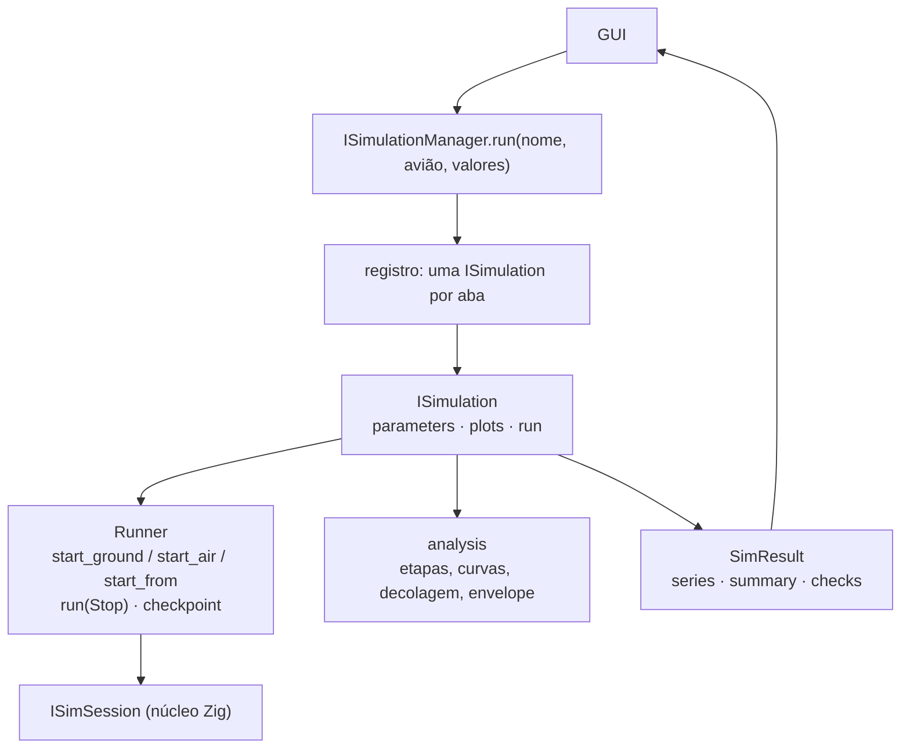

# aerosim/manager — gerenciador de simulações

Aqui ficam as análises. Cada aba da GUI que roda alguma coisa (missão, desempenho, tração, aerodinâmica,
estabilidade, cargas, dimensionamento) é uma simulação registrada aqui. Uma simulação declara os campos que pede, os
gráficos que entrega e o que faz, e a GUI monta a aba sozinha a partir disso. Nem a GUI conhece o núcleo, nem o núcleo
conhece as abas.

## Para que serve

- **Rodar uma análise pelo nome**, com os parâmetros da aba, e receber séries, resumo e diagnóstico.
- **Voar uma missão por etapas** (decolagem, subida, curvas, cruzeiro), parar no fim de uma etapa, guardar o estado
  inteiro (checkpoint) e retomar dali.
- **Otimizar a decolagem**, achar o raio mínimo de curva, o envelope de voo e o MTOW.
- **Acrescentar uma análise** sem mexer na GUI: uma classe nova (Python) ou um tipo novo na lista (Zig).

## Como funciona



As análises já passadas para Zig (tração, voo nivelado e envelopes, desempenho, missão, estabilidade dinâmica e do
avião montado) ficam num `.zig` ao lado do `.py` de cada uma, registradas na lista `analyses` de `manager.zig`. A
tela em Zig chama essas direto, sem Python no meio.

## Exemplo

```python
from aerosim.manager import SimulationManager
from aerosim.model.templates import conventional

m = SimulationManager()
ac = conventional()
r = m.run("performance", ac)                                  # contas rápidas, sem simulação
print(r.status, list(r.summary)[:5])
r = m.run("mission", ac, {"until": "fim: manobra 1"})         # voa até o fim de uma etapa
r = m.run("mission", ac, {"start": "início: cruzeiro 1"})     # retoma dali
```

Uma simulação nova:

```python
from aerosim.interfaces.simulation import ParamSpec, PlotSpec, SimResult
from aerosim.manager.simulations.base import SimulationBase
from aerosim.manager.runner import Runner, Stop

class Planeio(SimulationBase):
    name, title, description = "glide", "Planeio", "motor cortado a partir de voo nivelado"
    def parameters(self): return [ParamSpec("V", "Velocidade", 14.0, unit="m/s")]
    def plots(self): return [PlotSpec("h", "Altura", "t", ("h",), "t (s)", "m")]
    def run(self, ctx):
        ac, info = self.prepare(ctx)
        with Runner(ctx.backend, ac, overrides={"ap": {"Dtrim": 0.0, "KV": 0.0, "KIV": 0.0, "KHT": 0.0}}, ctx=ctx) as r:
            r.start_air(1)
            out = r.run(Stop(t=30.0))
        return SimResult(log=out.log, summary={"perda_h": float(out.log["h"][0] - out.log["h"][-1])})
```

Ponha a classe em `BUILTIN` (`simulations/__init__.py`) ou chame `m.register(Planeio())`, e a aba aparece.

## O que isso influencia

Tudo o que a GUI mostra sai daqui, e o diagnóstico de cada aba (`checks`) é o que diz se o avião passa. A decolagem,
por exemplo, é julgada pela distância em que o avião sai do chão ($`x_{warning}`$) e pela altura no fim da pista
($`z_{warning}`$):


