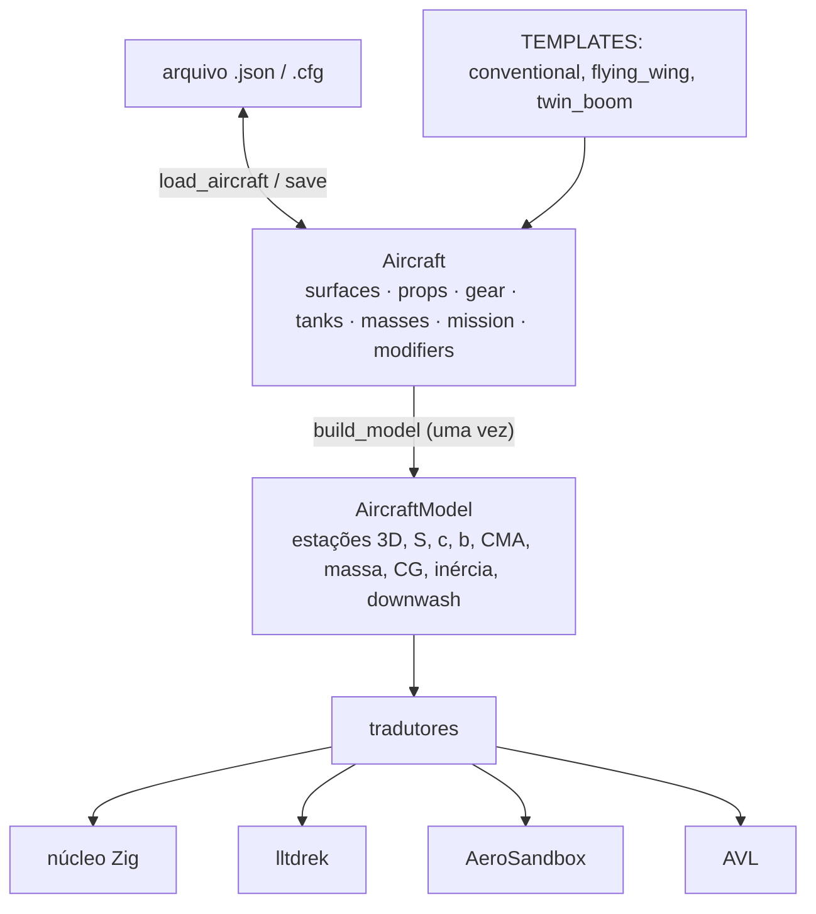

# aerosim/model — configuração e modelo universal da aeronave

Aqui o avião é descrito: as superfícies (asa, empenagem, quantas houver) com as suas seções e perfis, os comandos, os
motores com hélice e bateria, o trem de pouso, os tanques, as massas e a missão que ele vai voar. É o mesmo avião que a
GUI edita, que os arquivos `.json` guardam e que todas as análises recebem.

O avião existe em duas formas, uma derivada da outra. A configuração (`Aircraft`) é do jeito que o usuário pensa:
unidades SI, ângulos em graus, superfícies por seções. O modelo universal (`AircraftModel`) é construído uma única vez
por `build_model`: as superfícies já viraram estações 3D com o lado espelhado, os dispositivos de ponta já são
superfícies, e estão prontas as referências (área, corda média aerodinâmica, envergadura), a massa seca com o CG e a
inércia, e o downwash. Todo método de cálculo recebe esse modelo pelo seu tradutor, então uma conta de geometria nunca
é feita duas vezes de jeitos diferentes.



O avião convencional de exemplo, com um canard acrescentado:

```python
from aerosim.model import TEMPLATES, LiftingSurface, ControlSurface
from aerosim.model.aircraft import rect_sections
from aerosim.model.universal import build_model

ac = TEMPLATES["conventional"]()
ac.surfaces.append(LiftingSurface(name="canard", role="htail", x=0.8, sections=rect_sections(0.3, 0.15),
                                  controls=[ControlSurface("elevator", 0.0, 1.0, 0.3)]))
model = build_model(ac)
print("S =", round(model.S, 3), "m²  c =", round(model.c, 3), "m  b =", round(model.b, 2), "m  massa =", model.mass["m"], "kg")
print([(s.name, len(s.stations)) for s in model.surfaces])
```

```
S = 1.0 m²  c = 0.4 m  b = 2.5 m  massa = 8.39 kg
[('asa', 3), ('EH', 2), ('EV', 2), ('canard', 2)]
```

A referência continua a da asa, e o canard entra como mais uma superfície, com as suas estações. A inclinação 3D de
cada superfície sai do perfil pela fórmula de Helmbold (1942, citada em Anderson, *Fundamentals of Aerodynamics*; página a conferir no PDF), que vale também para alongamento baixo, e os outros detalhes
(perfil NACA, atmosfera padrão, massa e inércia, missões prontas) estão no código, com a fonte de cada fórmula.

```math
C_{L\alpha} = \frac{\pi\,AR}{1 + \sqrt{1 + \left(\dfrac{\pi\,AR}{a_0}\right)^2}}
```

Tudo o que o projeto calcula parte deste modelo: a aerodinâmica, a estabilidade, a missão, as cargas e o voo no
AeroDrive. A Montagem é onde ele se edita na GUI:


