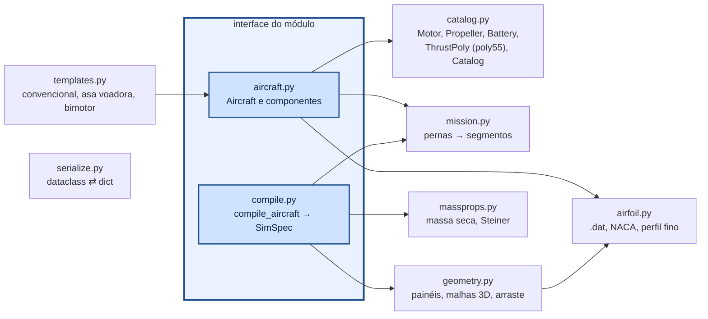

# aerosim/model — modelo de dados da aeronave

Dataclasses simples (SI, ângulos em graus), independentes do núcleo. A interface para o resto do
programa é a classe `Aircraft` e a função `compile_aircraft` (Aircraft → SimSpec para o núcleo).

## Aeronave

| componente | campos principais |
|---|---|
| `LiftingSurface` | papel (`wing`, `htail`, `vtail`), posição do bordo de ataque da raiz, `sections` (y, corda, recuo, torção), diedro, incidência, `airfoil`, `controls`, sobrescritas `CLa`, `CL0`, `CLmax`, `CD0`, `Cmac`, `eps0`, `depsda` |
| `ControlSurface` | `aileron`, `elevator`, `rudder`, `elevon`, `ruddervator`, `flap`; início/fim (fração da semi-envergadura), fração da corda |
| `PropulsionUnit` | posição, inclinação do eixo, sentido; `thrust_model = "motor"` (motor + hélice + bateria) ou `"poly"` (`ThrustPoly`) |
| `LandingGear` | `tricycle`, `conventional` ou `custom` (pontos livres) |
| `SloshTank` | base quadrada (lado) ou cilíndrica, altura do líquido |
| `MassModel` | massa base + inércia própria + massas pontuais (+ motores/baterias/estrutura, se ligado) |
| `Fuselage`, `TailBoom`, `Payload`, `Environment`, `Takeoff`, `Autopilot`, `SimSettings`, `Mission` | — |

## Geometria → núcleo

`geometry.surface_panels` corta cada superfície nas seções e nas bordas dos comandos; cada faixa de
cada lado vira um painel com centro aerodinâmico a 25 % da corda média (com enflechamento e diedro).
C_Lα vem de Helmbold com o alongamento da superfície; α_L0 e C_m,ac do perfil (teoria de perfil fino
sobre o `.dat`); τ do comando pela fração de corda. A deflexão de cada painel é
`τ · (mix · [δe, δa, δr])` — o mesmo esquema cobre elevon e ruddervator.

## Tração polinomial

`ThrustPoly` guarda os 21 coeficientes na ordem do `poly55` (`POLY_TERMS`), as variáveis `x_var`,
`y_var` (`none`, `V`, `throttle`, `h`, `rho`), `gain`, `rho_exp`, `xmax`, `ymax` e, informativos,
`T0` e `n` da planilha. `ThrustPoly.thrust(V, thr, h, rho)` faz a mesma conta do núcleo (testado
contra ele em `tests/core/test_poly_thrust.py`).
