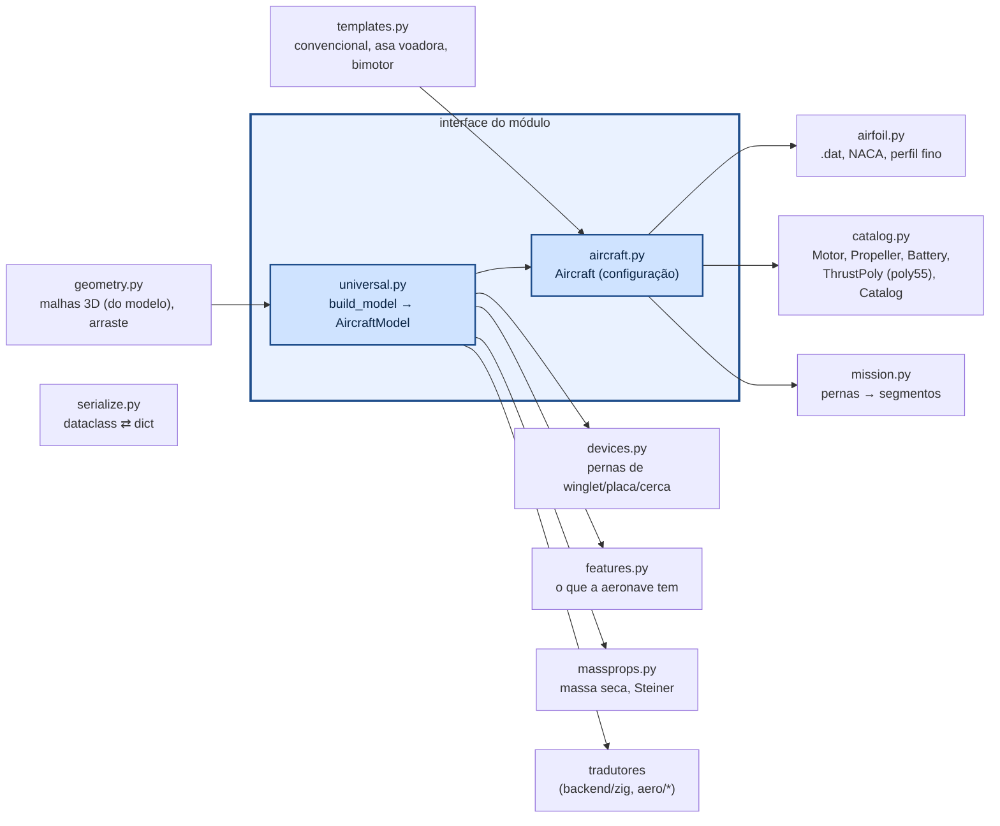

# aerosim/model — configuração e modelo universal da aeronave

Duas coisas, nesta ordem:

1. **`Aircraft`** (`aircraft.py`): a configuração que o usuário edita (dataclasses em SI, ângulos em graus) —
   superfícies por seções, comandos, dispositivos, motores, trem, tanques...
2. **`AircraftModel`** (`universal.py`, `build_model(ac)`): o **modelo universal**, construído uma única vez
   a partir da configuração. É o que todo núcleo e todo solver recebe. Superfícies viram estações 3D
   (bordo de ataque, corda, torção total, coordenada de envergadura), com espelho, comandos por faixa e
   coeficientes do perfil já resolvidos; dispositivos (winglet, placa, cerca) já chegam como superfícies;
   referências S, c, b e a CMA; massa seca, CG e inércia; downwash.

Ninguém fora de `universal.py` deriva geometria da configuração: o núcleo Zig, o lltdrek e o AeroSandbox
recebem o `AircraftModel` pelos **tradutores** (`IModelTranslator`), que levam ao formato de cada um e
trazem o resultado de volta em formato universal. Um teste (`tests/test_architecture.py`) garante isso.

## Como chamar

```python
from aerosim.model import TEMPLATES, Aircraft, LiftingSurface, ControlSurface
from aerosim.model.aircraft import rect_sections
from aerosim.model.universal import build_model

ac = TEMPLATES["conventional"]()               # ou "flying_wing", "twin_boom"; templates.empty(); ou load_aircraft(arquivo)
ac.surfaces.append(LiftingSurface(name="canard", role="htail", x=0.8, sections=rect_sections(0.3, 0.15),
                                  controls=[ControlSurface("elevator", 0.0, 1.0, 0.3)]))
model = build_model(ac)                        # modelo universal: o que todo solver recebe
print(model.S, model.c, model.b, model.mass["m"], model.mass["cg"])
print([(s.name, len(s.stations)) for s in model.surfaces])
```

## Como funciona



### Aeronave

| componente | campos principais |
|---|---|
| `LiftingSurface` | papel (`wing`, `htail`, `vtail`), posição do bordo de ataque da raiz, `sections` (y, corda, recuo, torção), diedro, incidência, `airfoil`, `controls`, sobrescritas `CLa`, `CL0`, `CLmax`, `CD0`, `Cmac`, `eps0`, `depsda`; `mount` (`""` solta, `"tubo:i"` na ponta do tubo i, `"ponta:j"` na ponta da superfície j: cauda em T) |
| `WingSection` | y, corda, recuo, torção e `airfoil` (None: o da superfície); entre seções as propriedades 2D (c_lα, α_L0, c_l máx, c_d0, c_m) são interpoladas e cada faixa leva as suas (`universal.strip_coeffs`) |
| `ControlSurface` | `kind` é o nome; `mix` = [arfagem, rolagem, guinada] (None: a do tipo em `KIND_MIX`: aileron, elevator, rudder, elevon, ruddervator, flaperon, flap); `role` diz o que faz pela mistura; `deflection` = deflexão fixa; início/fim (fração da semi-envergadura), fração da corda |
| `PropulsionUnit` | posição, inclinação do eixo, `tilt_range` (eixo móvel: inclinação = tilt + comando·faixa, comando `pilot.tilt` 0..1 no núcleo), sentido; `thrust_model = "motor"` (motor + hélice + bateria) ou `"poly"` (`ThrustPoly`) |
| `LandingGear` | `tricycle`, `conventional` ou `custom` (pontos livres) |
| `SloshTank` | base quadrada (lado) ou cilíndrica, altura do líquido |
| `MassModel` | massa base + inércia própria + massas pontuais (+ motores/baterias/estrutura, se ligado) |
| `TailBoom` (lista `booms`) | início (x, y, z), comprimento, diâmetro, `pitch` (+ ponta de trás sobe), `yaw` (abertura); tubo duplo = dois tubos. Arquivos antigos com `boom` único viram a lista ao abrir (`Aircraft.migrate`) |
| `Modifier` (lista `modifiers`) | metodologias que mudam a aerodinâmica do avião inteiro (efeito solo, esteira...): só dados (`modifiers.py`); quem calcula é o núcleo, em [`core/src/modifiers`](../../core/src/modifiers/README.md). Padrão: `[solo.mccormick]` (o de sempre); `.json` antigo abre com ele |
| `SimSettings` | passo, tempo máximo, registro, estol (`Mst`), sloshing; `prop_strike` (a pá no chão encerra o voo; desligado por padrão); `aero_model` ("faixas", o padrão e o do AeroDrive; "llt", "llt_gh", "tabela") e `aero_table` (a tabela de voo de `aerosim/aero/flight_table.py`): o modelo aerodinâmico do voo, em [`core/src/physics/aeromodel.zig`](../../core/README.md). O `.json` guarda os dois; o `.cfg` e a planilha, não |
| `Fuselage`, `Payload`, `Environment`, `Takeoff`, `Autopilot`, `Mission` | — |

### Geometria → núcleo

O tradutor do núcleo corta cada superfície nas seções e nas bordas dos comandos; cada faixa de cada lado vira um painel
com centro aerodinâmico a 1/4 da corda média (com enflechamento e diedro). Entre seções, as propriedades 2D do perfil
($c_{l\alpha}$, $\alpha_{L0}$, $c_{l,max}$, $c_{d0}$, $c_{m,ac}$) são interpoladas linearmente em $y$, e cada faixa leva as
suas (`universal.strip_coeffs`). A deflexão de cada painel mistura os três comandos; o mesmo esquema cobre elevon e
ruddervator:

$$
\delta_{painel} = \tau\,(m_e\,\delta_e + m_a\,\delta_a + m_r\,\delta_r)
$$

## Equações (`universal.py`, `airfoil.py`, `atmosphere.py`, `massprops.py`, `mission.py`)

**2D → 3D (Helmbold).** O $C_{L\alpha}$ da superfície vem da inclinação 2D do perfil e do alongamento (fórmula de
Helmbold, 1942; em Anderson, *Fundamentals of Aerodynamics*, cap. 5, a conferir no PDF). As sobrescritas da
superfície, quando dadas, mandam:

$$
C_{L\alpha} = \frac{a_0}{\sqrt{1 + k^2} + k}
\qquad
k = \frac{a_0}{\pi\,AR}
$$

O $C_{L0}$ vem do ângulo de sustentação nula, e o $C_{L,max}$ da superfície é uma fração do $c_{l,max}$ do perfil
(fator empírico desta implementação, sem fonte):

$$
C_{L0} = -C_{L\alpha}\,\alpha_{L0}
\qquad
C_{L,max} = 0{,}9\,c_{l,max}
$$

Com perfil por seção, a média da superfície pesa cada trecho entre seções pela área dele.

**Downwash da asa na cauda**, linear em $\alpha$ (teoria da linha sustentadora para a asa elíptica; Nelson, *Flight
Stability and Automatic Control*, cap. 2, a conferir no PDF), com $C_{L0,w}$ já com a incidência da asa:

$$
\varepsilon = \varepsilon_0 + \frac{d\varepsilon}{d\alpha}\,\alpha
\qquad
\varepsilon_0 = \frac{2\,C_{L0,w}}{\pi\,AR_w}
\qquad
\frac{d\varepsilon}{d\alpha} = \frac{2\,C_{L\alpha,w}}{\pi\,AR_w}
$$

**Perfil fino** (`airfoil.thin_airfoil`; Anderson, *Fundamentals of Aerodynamics*, cap. 4, a conferir no PDF). Com a
linha média $z_c(x)$ do `.dat`, a mudança de variável $x = \tfrac12(1 - \cos\theta)$ dá o ângulo de sustentação nula e
o momento no centro aerodinâmico:

$$
\alpha_{L0} = -\frac{1}{\pi}\int_0^\pi \frac{dz_c}{dx}\,(\cos\theta - 1)\,d\theta
\qquad
A_n = \frac{2}{\pi}\int_0^\pi \frac{dz_c}{dx}\cos(n\theta)\,d\theta
\qquad
c_{m,ac} = -\frac{\pi}{4}\,(A_1 - A_2)
$$

**Efetividade de um flape simples** (`flap_effectiveness`), pelo perfil fino com a fração de corda $c_f/c$ e um fator
empírico de 0,85 (a conferir no PDF):

$$
\theta_f = \arccos\!\left(2\,\frac{c_f}{c} - 1\right)
\qquad
\tau = 0{,}85\left(1 - \frac{\theta_f - \sin\theta_f}{\pi}\right)
$$

**NACA de 4 dígitos** (`naca4`; Abbott e von Doenhoff, *Theory of Wing Sections*, cap. 6, a conferir no PDF). Com $m$ o
arqueamento máximo, $p$ a posição dele e $t$ a espessura (frações da corda), a espessura e a linha média são:

$$
y_t = 5t\left(0{,}2969\sqrt x - 0{,}1260\,x - 0{,}3516\,x^2 + 0{,}2843\,x^3 - 0{,}1036\,x^4\right)
$$

$$
y_c = \begin{cases}
\dfrac{m}{p^2}\,(2px - x^2) & x < p \\[2mm]
\dfrac{m}{(1 - p)^2}\,\left((1 - 2p) + 2px - x^2\right) & x \ge p
\end{cases}
$$

e o contorno soma a espessura perpendicular à linha média ($\theta = \arctan dy_c/dx$): $x_{u,l} = x \mp y_t\sin\theta$,
$y_{u,l} = y_c \pm y_t\cos\theta$.

**Atmosfera ISA** na troposfera (`atmosphere.py`) e a altitude-densidade, a inversa:

$$
\rho(h) = \rho_0\,(1 - 2{,}25577\times10^{-5}\,h)^{4{,}25588}
\qquad
h_\rho = \frac{1 - (\rho/\rho_0)^{1/4{,}25588}}{2{,}25577\times10^{-5}}
$$

**Massa seca** (`massprops.dry_mass`): a massa base mais as massas pontuais (motores, hélices, baterias, estrutura,
lastro); CG pela média pesada e inércia levada ao CG por Steiner (as mesmas equações do núcleo, em
[`core/src/physics/README.md`](../../core/src/physics/README.md)).

**Raio automático das curvas da missão** (`mission.auto_radius`), o da curva nivelada coordenada:

$$
R = \frac{V^2}{g\,\tan\phi}
$$

## Um exemplo por arquivo

```python
import numpy as np
from aerosim.model.templates import conventional, flying_wing, empty, not_ready      # templates.py
from aerosim.model.aircraft import Aircraft, LiftingSurface, WingDevice, rect_sections  # aircraft.py
from aerosim.model.universal import build_model, strip_coeffs, wing_downwash          # universal.py

ac = conventional()
print(not_ready(empty()))                                  # o que falta para analisar
model = build_model(ac)
print(wing_downwash(ac), strip_coeffs(ac.wing, 0.3)["CLa"])

# airfoil.py: NACA, perfil fino, Helmbold e efetividade de flape
from aerosim.model.airfoil import naca4, thin_airfoil, helmbold, flap_effectiveness
xy = naca4("2412")
print(thin_airfoil(xy), helmbold(2 * np.pi, 8.0), flap_effectiveness(0.25))

# atmosphere.py
from aerosim.model.atmosphere import isa_density, density_altitude
print(isa_density(600.0), density_altitude(1.15))

# catalog.py: motores, hélices, baterias e o polinômio de tração
from aerosim.model.catalog import builtin_catalog, generic_propeller, ThrustPoly
cat = builtin_catalog()
print(len(cat.motors), generic_propeller("12x6", 12, 6).name, ThrustPoly().thrust(10.0))

# devices.py: as pernas de um winglet
from aerosim.model.devices import legs, device_area
w = WingDevice(kind="winglet", height=0.12)
print(len(legs(ac.wing, w)), device_area(ac.wing, w))

# features.py: o que a aeronave tem (decide o que as abas mostram)
from aerosim.model.features import features
print(features(ac))

# geometry.py: as malhas 3D da GUI, a partir do modelo
from aerosim.model.geometry import aircraft_meshes
print(list(aircraft_meshes(ac)))

# massprops.py: massa seca, CG, inércia
from aerosim.model.massprops import dry_mass
print(dry_mass(ac)["m"])

# mission.py: missões prontas e o raio automático
from aerosim.model.mission import circuit, auto_radius
print(len(circuit().legs), auto_radius(14.0))

# modifiers.py: os modificadores do avião (só dados; quem calcula é o núcleo)
from aerosim.model.modifiers import describe, default_modifiers
print(describe(ac), default_modifiers())

# serialize.py: dataclass ⇄ dict (é o que o .json guarda)
from aerosim.model.serialize import to_dict, from_dict
copia = from_dict(Aircraft, to_dict(ac))
print(copia.name == ac.name)
```

### Tração polinomial

`ThrustPoly` guarda os coeficientes na ordem do `poly55` (`POLY_TERMS`), as variáveis `x_var`,
`y_var` (`none`, `V`, `throttle`, `h`, `rho`), `gain`, `rho_exp`, `xmax`, `ymax` e, informativos,
`T0` e `n` da planilha. `ThrustPoly.thrust(V, thr, h, rho)` faz a mesma conta do núcleo (testado
contra ele em `tests/core/test_poly_thrust.py`).
