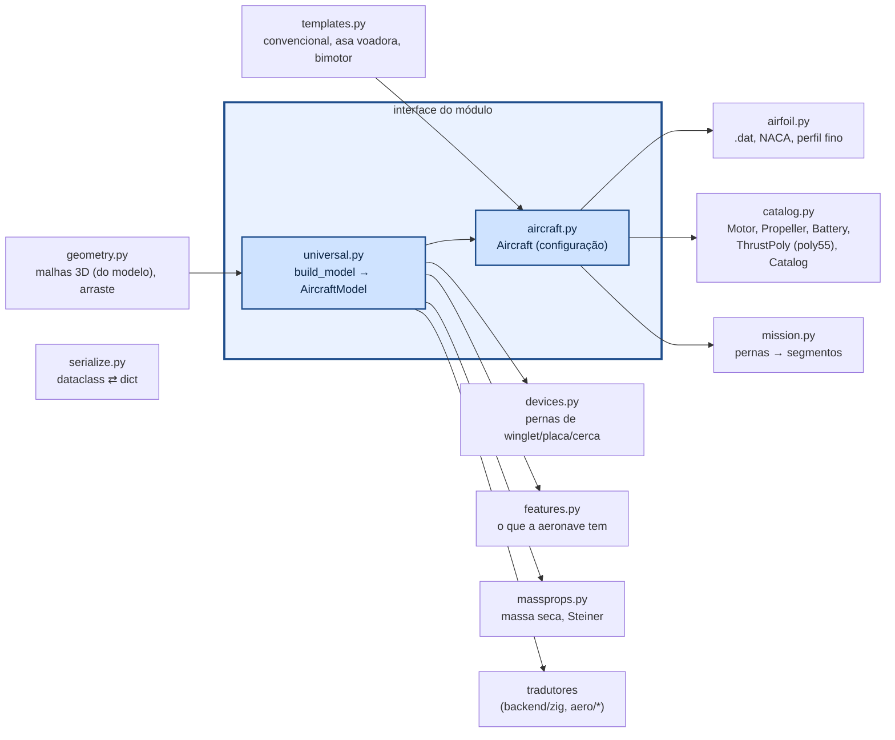

# aerosim/model — configuração e modelo universal da aeronave

Duas coisas, nesta ordem:

1. **`Aircraft`** (`aircraft.py`): a configuração que o usuário edita (dataclasses em SI, ângulos em graus) —
   superfícies por seções, comandos, dispositivos, motores, trem, tanques...
2. **`AircraftModel`** (`universal.py`, `build_model(ac)`): o **modelo universal**, construído uma única vez
   a partir da configuração. É o que todo núcleo e todo solver recebe. Superfícies viram estações 3D
   (bordo de ataque, corda, torção total, coordenada de envergadura), com espelho, comandos por faixa e
   coeficientes do perfil já resolvidos; dispositivos (winglet, placa, cerca) já chegam como superfícies;
   referências S, c, b e a CMA; massa seca, CG e inércia; downwash.

Ninguém fora de `universal.py` deriva geometria da configuração: o núcleo Zig, o lltdrek e o AeroSandbox
recebem o `AircraftModel` pelos **tradutores** (`IModelTranslator`), que levam ao formato de cada um e
trazem o resultado de volta em formato universal. Um teste (`tests/test_architecture.py`) garante isso.

## Como chamar

```python
from aerosim.model import TEMPLATES, Aircraft, LiftingSurface, ControlSurface
from aerosim.model.aircraft import rect_sections
from aerosim.model.universal import build_model

ac = TEMPLATES["conventional"]()               # ou "flying_wing", "twin_boom"; templates.empty(); ou load_aircraft(arquivo)
ac.surfaces.append(LiftingSurface(name="canard", role="htail", x=0.8, sections=rect_sections(0.3, 0.15),
                                  controls=[ControlSurface("elevator", 0.0, 1.0, 0.3)]))
model = build_model(ac)                        # modelo universal: o que todo solver recebe
model.S, model.c, model.b, model.mass["m"], model.mass["cg"]
[ (s.name, len(s.stations)) for s in model.surfaces ]
ac.mission.segments()                          # percurso → segmentos do núcleo
```

## Como funciona



### Aeronave

| componente | campos principais |
|---|---|
| `LiftingSurface` | papel (`wing`, `htail`, `vtail`), posição do bordo de ataque da raiz, `sections` (y, corda, recuo, torção), diedro, incidência, `airfoil`, `controls`, sobrescritas `CLa`, `CL0`, `CLmax`, `CD0`, `Cmac`, `eps0`, `depsda`; `mount` (`""` solta, `"tubo:i"` na ponta do tubo i, `"ponta:j"` na ponta da superfície j: cauda em T) |
| `WingSection` | y, corda, recuo, torção e `airfoil` (None: o da superfície); entre seções as propriedades 2D (c_lα, α_L0, c_l máx, c_d0, c_m) são interpoladas e cada faixa leva as suas (`universal.strip_coeffs`) |
| `ControlSurface` | `kind` é o nome; `mix` = [arfagem, rolagem, guinada] (None: a do tipo em `KIND_MIX`: aileron, elevator, rudder, elevon, ruddervator, flaperon, flap); `role` diz o que faz pela mistura; `deflection` = deflexão fixa; início/fim (fração da semi-envergadura), fração da corda |
| `PropulsionUnit` | posição, inclinação do eixo, `tilt_range` (eixo móvel: inclinação = tilt + comando·faixa, comando `pilot.tilt` 0..1 no núcleo), sentido; `thrust_model = "motor"` (motor + hélice + bateria) ou `"poly"` (`ThrustPoly`) |
| `LandingGear` | `tricycle`, `conventional` ou `custom` (pontos livres) |
| `SloshTank` | base quadrada (lado) ou cilíndrica, altura do líquido |
| `MassModel` | massa base + inércia própria + massas pontuais (+ motores/baterias/estrutura, se ligado) |
| `TailBoom` (lista `booms`) | início (x, y, z), comprimento, diâmetro, `pitch` (+ ponta de trás sobe), `yaw` (abertura); tubo duplo = dois tubos. Arquivos antigos com `boom` único viram a lista ao abrir (`Aircraft.migrate`) |
| `Modifier` (lista `modifiers`) | metodologias que mudam a aerodinâmica do avião inteiro (efeito solo, esteira...): só dados (`modifiers.py`); quem calcula é o núcleo, em [`core/src/modifiers`](../../core/src/modifiers/README.md). Padrão: `[solo.mccormick]` (o de sempre); `.json` antigo abre com ele |
| `Fuselage`, `Payload`, `Environment`, `Takeoff`, `Autopilot`, `SimSettings`, `Mission` | — |

### Geometria → núcleo

`geometry.surface_panels` corta cada superfície nas seções e nas bordas dos comandos; cada faixa de
cada lado vira um painel com centro aerodinâmico a 25 % da corda média (com enflechamento e diedro).
C_Lα vem de Helmbold com o alongamento da superfície; α_L0 e C_m,ac do perfil (teoria de perfil fino
sobre o `.dat`); τ do comando pela fração de corda. A deflexão de cada painel é
`τ · (mix · [δe, δa, δr])` — o mesmo esquema cobre elevon e ruddervator.

### Tração polinomial

`ThrustPoly` guarda os 21 coeficientes na ordem do `poly55` (`POLY_TERMS`), as variáveis `x_var`,
`y_var` (`none`, `V`, `throttle`, `h`, `rho`), `gain`, `rho_exp`, `xmax`, `ymax` e, informativos,
`T0` e `n` da planilha. `ThrustPoly.thrust(V, thr, h, rho)` faz a mesma conta do núcleo (testado
contra ele em `tests/core/test_poly_thrust.py`).
