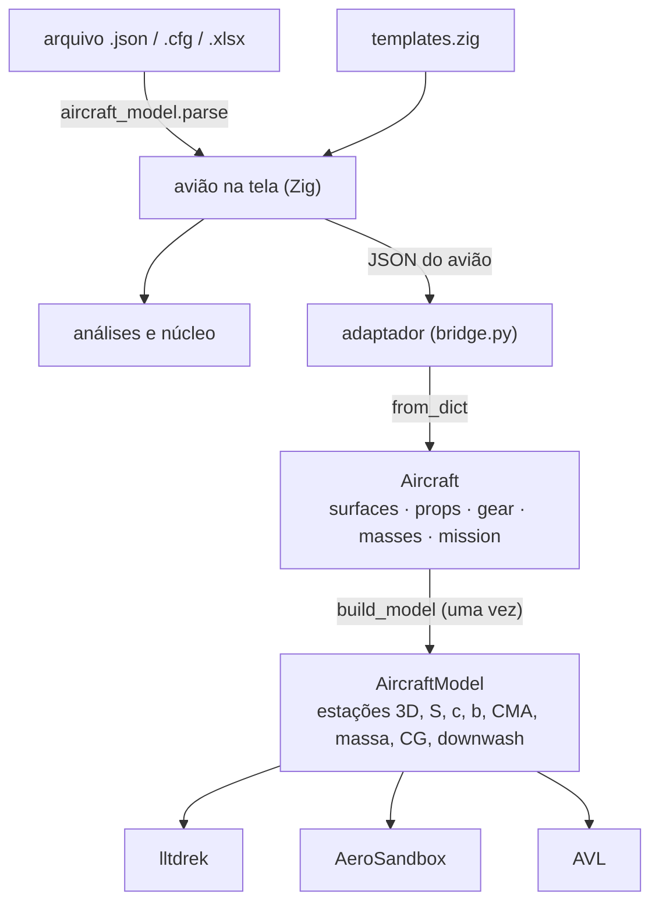
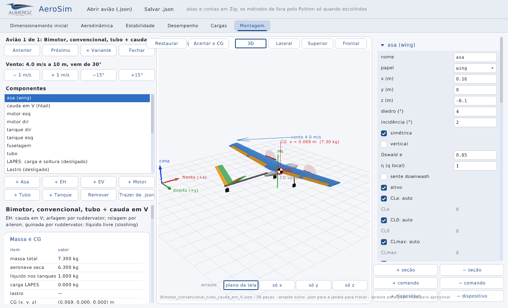

# aerosim/model — o avião, para a tela e para os métodos de fora

Aqui o avião é descrito: as superfícies (asa, empenagem, quantas houver) com as suas seções e perfis, os comandos, os
motores com hélice e bateria, o trem de pouso, os tanques, as massas e a missão que ele vai voar. É o mesmo avião que a
tela edita, que os arquivos `.json` guardam e que todas as análises recebem.

Na tela, o avião é lido pelo modelo do AeroDrive (`aerodrive/src/aircraft_model.zig`), o mesmo que o AeroDrive pilota.
Ficam aqui os modelos padrão do "Restaurar" da Montagem (`templates.zig`) e o catálogo de motores, hélices e baterias
(`catalog.zig`). Os arquivos em Python são do adaptador dos métodos de fora (`../bridge.py`): a configuração
(`Aircraft`, como o usuário pensa, em graus e por seções) e o modelo universal (`AircraftModel`), construído uma vez
por `build_model`, com as superfícies já em estações 3D com o lado espelhado, as referências (área, corda média
aerodinâmica, envergadura), a massa seca com o CG e a inércia, e o downwash. O lltdrek, o AeroSandbox e o AVL recebem
esse modelo pelo tradutor de cada um, então uma conta de geometria nunca é feita duas vezes de jeitos diferentes.



O avião de exemplo como o adaptador o vê, rodado da raiz do repositório:

```python
import json
from aerosim.model.aircraft import Aircraft
from aerosim.model.serialize import from_dict
from aerosim.model.universal import build_model

data = json.load(open("data/aircraft/Convencional_original.json"))["aeronave"]
model = build_model(from_dict(Aircraft, data))
print("S =", round(model.S, 3), "m²  c =", round(model.c, 3), "m  b =", round(model.b, 2), "m  massa =", round(model.mass["m"], 2), "kg")
print([(s.name, len(s.stations)) for s in model.surfaces])
```

```
S = 1.0 m²  c = 0.4 m  b = 2.5 m  massa = 8.39 kg
[('asa', 3), ('EH', 2), ('EV', 2)]
```

A massa é a base do arquivo, sem a carga paga e o líquido dos tanques. A inclinação 3D de cada superfície sai do perfil pela fórmula de Helmbold (1942, citada em Anderson, *Fundamentals of Aerodynamics*; página a conferir no PDF), que vale também para alongamento baixo, e os outros detalhes
(perfil NACA, atmosfera padrão, massa e inércia, missões prontas) estão no código, com a fonte de cada fórmula.

```math
C_{L\alpha} = \frac{\pi\,AR}{1 + \sqrt{1 + \left(\dfrac{\pi\,AR}{a_0}\right)^2}}
```

Tudo o que o projeto calcula parte deste avião: a aerodinâmica, a estabilidade, a missão, as cargas e o voo no
AeroDrive. A Montagem é onde ele se edita na tela:


