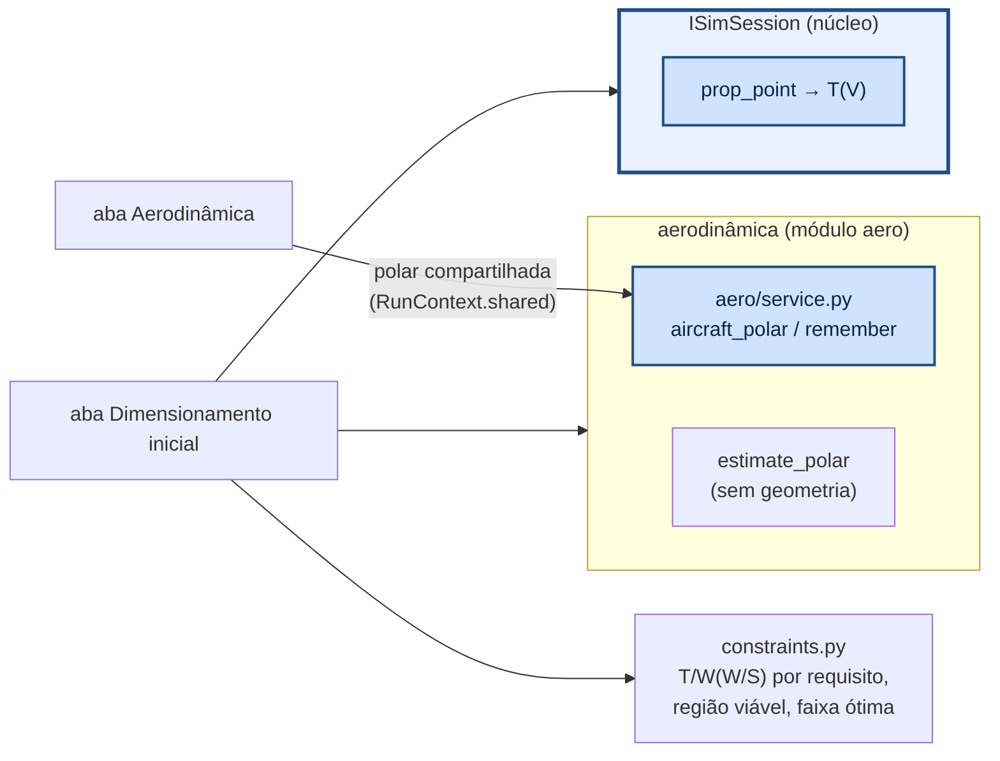

# aerosim/sizing — dimensionamento inicial

Esta é a parte do projeto que ajuda a escolher o tamanho do avião antes de desenhá-lo. Dados os requisitos (pista de
decolagem, velocidade de cruzeiro, subida, curva, teto, velocidade de estol), ela diz qual a razão entre tração e peso
($`T/W`$) cada requisito exige para cada carga alar ($`W/S`$, o peso dividido pela área da asa). O resultado é o diagrama
de restrições: as curvas de todos os requisitos juntas, e a região acima delas é onde o avião cumpre tudo. O ponto de
projeto é escolhido nessa região.

Aqui só há equações, sem núcleo e sem GUI. A polar não é calculada aqui: ela vem da aba Aerodinâmica
(`aero/service.py`, a partir do modelo universal) ou de `estimate_polar`, uma estimativa estatística para quando
ainda não há geometria. A tração do motor vem do núcleo pela interface `ISimSession`.

O README mostra primeiro como as peças se ligam, depois as equações de cada requisito e como se lê o diagrama. No fim,
como chamar.

## Como funciona



## Equações

Polar parabólica, com $`q = \tfrac12\rho V^2`$ e $`k = 1/(\pi\,AR\,e)`$. As curvas de T/W exigido por requisito vêm de
Gudmundsson, *General Aviation Aircraft Design* (2014), cap. 3, e Raymer, *Aircraft Design*, cap. 5 e 12 (equações e
páginas a conferir no PDF). Cada requisito pode ser desligado (0).

```math
C_D = C_{D0} + k\,C_L^2
```

**Cruzeiro ou V máxima a V.** Tração igual ao arrasto do voo nivelado:

```math
\frac{T}{W} = \frac{q\,C_{D0}}{W/S} + k\,\frac{W/S}{q}
```

**Razão de subida $`V_V`$ a V.** Soma a parcela da subida ($`V_V/V = \sin\gamma`$):

```math
\frac{T}{W} = \frac{V_V}{V} + \frac{q\,C_{D0}}{W/S} + k\,\frac{W/S}{q}
```

**Gradiente de subida G** ($`G = \sin\gamma`$):

```math
\frac{T}{W} = G + \frac{q\,C_{D0}}{W/S} + k\,\frac{W/S}{q}
```

**Curva sustentada com fator de carga n a V:**

```math
\frac{T}{W} = q\left[\frac{C_{D0}}{W/S} + k\left(\frac{n}{q}\right)^2\frac{W}{S}\right]
```

**Corrida de decolagem $`S_G`$**, com $`V_{LOF} = 1{,}1\,V_S`$, a pressão dinâmica tomada a $`V_{LOF}/\sqrt2`$, $`\mu`$ o atrito
de rolamento e $`C_{L,TO}`$, $`C_{D,TO}`$ os coeficientes na corrida:

```math
\frac{T}{W} = \frac{V_{LOF}^2}{2\,g\,S_G} + \frac{q\,C_{D,TO}}{W/S} + \mu\left(1 - \frac{q\,C_{L,TO}}{W/S}\right)
```

**Teto.** A subida residual com a densidade do teto $`\rho_h`$, levada ao nível do mar pela correção da tração
$`(\rho_h/\rho_0)^m`$.

**Limites de carga alar.** O estol e a corrida de pouso $`S_L`$ (toque a $`1{,}15\,V_S`$, frenagem $`\mu_f`$, sem arrasto nem
sustentação na frenagem: conservador):

```math
\frac{W}{S} \le \tfrac12\,\rho\,V_S^2\,C_{L,max}
\qquad
\frac{W}{S} \le \frac{\rho\,C_{L,max}\,g\,\mu_f\,S_L}{1{,}15^2}
```

**Potência (hélice)**, na velocidade de cada requisito, com $`\eta_p`$ a eficiência da hélice:

```math
\frac{P}{m} = \frac{T}{W}\,\frac{g\,V}{\eta_p}
```

**Polar estimada** (`estimate_polar`, quando ainda não há geometria): o arrasto parasita pelo atrito equivalente
$`C_{fe}`$ vezes a razão área molhada / área de referência (Raymer, eq. 12.23 e tabela 12.3), e, se o Oswald não for
dado, a estimativa do Raymer (eq. 12.49):

```math
C_{D0} = C_{fe}\,\frac{S_{molhada}}{S}
\qquad
e = 1{,}78\,(1 - 0{,}045\,AR^{0{,}68}) - 0{,}64
\qquad
k = \frac{1}{\pi\,AR\,e}
```

**Densidade ISA** pela altitude, a mesma do núcleo:

```math
\rho(h) = \rho_0\,(1 - 2{,}25577\times10^{-5}\,h)^{4{,}2559}
```

## Como se lê o diagrama

- **Região viável**: acima de todas as curvas de T/W e à esquerda do menor limite de W/S.
- **Ponto de projeto**: o menor T/W dentro da região (o menor motor que atende tudo); dele saem a
  área de asa S = W/(W/S) e a tração. A aba diz qual requisito manda nele.
- **Faixa ótima**: as W/S em que o T/W exigido fica até `tol` % acima do mínimo — a margem para
  escolher a asa sem pagar motor.
- **Potência (hélice)**: P/m = (T/W) g V / $`\eta_p`$ na velocidade de cada requisito.
- A aeronave atual é posta no diagrama e cada requisito é verificado com a tração do motor **na
  velocidade daquele requisito**, não com a estática; o diagnóstico diz qual falha e por quê.

## Como chamar

```python
from aerosim.sizing import Requirements, estimate_polar, design_point, constraint_curves
from aerosim.sizing.constraints import active_kinds, required_tw, ws_limits, isa_rho

req = Requirements(V_stall=11, S_G=50, roc=2.0, V_cruise=16, n_turn=2.0)   # 0 desliga um requisito
polar = estimate_polar(Swet_S=4.0, AR=7.0)       # ou a polar da aba Aerodinâmica
dp = design_point(req, polar)                    # {"ws": W/S, "tw": T/W, "active": requisito que manda, ...}
curvas = constraint_curves(req, polar, ws=range(20, 120))   # T/W exigido por requisito
print(active_kinds(req), ws_limits(req, polar), required_tw("cruzeiro", 60.0, req, polar), isa_rho(600.0))
```
