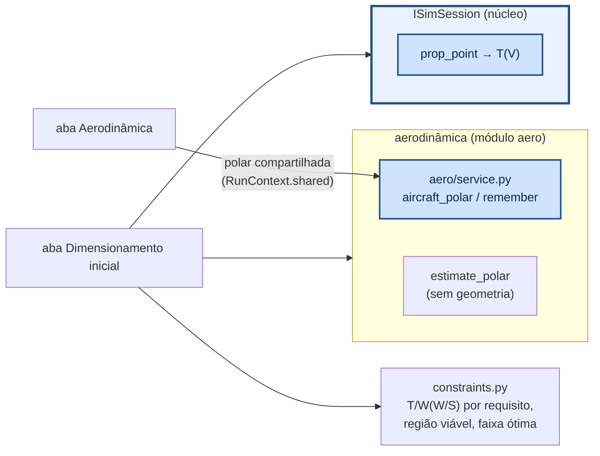

# aerosim/sizing — dimensionamento inicial

Equações do diagrama de restrições (T/W exigido × carga alar W/S), sem núcleo e sem GUI. A polar
**não é calculada aqui**: ela vem de fora, pela aba Aerodinâmica (`aero/service.py`, a partir do
modelo universal da aeronave) ou de `estimate_polar` (estimativa estatística, quando ainda não há
geometria). A tração do motor vem do núcleo pela interface `ISimSession`.

| requisito (0 desliga) | T/W exigido (Gudmundsson cap. 3; Raymer cap. 5) |
|---|---|
| corrida de decolagem S_G | V_LOF²/(2 g S_G) + q C_D,TO/(W/S) + μ (1 − q C_L,TO/(W/S)), V_LOF = 1,1 V_S |
| razão de subida V_V a V | V_V/V + q C_D0/(W/S) + k (W/S)/q |
| gradiente de subida G | G + q C_D0/(W/S) + k (W/S)/q |
| cruzeiro / V máxima a V | q C_D0/(W/S) + k (W/S)/q |
| curva sustentada n a V | q [C_D0/(W/S) + k (n/q)² W/S] |
| teto | subida residual com ρ do teto, corrigida para o nível do mar por (ρ/ρ0)^m |

| limite de W/S | |
|---|---|
| estol | W/S ≤ ½ ρ V_S² C_Lmax |
| corrida de pouso S_L | W/S ≤ ρ C_Lmax g μ_f S_L / 1,15² (frenagem sem arrasto: conservador) |

- **Região viável**: acima de todas as curvas de T/W e à esquerda do menor limite de W/S.
- **Ponto de projeto**: o menor T/W dentro da região (o menor motor que atende tudo); dele saem a
  área de asa S = W/(W/S) e a tração. A aba diz qual requisito manda nele.
- **Faixa ótima**: as W/S em que o T/W exigido fica até `tol` % acima do mínimo — a margem para
  escolher a asa sem pagar motor.
- **Potência (hélice)**: P/m = (T/W) g V / η_p na velocidade de cada requisito.
- A aeronave atual é posta no diagrama e cada requisito é verificado com a tração do motor **na
  velocidade daquele requisito**, não com a estática; o diagnóstico diz qual falha e por quê.
