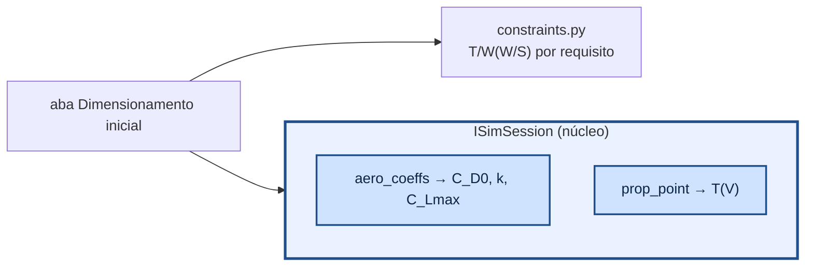

# aerosim/sizing — dimensionamento inicial

Equações do diagrama de restrições (T/W exigido × carga alar W/S), sem núcleo e sem GUI. A aba
**Dimensionamento inicial** (`manager/simulations/sizing.py`) usa a polar e a tração do núcleo pela
interface `ISimSession`.

| requisito | T/W exigido (Gudmundsson cap. 3; Raymer cap. 5) |
|---|---|
| curva sustentada n a V | q [C_D0/(W/S) + k (n/q)² W/S] |
| razão de subida V_V a V | V_V/V + q C_D0/(W/S) + k (W/S)/q |
| cruzeiro a V | q C_D0/(W/S) + k (W/S)/q |
| corrida de decolagem S_G | V_LOF²/(2 g S_G) + q C_D,TO/(W/S) + μ (1 − q C_L,TO/(W/S)), V_LOF = 1,1 V_S |
| teto | subida residual com ρ do teto, corrigida para o nível do mar por (ρ/ρ0)^m |
| estol | W/S ≤ ½ ρ V_S² C_Lmax |

O ponto de projeto é o menor T/W viável (acima de todas as curvas, à esquerda do estol); dele saem a
área de asa (S = W/(W/S)) e a tração. Para hélice, cada requisito é comparado com a tração do motor
**na velocidade daquele requisito**, não com a estática.
