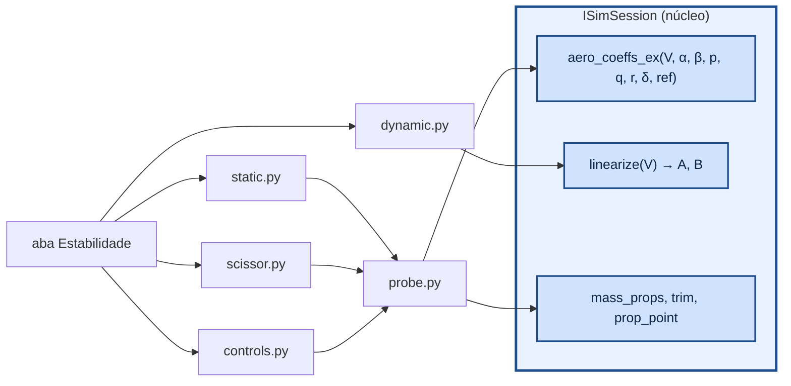
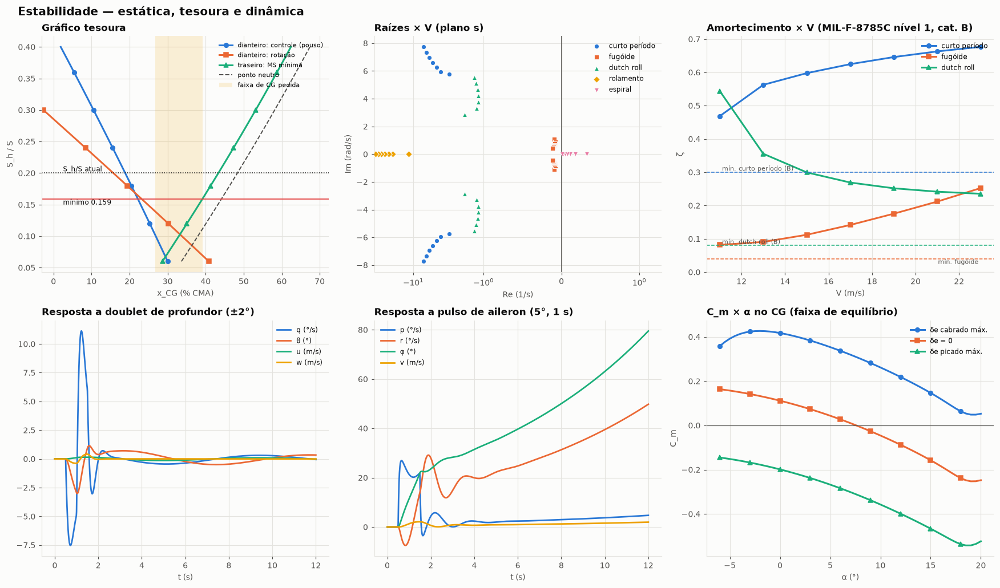
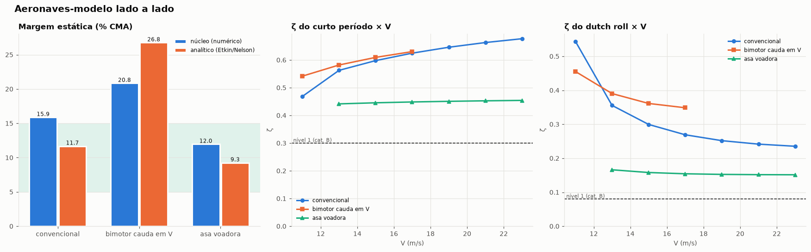
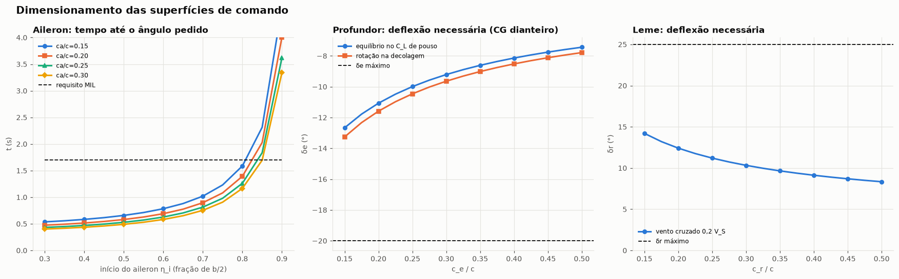

# aerosim/stability — estabilidade estática, dinâmica e superfícies de comando

Usado pela aba **Estabilidade** (`manager/simulations/stability.py`). Tudo vem do núcleo: os
coeficientes com momento em qualquer ponto (`aero_coeffs_ex`) e o modelo linear (`linearize`).

## Estática (`static.py`)

- Ponto neutro numérico x_np = x_ref + c C_mα/C_Lα; margem MS = (x_CG − x_np)/c (x à frente).
- Ponto neutro analítico (Etkin & Reid; Nelson):
  `x_np = Σ C_Lα,i (1 − dε/dα) η_i (S_i/S) x_ca,i / C_Lα + c C_mα,fus / C_Lα`.
- C_nβ > 0, C_lβ < 0; volumes V_H = S_h l_h/(S c), V_V = S_v l_v/(S b) contra a tabela 6.4 do Raymer.
- Manche fixo: δe de equilíbrio × V com dδe/dV > 0.
- Faixa de CG: atual, sem carga, sem líquido.

## Margem estática e tamanho da EH — gráfico tesoura (`scissor.py`)

Para cada S_h/S (EH escalada com a mesma razão de aspecto) o núcleo dá três limites de CG:

| limite | condição |
|---|---|
| traseiro (estabilidade) | CG pelo menos MS_mín à frente do ponto neutro: `x% ≤ x_np% − MS_mín` |
| dianteiro (controle) | equilíbrio em `k · C_Lmax` com o profundor todo cabrado: `x_CG = x_P + c C_m,P / C_N` |
| dianteiro (rotação) | em V_R, no trem principal: `I θ̈ = q S c C_m,tp − W (x_CG − x_tp) + T (z_T − z_tp)` |

O menor S_h/S em que a faixa de CG desejada cabe entre os limites é o dimensionamento (Torenbeek,
*Synthesis of Subsonic Airplane Design*, cap. 9; Sadraey, *Aircraft Design: A Systems Engineering
Approach*, cap. 6; Raymer, cap. 16). MS mínima usual: 5 % da CMA; 5–15 % para aviação geral e VANTs.
Sem EH (asa voadora) a tesoura não se aplica.

## Dinâmica (`dynamic.py`)

`linearize(V)` trima o avião nivelado (longitudinal exato; δa, δr e φ pequenos equilibram o torque dos
motores) e deriva A (8×8 em u, v, w, p, q, r, φ, θ) e B (8×4 em δe, δa, δr, acelerador) por diferenças
centrais do corpo rígido com comandos congelados. `modes` separa os blocos longitudinal e
látero-direcional e classifica curto período, fugóide, dutch roll, rolamento e espiral. `mil_check`
compara com a **MIL-F-8785C** por classe (I–IV) e categoria (A, B, C):

| modo | nível 1 |
|---|---|
| curto período ζ | 0,35–1,30 (A, C); 0,30–2,0 (B) |
| fugóide ζ | ≥ 0,04 |
| dutch roll ζ / ζω_n / ω_n | A: 0,19/0,35/1,0 · B: 0,08/0,15/0,4 · C: 0,08/0,15/1,0 (classe I) |
| rolamento τ_R | ≤ 1,0 s (A, C) · ≤ 1,4 s (B) |
| espiral, tempo p/ dobrar | ≥ 12 s (A, C) · ≥ 20 s (B) |

Mais: raízes × V, Lanchester para o fugóide, respostas lineares a doublet de profundor e pulso de aileron.

## Superfícies de comando (`controls.py`)

| comando | critério |
|---|---|
| aileron | teoria das faixas (Sadraey cap. 12): `C_lδa = 2 C_Lα τ/(S b) ∫ c y dy`, `P_ss = −C_lδa δa (2V/b)/C_lp`, `φ(t) = P_ss (t − τ_R (1 − e^{−t/τ_R}))`; requisito MIL-F-8785C (classe I: 60° em 1,3 s (A), 1,7 s (B); 30° em 1,3 s (C)). Varre início do aileron e c_a/c; confere C_lδa das faixas com o do núcleo |
| profundor | δe para o C_L de pouso no CG dianteiro e para θ̈ pedido na rotação; varre c_e/c (τ por perfil fino) |
| leme | vento cruzado de 0,2 V_S (FAR 23.233): `δr = C_nβ β / C_nδr`; multimotor: motor crítico parado em 1,2 V_S |

Figuras: `python tools/plot_comparativo.py docs/img/comparativo`.
