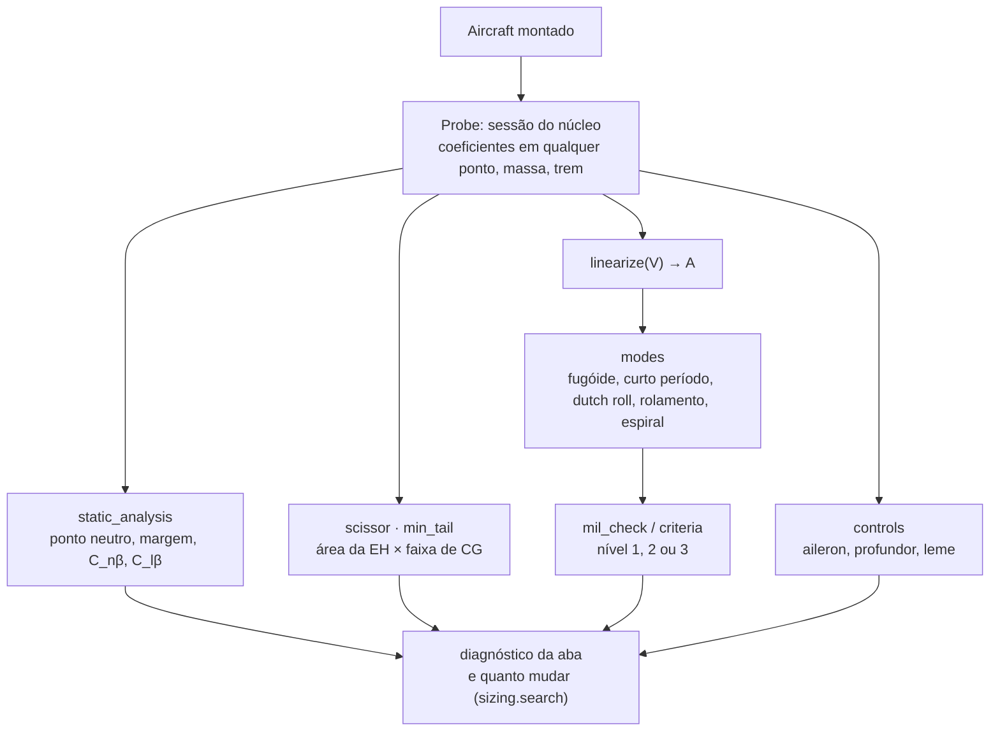
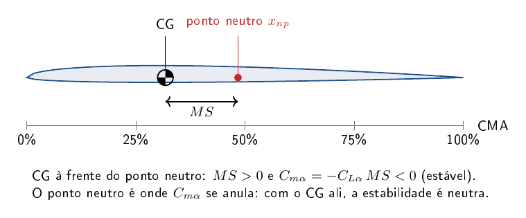
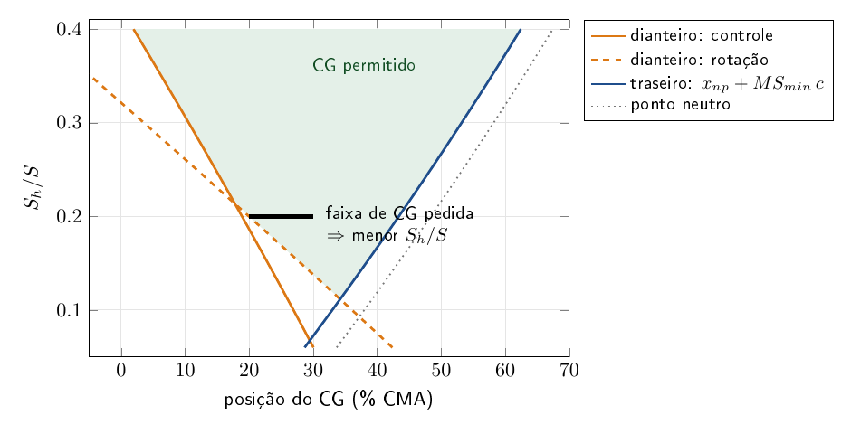

# aerosim/stability — estabilidade estática, dinâmica e superfícies de comando

Esta pasta responde se o avião é estável e controlável, e o que mudar quando não é. Entra o avião montado, e saem a
margem estática e o ponto neutro, a faixa em que o CG pode ficar (a "tesoura" de área da EH contra o CG), os modos
dinâmicos (como o avião oscila depois de uma perturbação) e o tamanho que o aileron, o profundor e o leme precisam
ter. A aba **Estabilidade** não entrega só gráficos: cada verificação tem estado, valor, critério com a fonte, a causa
física e quanto mudar (CG, área, diedro). Os critérios podem ser os da MIL-F-8785C, por classe e fase de voo, um
conjunto personalizado ou nenhum, porque a norma pode não valer para o tipo de avião. A aba se monta pelo que o avião
tem: sem EH (asa voadora) ela olha o $`C_{m0}`$ e o elevon, com carga lançável ela calcula a faixa de CG com e sem a
carga.



A margem estática é a distância do CG ao ponto neutro em fração da corda média aerodinâmica (Etkin e Reid, *Dynamics
of Flight*, cap. 2, a conferir no PDF), com as duas posições medidas da frente da CMA para trás:

```math
MS = \frac{x_{np} - x_{CG}}{\bar c}
```

O avião de exemplo a 15 m/s, com os modos do modelo linear e a nota da MIL-F-8785C (classe I, fase B):

```python
import numpy as np
from aerosim.backend.zig import ZigBackend
from aerosim.model.templates import conventional
from aerosim.stability import Probe, static_analysis, modes, mil_check

be, ac = ZigBackend(), conventional()
pr = Probe(be, ac)
est, _ = static_analysis(pr, V=15.0)
print({k: round(float(est[k]), 2) for k in ("x_CG (% CMA)", "x_np numérico (% CMA)", "margem estática (% CMA)", "C_nβ (1/rad)")})
with be.session_for(pr.model) as s:
    m = modes(np.asarray(s.linearize(15.0)["A"]))
for nome, modo in m.items():
    print(f"{nome:14s} ζ = {float(modo['zeta']):5.2f}  ωn = {float(modo['wn']):5.2f} rad/s")
print([(c["criterio"], c["nivel"]) for c in mil_check(m, "I", "B")])
pr.close()
```

```
{'x_CG (% CMA)': 31.73, 'x_np numérico (% CMA)': 48.37, 'margem estática (% CMA)': 16.64, 'C_nβ (1/rad)': 0.07}
fugoide        ζ =  0.11  ωn =  0.75 rad/s
curto_periodo  ζ =  0.58  ωn =  7.91 rad/s
dutch_roll     ζ =  0.30  ωn =  3.95 rad/s
rolamento      ζ =  1.00  ωn = 22.40 rad/s
espiral        ζ = -1.00  ωn =  0.12 rad/s
[('ζ curto período', 1), ('ζ fugóide', 1), ('dutch roll ζ / ζω_n / ω_n', 1), ('τ_R rolamento (s)', 1), ('espiral: tempo para dobrar (s)', 3)]
```

O avião é estaticamente estável, com 16,6 % da CMA de margem, e quatro modos ficam no nível 1 da norma. A espiral
diverge (ζ = −1 marca um modo real instável) e cai no nível 3: dobra em uns 6 s, o que um piloto corrige sem esforço,
mas a aba aponta e sugere mais diedro. Os outros pedaços seguem o mesmo jeito: `scissor(be, ac, V)` e `min_tail` dão a
menor EH para uma faixa de CG, `aileron_sizing` e `rudder_sizing` dimensionam os comandos, e `stall_speed` e `cm0` dão
o estol equilibrado e o momento de arfagem com sustentação nula.

A posição do CG decide quase tudo aqui, e é o que o projeto e a Montagem ajustam. A margem estática na CMA e a tesoura
de área da EH contra o CG:




