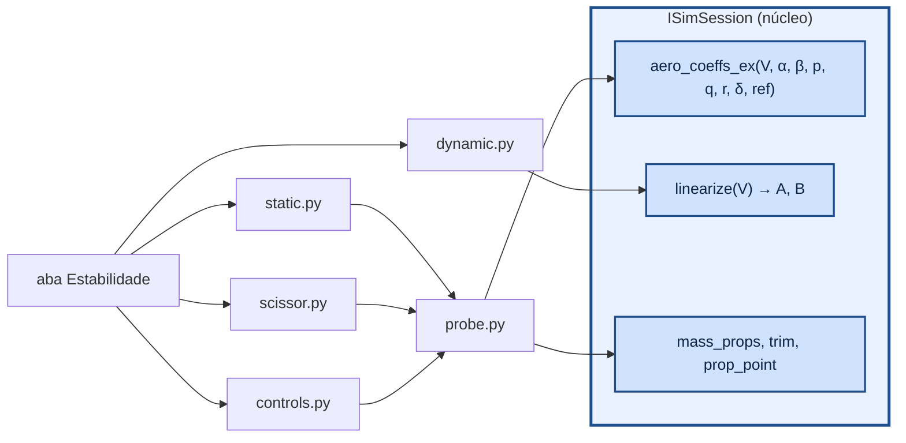
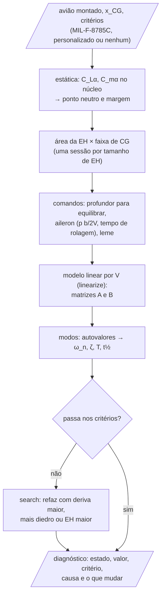
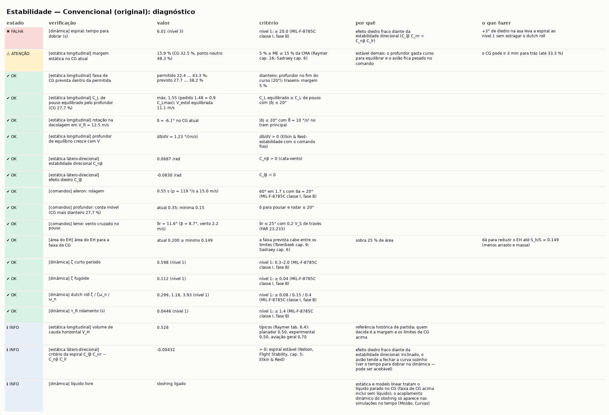
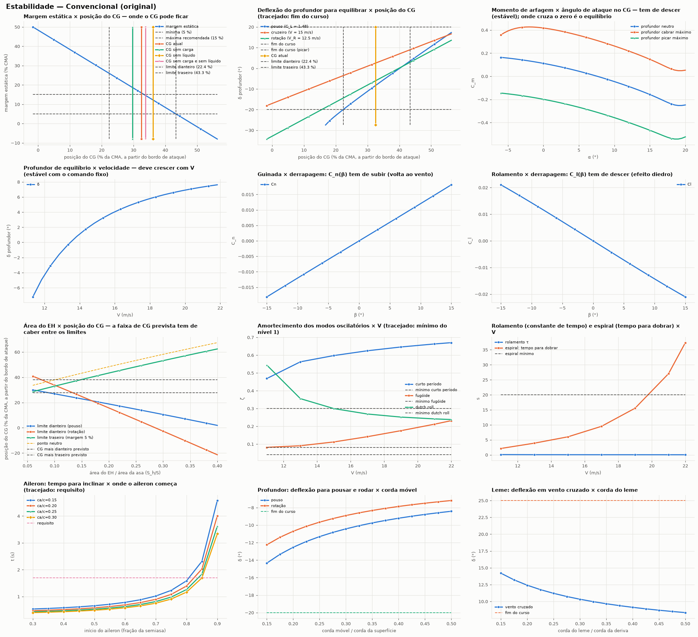
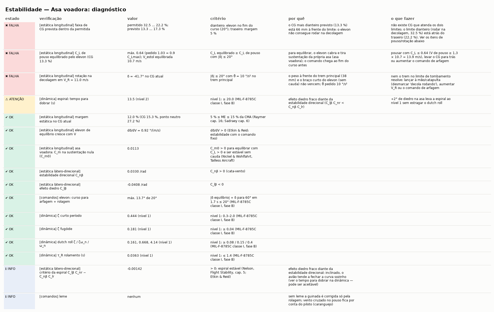

# aerosim/stability — estabilidade estática, dinâmica e superfícies de comando

Esta é a parte do projeto que responde se o avião é estável e controlável, e o que mudar quando não é. Aqui entra o
avião já montado, e saem a margem estática e o ponto neutro, a faixa em que o CG pode ficar, os modos dinâmicos (como
o avião oscila depois de uma perturbação) e o tamanho que os comandos precisam ter. Ela alimenta a aba
**Estabilidade** (`manager/simulations/stability.py`), e tudo vem do núcleo: os coeficientes com o momento em qualquer
ponto (`aero_coeffs_ex`) e o modelo linear (`linearize`).

A aba não entrega só gráficos, entrega um diagnóstico. Cada verificação tem um estado (OK, ATENÇÃO, FALHA ou INFO), o
valor, o critério e a fonte, a causa física e o que mudar, com quanto mudar (CG, área, diedro). Quando um modo
dinâmico falha, a análise é refeita com a deriva maior, mais diedro ou a EH maior, para dizer quanto mudar
(`sizing.search`). Os critérios de aprovação podem ser os da norma MIL-F-8785C (por classe e fase de voo), um conjunto
personalizado, com cada critério ligado ou desligado e o limite digitado, ou nenhum, só para ver os valores, porque a
norma pode não valer para o tipo de avião. Os gráficos principais são a margem estática e a deflexão de arfagem para
equilibrar, as duas em função da posição do CG, com os limites dianteiro e traseiro marcados.

A aba se monta pelo que o avião tem (`aerosim/model/features.py`):

| a aeronave tem | a aba mostra |
|---|---|
| EH (ou cauda em V) | área de EH × faixa de CG, volume de cauda, corda do profundor |
| sem EH (asa voadora) | $`C_{m0}`$ > 0, $`C_L`$ máximo equilibrado pelo elevon, divisão do curso do elevon entre arfagem e rolagem |
| aileron | tempo de rolagem × tamanho do aileron |
| leme / ruddervator | leme em vento cruzado (e motor parado, se multimotor) |
| carga lançável / líquido | faixa de CG calculada (com/sem carga, com/sem líquido); senão, a variação é informada |
| trem de pouso | rotação na decolagem (e onde pôr o trem principal se não roda) |

O README segue a ordem da aba: a estabilidade estática, a área da EH contra a faixa de CG, a dinâmica e as
superfícies de comando, cada uma com as suas equações. No fim, um exemplo por arquivo e como chamar.

## Como funciona



### A análise, passo a passo

O que a aba faz com o avião, do começo ao diagnóstico:



### Estática (`static.py`)

**Ponto neutro numérico.** O núcleo dá $`C_{L\alpha}`$ e $`C_{m\alpha}`$ com os momentos num ponto $`x_{ref}`$; o ponto neutro é
onde $`C_{m\alpha}`$ se anula, e a margem estática mede a distância do CG até ele em cordas (x à frente):

```math
x_{np} = x_{ref} + c\,\frac{C_{m\alpha}}{C_{L\alpha}}
\qquad
MS = \frac{x_{cg} - x_{np}}{c}
\qquad
C_{m\alpha} = -C_{L\alpha}\,MS
```

**Ponto neutro analítico** (Etkin e Reid, *Dynamics of Flight*, cap. 2; Nelson, *Flight Stability and Automatic
Control*, cap. 2; a conferir no PDF). A média dos centros aerodinâmicos das superfícies horizontais, pesada pela
sustentação que cada uma ganha com $`\alpha`$ (com o downwash na cauda), mais a fuselagem:

```math
x_{np} = \frac{\sum_i C_{L\alpha,i}\left(1 - \frac{d\varepsilon}{d\alpha}\right)_i \eta_i\,\frac{S_i}{S}\,x_{ac,i}}{C_{L\alpha}} + c\,\frac{C_{m\alpha,fus}}{C_{L\alpha}}
\qquad
C_{L\alpha} = \sum_i C_{L\alpha,i}\left(1 - \frac{d\varepsilon}{d\alpha}\right)_i \eta_i\,\frac{S_i}{S}
```

**Volumes de cauda**, contra a tabela 6.4 do Raymer (*Aircraft Design: A Conceptual Approach*), com $`l_h`$ e $`l_v`$ os
braços do CG até o centro aerodinâmico de cada cauda:

```math
V_H = \frac{S_h\,l_h}{S\,c}
\qquad
V_V = \frac{S_v\,l_v}{S\,b}
```

**Látero-direcional:** $`C_{n\beta} > 0`$ (cata-vento) e $`C_{l\beta} < 0`$ (efeito diedro). **Manche fixo:** o $`\delta_e`$
de equilíbrio em função de V precisa ter $`d\delta_e/dV > 0`$ (o piloto empurra para acelerar; Etkin). A faixa de CG
é calculada com e sem carga e com e sem líquido.

### Área da EH × faixa de CG (`scissor.py`, o "scissor plot" de Torenbeek)

Para cada $`S_h/S`$ (EH escalada com a mesma razão de aspecto) o núcleo dá três limites de CG (x à frente):

**Traseiro (estabilidade):** o CG pelo menos $`MS_{min}`$ à frente do ponto neutro.

```math
x_{cg} \ge x_{np} + MS_{min}\,c
```

**Dianteiro (controle):** equilíbrio no $`C_L`$ de pouso ($`k\,C_{L,max}`$) com o profundor todo cabrado. Com os
coeficientes tomados num ponto $`x_P`$:

```math
C_{m,cg} = C_{m,P} + C_N\,\frac{x_P - x_{cg}}{c} = 0
\quad\Rightarrow\quad
x_{cg} = x_P + c\,\frac{C_{m,P}}{C_N}
```

**Dianteiro (rotação):** em $`V_R`$, girando no trem principal (tp) com a aceleração de arfagem pedida $`\ddot\theta`$ e o
profundor cabrado; $`I_{tp}`$ é a inércia em torno do trem e $`z`$ é para baixo (tração acima do trem pica):

```math
I_{tp}\,\ddot\theta = q S c\,C_{m,tp} - W\,(x_{cg} - x_{tp}) + T\,(z_T - z_{tp})
\quad\Rightarrow\quad
x_{cg} \le x_{tp} + \frac{q S c\,C_{m,tp} + T\,(z_T - z_{tp}) - I_{tp}\,\ddot\theta}{W}
```

O menor $`S_h/S`$ em que a faixa de CG desejada cabe entre os limites é o dimensionamento (Torenbeek, *Synthesis of
Subsonic Airplane Design*, cap. 9; Sadraey, *Aircraft Design: A Systems Engineering Approach*, cap. 6; Raymer, cap.
16). A margem mínima é uma entrada do usuário. Sem EH (asa voadora) a tesoura não se aplica.

### Dinâmica (`dynamic.py`)

`linearize(V)` trima o avião nivelado e deriva $`A`$ (8×8 em $`u, v, w, p, q, r, \phi, \theta`$) e $`B`$ (8×4 em $`\delta_e, \delta_a, \delta_r`$,
acelerador) por diferenças centrais do corpo rígido com comandos congelados (as equações estão em
[`core/src/sim/README.md`](../../core/src/sim/README.md)). `modes` separa os blocos longitudinal ($`u, w, q, \theta`$) e
látero-direcional ($`v, p, r, \phi`$) e tira os autovalores $`\lambda`$ de cada um (Etkin e Reid; Nelson). Para cada
modo:

```math
\omega_n = |\lambda|
\qquad
\zeta = -\frac{\operatorname{Re}\lambda}{|\lambda|}
\qquad
T = \frac{2\pi}{|\operatorname{Im}\lambda|}
\qquad
t_{1/2} = \frac{\ln 2}{-\operatorname{Re}\lambda}\ \ (\text{ou } t_2 = \frac{\ln 2}{\operatorname{Re}\lambda}\ \text{se instável})
```

O curto período é o par longitudinal de maior $`\omega_n`$ e a fugóide o outro; no látero-direcional, o dutch roll é o
par complexo, o rolamento o real mais rápido e a espiral o real mais lento. A fugóide também é comparada com a
aproximação de Lanchester (Etkin e Reid, a conferir no PDF):

```math
\omega_{n,fug} \approx \sqrt2\,\frac{g}{V}
\qquad
\zeta_{fug} \approx \frac{1}{\sqrt2\,(L/D)}
```

`mil_check` compara cada modo com a **MIL-F-8785C** (1980) por classe de avião (I a IV) e categoria de fase de voo
(A, B, C), em níveis 1, 2 e 3; os limites, com a seção da norma, estão em `criteria.py`. As respostas lineares
(`response`) integram $`\dot x = A x + B u(t)`$ para um doublet de profundor e um pulso de aileron.




### Superfícies de comando (`controls.py`)

**Aileron** pela teoria das faixas (Sadraey, *Aircraft Design*, cap. 12; Roskam, *Airplane Design* VI; a conferir no
PDF). A efetividade sai da integral da corda vezes o braço sobre o trecho com aileron, com $`\tau_a`$ a efetividade da
superfície (teoria de perfil fino, `flap_effectiveness`):

```math
C_{l\delta_a} = \frac{2\,C_{L\alpha,w}\,\tau_a}{S\,b}\int_{y_i}^{y_o} c(y)\,y\,dy
```

A taxa de rolamento de regime e a constante de tempo do rolamento, com $`C_{lp}`$ o amortecimento:

```math
P_{ss} = -\frac{C_{l\delta_a}}{C_{lp}}\,\delta_a\,\frac{2V}{b}
\qquad
\tau_R = -\frac{2V\,I_{xx}}{q S b^2\,C_{lp}}
```

E o ângulo de inclinação no tempo (resposta de 1ª ordem), comparado com o requisito de tempo para inclinar da norma
escolhida (`ROLL_REQ`, MIL-F-8785C por classe e categoria):

```math
\phi(t) = P_{ss}\left[t - \tau_R\left(1 - e^{-t/\tau_R}\right)\right]
```

A varredura muda o início do aileron e a razão de corda $`c_a/c`$, e confere o $`C_{l\delta_a}`$ das faixas com o do núcleo.

**Profundor.** $`\delta_e`$ para equilibrar o $`C_L`$ de pouso no CG mais à frente e para a rotação em $`V_R`$ (a mesma
equação do limite de rotação acima, resolvida em $`\delta_e`$); varre $`c_e/c`$, com $`C_{m\delta_e} \propto \tau_e`$.

**Leme.** Vento cruzado (FAR 23.233) com $`\beta = \arctan(V_w/V)`$, e, num multimotor, o motor crítico parado em
$`V_{MC}`$ (empuxo $`T`$ a uma distância $`y_T`$ do eixo):

```math
\delta_r = \frac{C_{n\beta}\,\beta}{C_{n\delta_r}}
\qquad
\delta_r = \frac{T\,y_T}{q S b\,C_{n\delta_r}}
```



Figuras: `python tools/plot_comparativo.py docs/img/comparativo`.

## Um exemplo por arquivo

```python
import math
import numpy as np
from aerosim.backend.zig import ZigBackend
from aerosim.model.templates import conventional

be, ac = ZigBackend(), conventional()

# probe.py: a sessão do núcleo com a aeronave (coeficientes em qualquer ponto, massa, trem)
from aerosim.stability.probe import Probe
pr = Probe(be, ac)

# static.py: ponto neutro (numérico e analítico), margem, volumes de cauda
from aerosim.stability.static import static_analysis, analytic_np
est, _ = static_analysis(pr, V=15.0)
print(analytic_np(pr.model)["x_np"])

# scissor.py: limites de CG por área de EH e a menor EH para uma faixa de CG
from aerosim.stability.scissor import scissor, min_tail
sc = scissor(be, ac, V=15.0)
print(min_tail(sc, cg_fwd=20, cg_aft=30))

# dynamic.py: modos do modelo linear, a norma e a fugóide de Lanchester
from aerosim.stability.dynamic import modes, mil_check, lanchester
with be.session_for(pr.model) as s:
    m = modes(np.asarray(s.linearize(15.0)["A"]))
print(mil_check(m, "I", "B")[0], lanchester(15.0, 10.0))

# criteria.py: a norma como critério (ou nenhuma, só mostrar)
from aerosim.stability.criteria import mil_8785c, evaluate
print(evaluate(m, mil_8785c("I", "B"))[0])

# controls.py: aileron, profundor e leme
from aerosim.stability.controls import aileron_sizing, rudder_sizing, time_to_bank
ail, _ = aileron_sizing(pr, V=15.0)
print(time_to_bank(Pss=1.5, tau=0.3, phi=math.radians(60)))

# sizing.py: C_L máximo equilibrado, velocidade de estol, C_m0
from aerosim.stability.sizing import trimmed_CLmax, stall_speed, cm0
print(stall_speed(pr), cm0(pr, 15.0))
pr.close()
```

## Como chamar

```python
import numpy as np
from aerosim.backend.zig import ZigBackend
from aerosim.model.universal import build_model
from aerosim.stability import Probe, static_analysis, scissor, min_tail, modes, mil_check

from aerosim.model.templates import conventional

ac = conventional()
be = ZigBackend()
estatica, comandos = static_analysis(Probe(be, ac), V=15.0)   # C_Lα, C_mα, C_nβ, ponto neutro, margem...
sc = scissor(be, ac, V=15.0)                   # limites de CG (% CMA) × S_h/S
min_tail(sc, cg_fwd=20, cg_aft=30)             # menor S_h/S para essa faixa de CG
with be.session_for(build_model(ac)) as s:
    lin = s.linearize(15.0)                    # A, B do corpo rígido
m = modes(np.asarray(lin["A"]))                # curto período, fugóide, dutch roll, rolamento, espiral
mil_check(m, "I", "B")                         # MIL-F-8785C
```
