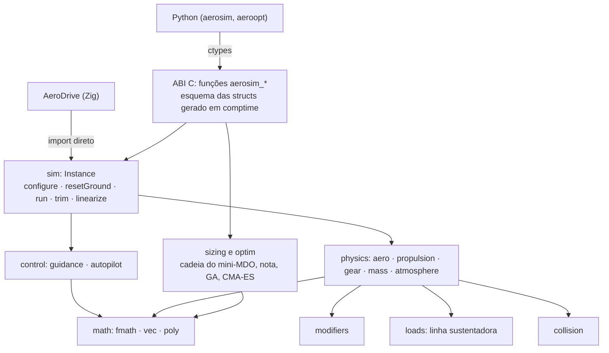

# core/ — núcleo de simulação em Zig

Este é o núcleo de simulação e controle da aeronave. Ele recebe o avião já descrito (superfícies, motores, massas,
missão) e devolve como ele voa: as forças em cada instante, o movimento nos seis graus de liberdade, o equilíbrio em
cada velocidade, o modelo linear, o desempenho, as cargas e o dimensionamento inicial. O `aerosim` (onde se projeta),
o `aerodrive` (onde se pilota) e o `aeroopt` (onde se otimiza) usam o mesmo núcleo, então o avião que se projeta é o
mesmo que se pilota. Ele é escrito em Zig e não aloca memória durante a simulação: tudo tem tamanho fixo, definido em
`src/limits.zig`, e uma corrida nunca falha por falta de memória no meio do voo.

O código vai da base para cima, e cada pasta tem o seu README:

| pasta | o que tem |
|---|---|
| [`src/math/`](src/math/README.md) | seno, exp, log por tabela e polinômio; vetores SIMD; polinômio de tração |
| [`src/physics/`](src/physics/README.md) | aerodinâmica por faixas, tabela de voo, propulsão, trem, massa e sloshing, vento |
| [`src/modifiers/`](src/modifiers/README.md) | efeito solo, esteira da hélice e interferência entre asas, desligáveis por avião |
| [`src/collision/`](src/collision/README.md) | o que fica dentro do tubo de cada hélice |
| [`src/loads/`](src/loads/README.md) | linha sustentadora (Phillips e Snyder; Goates e Hunsaker) para as cargas e o voo |
| [`src/control/`](src/control/README.md) | guiamento, piloto automático e ajuste automático dos ganhos |
| [`src/sim/`](src/sim/README.md) | equações do movimento e RK4, corrida, trimagem, modelo linear, envelope, desempenho |
| [`src/sizing/`](src/sizing/README.md) | dimensionamento inicial (mini-MDO) |
| [`src/optim/`](src/optim/README.md) | a nota do regulamento e as buscas do aeroopt |



O Python chama o núcleo pela ABI C, e o layout de todas as structs sai de `aerosim_schema()`: um campo novo em
`types.zig` aparece no Python sem mexer em nada, porque o Python lê pelo esquema e confere o hash ao carregar. Os
limites que o núcleo tem e os canais que ele grava em cada corrida:

```python
from aerosim.backend.zig import ZigBackend

be = ZigBackend()                       # compila o núcleo sozinho se o código Zig mudou
print(be.limits())
print(len(be.log_channels()), "canais:", be.log_channels()[:8], "...")
```

```
{'surfaces': 48, 'props': 8, 'prop_pts': 64, 'gear': 8, 'tanks': 8, 'segments': 32, 'events': 16, 'instances': 16, 'mods': 8, 'nx': 61, 'poly_coef': 21}
110 canais: ['t', 'seg', 'n', 'e', 'h', 'phi', 'theta', 'psi'] ...
```

São até 48 superfícies, 8 motores e 16 instâncias ao mesmo tempo, com um vetor de 61 estados. Os testes ficam junto
do código e rodam por grupo:

```sh
cd core && python -m ziglang build test -Dgrupo=math --summary all
```

```
Build Summary: 5/5 steps succeeded; 16/16 tests passed
```

Os grupos são math, physics, control, sim, sizing, optim e geometry; `-Dfiltro=trim` roda só os testes com "trim" no
nome, e `python -m ziglang build docs` gera a documentação dos `///` em `zig-out/docs`. Um programa em Zig importa o
núcleo direto, sem a ABI, como o AeroDrive faz:

```zig
const core = @import("aerosim");
var inst: core.runner.Instance = .{};         // grande: prefira gpa.create
inst.p = parametros;                          // core.types.Params
try core.runner.configure(&inst);
try core.runner.resetGround(&inst);
var buf: [256]core.types.LogRow = undefined;
var n: usize = 0;
const status = core.runner.run(&inst, 10.0, &buf, &n);
```

Tudo o que o projeto calcula passa por aqui, e por isso a simulação, o AeroDrive e os exemplos são conferidos bit a
bit contra a `main` (`python tools/checks/run.py`): física nova entra desligada e não muda o que já existe.
