# core/ — núcleo de simulação em Zig

Integra a dinâmica 6GDL com RK4 (dt = 1 ms), calcula equilíbrios (trimagem) e entrega o registro em
fatias. Toda a memória é estática (`src/limits.zig`); nada é alocado em tempo de execução.

```mermaid
flowchart LR
    subgraph API["Interface (C ABI)"]
        direction TB
        ROOT["root.zig<br/>funções aerosim_*"]
        ABI["abi.zig<br/>esquema gerado em comptime"]
        TYP["types.zig<br/>structs extern"]
    end
    subgraph SIM["sim/"]
        direction TB
        RUN["runner.zig<br/>eventos, paradas, fatias, checkpoint"]
        DYN["dynamics.zig<br/>f(t,x) e RK4 em SIMD"]
        TRIM["trim.zig<br/>Newton, desempenho"]
        ENV["envelope.zig<br/>envelope por altitude"]
        SP["simple_perf.zig<br/>potências, subida, planeio,<br/>curva × V, bateria (Peukert)"]
        LIN["linear.zig<br/>modelo linear A, B"]
        ST["state.zig<br/>vetor de estados"]
        BENCH["bench.zig<br/>medições"]
    end
    subgraph CTL["control/"]
        direction TB
        GD["guidance.zig"]
        AP["autopilot.zig"]
    end
    subgraph PHY["physics/"]
        direction TB
        AERO["aero.zig<br/>painéis + fuselagem"]
        PROP["propulsion.zig<br/>motor+hélice ou polinômio"]
        GEAR["gear.zig<br/>trem"]
        TER["terrain.zig<br/>chão, mesa, plataforma"]
        MASS["mass.zig<br/>massa, sloshing, carga"]
        ATM["atmosphere.zig<br/>vento, rajada"]
    end
    subgraph MATH["math/"]
        direction TB
        FM["fmath.zig<br/>LUT sin/cos/atan, exp/log"]
        POLY["poly.zig<br/>Poly2 em comptime"]
        VEC["vec.zig<br/>@Vector"]
    end
    API --> SIM
    SIM --> CTL
    SIM --> PHY
    CTL --> MATH
    PHY --> MATH
    classDef iface fill:#cfe3ff,stroke:#1f4e8c,stroke-width:2px,color:#0b2545
    class ROOT,ABI,TYP iface
    style API fill:#eaf2ff,stroke:#1f4e8c,stroke-width:3px
```



## Compilar e testar

```sh
python -m ziglang build --release=fast        # zig-out/lib/libaerosim.so (dll/dylib)
python -m ziglang build --release=fast -Dfast_math=false   # funções da std no lugar das LUTs
python -m ziglang build test                  # todos os testes
python -m ziglang build test-math             # só math/: LUTs, polinômio, vetores
python -m ziglang build test-physics          # physics/
python -m ziglang build test-control          # control/
python -m ziglang build test-sim              # sim/, abi, bench (decolagem, checkpoint, trimagem...)
```

Opções: `-Dfast_math` (padrão `true`), `-Dstrip` (padrão: sim fora do Debug), `-Dcpu` (padrão
`x86_64_v3` em x86, ver abaixo).

## Interface (o que o Python chama)

| função | faz |
|---|---|
| `aerosim_schema()` | texto com o layout de todas as structs (gerado por reflexão em comptime) e os limites |
| `aerosim_acquire()` / `aerosim_release(slot)` | pega/devolve uma das `max_instances` simulações estáticas |
| `aerosim_params(slot)` / `aerosim_params_reset` / `aerosim_configure` | escreve os parâmetros direto na struct e calcula os derivados |
| `aerosim_reset_ground` / `aerosim_reset_air(seg)` | começa parado na pista ou em voo equilibrado |
| `aerosim_run(slot, t_limit, buf, cap, &n)` | avança até parar, até `t_limit` ou até encher `buf` |
| `aerosim_snapshot_save/load` | checkpoint = bytes do estado (os parâmetros vêm da configuração nova) |
| `aerosim_trim`, `aerosim_performance` | equilíbrio e tabela de desempenho por V |
| `aerosim_envelope`, `aerosim_envelope_curve` | envelope por altitude (V_min, V_max, V_e, V*, V_cru, teto) e as curvas T_d, T_r |
| `aerosim_simple_perf` | desempenho por cálculo (sem instância): por V, C_L, C_D, T_d/T_r, P_d/P_r, RC, γ, planeio, R(φ), limites de estol e de tração, autonomia e alcance (Peukert); resumo com V_min/V_max, RC máx., E máx., R mín. |
| `aerosim_aero_coeffs`, `aerosim_prop_point`, `aerosim_mass_props` | polar, curva de tração, massa/CG/inércia |
| `aerosim_aero_coeffs_ex` | coeficientes com rotação (p, q, r) e momentos em qualquer ponto (derivadas de amortecimento, ponto neutro, momento no trem) |
| `aerosim_linearize(slot, V, &LinModel)` | trima nivelado (Levenberg-Marquardt em α, δe, acelerador, φ, δa, δr; longitudinal com peso maior) e devolve A (8×8) e B (8×4) do corpo rígido com comandos congelados |
| `aerosim_bench_math`, `aerosim_bench_dynamics` | medições (ver abaixo) |

Erros: dentro do núcleo são *error unions* do Zig (`ConfigError`, `StateError`); só na fronteira viram
códigos negativos (`configCode`, `stateCode` em `root.zig`). Para acrescentar um campo: ponha em
`types.zig` — o esquema e o Python se ajustam sozinhos.

## Tração polinomial (comptime)

`math/poly.zig` define `Poly2(grau)`: a tabela de expoentes (p00, p10, p01, p20, p11, p02, …, na ordem
do `poly55` do MATLAB) e o laço de avaliação são resolvidos pelo compilador; em execução sobra uma
sequência de FMAs. `types.ThrustPoly = Poly2(limits.thrust_poly_deg)` (grau 5, 21 coeficientes). Cada
unidade propulsora escolhe `model = prop_motor` (motor BLDC + hélice J/C_T/C_P, com rotação como
estado) ou `prop_poly`:

```
T = gain · P(x, y) · (ρ/ρ0)^rho_exp        x, y ∈ {nenhuma, V, acelerador, h, ρ, constante}
T × acelerador, se nem x nem y for o acelerador;   T ≥ 0;   x, y limitados a [0, xmax] se xmax > 0
```

Com x = constante n, y = V, gain = g, rho_exp = 1 e T0 em p00, é exatamente a tração do
`Envelope_main` original. A ordem dos termos sai no esquema (`poly_terms`) e o teste `tests/core/test_abi.py` confere que é a
mesma do Python.

## LUTs e desempenho — o que foi medido

`math/fmath.zig` tem as duas implementações lado a lado (`lut` e `ref`), e `SinLut(bits)` gera tabelas
de qualquer tamanho em comptime. `bench.zig` mede cada função isolada (entradas sequenciais ou
aleatórias) e a avaliação de f(t, x). Nesta máquina (Xeon 2,1 GHz, L1d 48 KB, L2 2 MB por núcleo):

| função (entradas aleatórias) | LUT / polinômio | std |
|---|---|---|
| sin (tabela 2 KB) | 6,2 ns | 28,1 ns |
| sin (tabela 32 KB / 512 KB) | 6,2 / 6,3 ns | — |
| atan2 | 9,3 ns | 15,3 ns |
| exp | 8,1 ns | 19,2 ns |
| log | 13,6 ns | 8,7 ns |

- **As tabelas estão no cache**: 2 KB, 32 KB e 512 KB dão o mesmo tempo. Por isso o seno usa 256
  pontos (2 KB) com correção de Taylor de 6ª ordem (erro ~1e-15).
- **O que deixava a simulação lenta não eram as LUTs:** com `-Dcpu=native` num Xeon com AVX-512 o
  LLVM gera código pior para elas (f(t, x): 1478 ns com LUT contra 987 ns com `x86_64_v3`), por isso
  o padrão em x86 é `x86_64_v3`. Além disso, um `memset` genérico (slice de tamanho em tempo de
  execução e uma struct de saída zerada a cada chamada) custava ~1 000 instruções por avaliação; foi
  trocado por stores de tamanho fixo.
- Hoje: f(t, x) ≈ 1 µs; missão completa (165 s) ≈ 1 s. Pelo callgrind a versão LUT executa ~2,5× menos
  instruções que a std, mas o tempo das duas fica parecido: o gargalo é a cadeia de dependências do
  laço dos painéis em `aero.zig`, não as funções matemáticas.

Para reproduzir: `python -m pytest -m bench -s`.

Rotação de equilíbrio do motor (trimagem, curva de tração, envelope): `dn/dt` cai com n, então a
raiz é única em [1, 600] rps; *regula falsi* com a modificação de Illinois em vez de bisseção (≈10
avaliações em vez de 60) — o envelope "modelo completo" ficou ~2× mais rápido.
