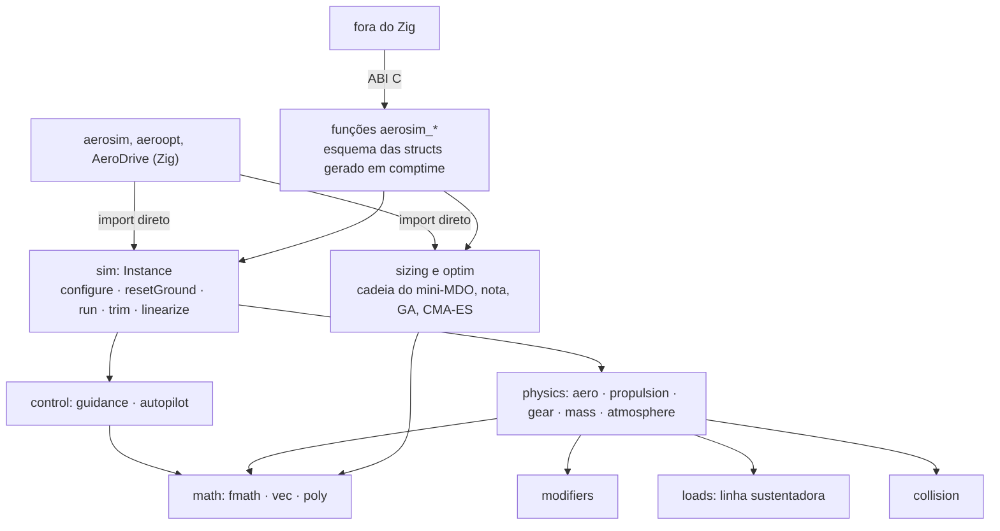

# core/ — núcleo de simulação em Zig

Este é o núcleo de simulação e controle da aeronave. Ele recebe o avião já descrito (superfícies, motores, massas,
missão) e devolve como ele voa: as forças em cada instante, o movimento nos seis graus de liberdade, o equilíbrio em
cada velocidade, o modelo linear, o desempenho, as cargas e o dimensionamento inicial. O `aerosim` (onde se projeta),
o `aerodrive` (onde se pilota) e o `aeroopt` (onde se otimiza) usam o mesmo núcleo, então o avião que se projeta é o
mesmo que se pilota. Ele é escrito em Zig e não aloca memória durante a simulação: tudo tem tamanho fixo, definido em
`src/limits.zig`, e uma corrida nunca falha por falta de memória no meio do voo.
Os ajustes das contas (iterações, tolerâncias, passos, grades) também não ficam escondidos no meio do código: estão
todos em `src/numerics.zig`, cada um com o padrão de sempre, o rótulo e o solver a que pertence, e quem chama o núcleo
troca antes de rodar. Na tela eles aparecem no "Refino dos Solvers" de cada análise.

O código vai da base para cima, e cada pasta tem o seu README:

| pasta | o que tem |
|---|---|
| [`src/math/`](src/math/README.md) | seno, exp, log por tabela e polinômio; vetores SIMD; polinômio de tração |
| [`src/physics/`](src/physics/README.md) | aerodinâmica por faixas, tabela de voo, propulsão, trem, massa e sloshing, vento |
| [`src/modifiers/`](src/modifiers/README.md) | efeito solo, esteira da hélice e interferência entre asas, desligáveis por avião |
| [`src/collision/`](src/collision/README.md) | o que fica dentro do tubo de cada hélice |
| [`src/loads/`](src/loads/README.md) | linha sustentadora (Phillips e Snyder; Goates e Hunsaker) para as cargas e o voo |
| [`src/control/`](src/control/README.md) | guiamento, piloto automático e ajuste automático dos ganhos |
| [`src/sim/`](src/sim/README.md) | equações do movimento e RK4, corrida, trimagem, modelo linear, envelope, desempenho |
| [`src/sizing/`](src/sizing/README.md) | dimensionamento inicial (mini-MDO) |
| [`src/optim/`](src/optim/README.md) | a nota do regulamento e as buscas do aeroopt |



Os programas em Zig importam o núcleo direto, como módulo (`@import("aerosim")`). A ABI C (`root.zig`, funções
`aerosim_*` com o esquema das structs conferido por hash) fica para quem chama de fora do Zig. Os limites que o núcleo
tem e os canais que ele grava em cada corrida (`src/exemplo.zig`, `python -m ziglang build exemplo -Dexemplo=.`):

```zig
const std = @import("std");
const core = @import("aerosim");

pub fn main() !void {
    const limits = core.limits;
    std.debug.print("superfícies {d}, motores {d}, trens {d}, tanques {d}, pernas {d}, instâncias {d}, estados {d}\n", .{
        limits.max_surfaces, limits.max_props, limits.max_gear, limits.max_tanks, limits.max_segments, limits.max_instances, core.state.nx,
    });
    const channels = @typeInfo(core.types.LogRow).@"struct".fields;
    std.debug.print("{d} canais:", .{channels.len});
    inline for (channels[0..8]) |channel| std.debug.print(" {s}", .{channel.name});
    std.debug.print(" ...\n", .{});
}
```

```
superfícies 48, motores 8, trens 8, tanques 8, pernas 32, instâncias 16, estados 61
110 canais: t seg n e h phi theta psi ...
```

São até 48 superfícies, 8 motores e 16 instâncias ao mesmo tempo, com um vetor de 61 estados. Os testes ficam junto
do código e rodam por grupo:

```sh
cd core && python -m ziglang build test -Dgrupo=math --summary all
```

```
Build Summary: 5/5 steps succeeded; 16/16 tests passed
```

Os grupos são math, physics, control, sim, sizing, optim e geometry; `-Dfiltro=trim` roda só os testes com "trim" no
nome, e `python -m ziglang build docs` gera a documentação dos `///` em `zig-out/docs`. Uma corrida, como o AeroDrive
faz:

```zig
const core = @import("aerosim");
var inst: core.runner.Instance = .{};         // grande: prefira gpa.create
inst.p = parametros;                          // core.types.Params
try core.runner.configure(&inst);
try core.runner.resetGround(&inst);
var buf: [256]core.types.LogRow = undefined;
var n: usize = 0;
const status = core.runner.run(&inst, 10.0, &buf, &n);
```

Tudo o que o projeto calcula passa por aqui, e por isso a simulação, o AeroDrive e os exemplos são conferidos bit a
bit contra a `main` (`zig build check`): física nova entra desligada e não muda o que já existe.
