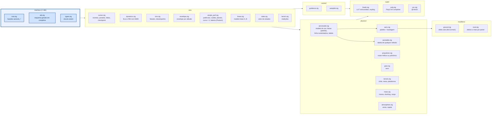

# core/ — núcleo de simulação em Zig

Este é o núcleo de simulação e controle da aeronave. Ele recebe o avião já descrito (superfícies, motores, massas,
missão) e devolve como ele voa: as forças em cada instante, o movimento nos seis graus de liberdade, o equilíbrio em
cada velocidade, o desempenho e o dimensionamento inicial. O `aerosim` (a GUI de projeto) e o `aerodrive` (o
simulador para pilotar) usam o mesmo núcleo, então o avião que se projeta é o mesmo que se pilota.

O núcleo é escrito em Zig e não aloca memória durante a simulação. Tudo o que ele usa tem tamanho fixo, definido em
`src/limits.zig`, e por isso uma corrida nunca falha por falta de memória no meio do voo.

## Como se divide

O código está em pastas que vão da base para cima. Na base fica `math/`, com as funções matemáticas rápidas e os
vetores. Em cima dela, `physics/` calcula as forças: a aerodinâmica do avião, a tração das hélices, o trem de pouso,
a massa e o vento. Os efeitos que se ligam por avião, como o efeito solo e a esteira da hélice, ficam em
`modifiers/`, e `collision/` diz quais partes do avião estão dentro do tubo de vento de cada hélice. A linha
sustentadora, um método mais fino que o padrão para a distribuição de sustentação, fica em `loads/`. O piloto
automático e o guiamento ficam em `control/`. A pasta `sim/` junta tudo isso: integra o movimento no tempo, acha o
equilíbrio, lineariza e calcula o envelope de voo. Por fim, `sizing/` faz o dimensionamento inicial (o mini-MDO),
sem integrar no tempo.

Cada pasta tem o seu README, com as equações, a fonte de cada uma e como chamar:

| pasta | o que tem |
|---|---|
| [`src/math/`](src/math/README.md) | seno, exp, log por tabela e polinômio; vetores SIMD; polinômio de tração |
| [`src/physics/`](src/physics/README.md) | aerodinâmica por faixas, tabela de voo, propulsão, trem, massa e sloshing, vento |
| [`src/modifiers/`](src/modifiers/README.md) | efeito solo e esteira da hélice, desligáveis por avião |
| [`src/collision/`](src/collision/README.md) | o que fica dentro do tubo de cada hélice |
| [`src/loads/`](src/loads/README.md) | linha sustentadora (Phillips e Snyder; Goates e Hunsaker) para as cargas e o voo |
| [`src/control/`](src/control/README.md) | guiamento, piloto automático e ajuste automático dos ganhos |
| [`src/sim/`](src/sim/README.md) | equações do movimento e RK4, corrida, trimagem, modelo linear, envelope, desempenho por fórmula |
| [`src/sizing/`](src/sizing/README.md) | dimensionamento inicial (mini-MDO) e os otimizadores |



## Uma corrida, do começo ao fim

Uma simulação começa com os parâmetros do avião (`types.Params`), escritos direto numa das instâncias estáticas. A
configuração (`runner.configure`) calcula uma vez o que deriva deles, como as estações de cada superfície e as
massas. A corrida começa parada na pista ou já em voo equilibrado, e avança em passos fixos de integração. A cada
passo, `sim/dynamics.zig` pede as forças a `physics/` e os comandos a `control/`, e o integrador (Runge-Kutta de
4ª ordem) avança o estado. O registro sai em fatias, para a GUI desenhar enquanto o avião voa, e a corrida para no
fim da missão, num evento pedido (fim da decolagem, entrada numa perna) ou num tempo limite. O estado inteiro pode
ser salvo como um checkpoint e retomado depois com outros parâmetros, o que permite, por exemplo, testar vários
raios de curva a partir do mesmo ponto sem refazer a decolagem.

## Qual modelo dá as forças (`physics/aeromodel.zig`)

A dinâmica, a trimagem e a linearização pedem as forças aerodinâmicas a `aeromodel.compute`, e o avião escolhe de
onde elas vêm pelo campo `Params.aero_model`. O padrão são as **faixas**: cada superfície é dividida em painéis, e
cada painel tem a sua inclinação de sustentação (Helmbold), o downwash da asa e o estol. É o modelo mais rápido, e é
o que o AeroDrive usa. A **linha sustentadora** troca as forças dos painéis pelas de um cálculo de vórtices que
enxerga a interação entre as superfícies; é mais lenta, e serve para conferir as faixas. A **tabela** voa com os
coeficientes de qualquer outro método (lltdrek, AeroSandbox, AVL), montados antes pelo Python.

| `aero_model` | modelo | onde |
|---|---|---|
| 0 (padrão) | faixas | `physics/aero.zig` |
| 1 | linha sustentadora (Phillips e Snyder; Goates e Hunsaker com `llt_joint`, `llt_blend`) | `loads/llt.zig` (`compute`) |
| 2 | tabela do avião inteiro ($`C_L`$, $`C_D`$, $`C_m`$ em α e derivadas lineares) mais a fuselagem do núcleo | `physics/aerotable.zig` |

Com o padrão, as contas são as de sempre, bit a bit, e a regressão dos exemplos confere isso. No Python, o campo é
`ac.sim.aero_model` ("faixas", "llt", "llt_gh", "tabela"), e a tabela vem de `aerosim/aero/flight_table.py`. Para
comparar os voos com cada modelo: `tools/aero/missao.py`.

## Tração polinomial (comptime)

Cada unidade propulsora escolhe entre `prop_motor` (motor e hélice, com a rotação como estado) e `prop_poly` (um
polinômio da tração em duas variáveis, ajustado de ensaio). O polinômio é gerado pelo compilador: `math/poly.zig`
define `Poly2(grau)` com a tabela de expoentes na ordem do `poly55` do MATLAB, e em execução sobra só a sequência de
multiplicações. As equações estão em [`src/physics/README.md`](src/physics/README.md) e
[`src/math/README.md`](src/math/README.md). A ordem dos termos sai no esquema (`poly_terms`), e o teste
`tests/core/test_abi.py` confere que é a mesma do Python.

## Funções matemáticas e tempo de conta

O núcleo tem duas implementações das funções matemáticas lado a lado em `math/fmath.zig`: `lut`, por tabela e
polinômio, e `ref`, a da biblioteca padrão. A primeira é a padrão. O que se aprendeu medindo é que as tabelas cabem
no cache, então o tamanho delas não muda o tempo, e que o gargalo não está nas funções matemáticas, e sim na cadeia
de dependências do laço dos painéis em `aero.zig`. Em x86 o alvo padrão é `x86_64_v3`, porque com AVX-512 o LLVM gera
código pior para as tabelas. A rotação de equilíbrio do motor usa *regula falsi* com a modificação de Illinois em vez
de bisseção, porque converge em menos avaliações.

As medidas, com a máquina e a data, e as otimizações em avaliação (`-Dopt`) ficam em
[`OTIMIZACOES.md`](OTIMIZACOES.md). Para medir: `python -m pytest -m bench -s`.

## Como chamar

### Compilar e testar

```sh
python -m ziglang build --release=fast        # zig-out/lib/libaerosim.so (dll/dylib)
python -m ziglang build --release=fast -Dfast_math=false   # funções da std no lugar das LUTs
python -m ziglang build test                  # todos os testes
python -m ziglang build test-math             # só math/: LUTs, polinômio, vetores
python -m ziglang build test-physics          # physics/
python -m ziglang build test-control          # control/
python -m ziglang build test-sim              # sim/, abi, bench (decolagem, checkpoint, trimagem...)
python -m ziglang build test-sizing           # sizing/: estágios, tipos de aeronave, otimizadores, fuzzing
python -m ziglang build test -Dfuzz=200000 -Dseed=7   # fuzzing mais longo das interfaces
```

As opções de compilação são `-Dfast_math` (as tabelas, ligado por padrão), `-Dstrip` (tira os símbolos fora do
Debug), `-Dcpu` (o alvo, `x86_64_v3` por padrão em x86) e `-Dopt`, que liga otimizações em avaliação pelo nome
(`-Dopt=peak,cse`; os nomes são os do enum `Opt` em `src/opt.zig`).

### Pelo Zig (módulo)

Programas em Zig importam o núcleo direto, sem passar pela ABI C. É o que o `aerodrive` faz:

```zig
// build.zig.zon: .aerosim = .{ .path = "../core" }
// build.zig:     .imports = &.{ .{ .name = "aerosim", .module = b.dependency("aerosim", .{ .target = target, .release = true }).module("aerosim") } }
const core = @import("aerosim");
var inst: core.runner.Instance = .{};         // grande: prefira gpa.create
inst.p = parametros;                          // core.types.Params
try core.runner.configure(&inst);
try core.runner.resetGround(&inst);
var buf: [256]core.types.LogRow = undefined;
var n: usize = 0;
const status = core.runner.run(&inst, 10.0, &buf, &n);
```

### Pela ABI C (o que o Python chama)

O Python carrega a biblioteca compilada e chama as funções `aerosim_*` por ctypes. O layout de todas as structs sai
de `aerosim_schema()`, gerado por reflexão em comptime, e o Python confere o hash dele ao carregar; por isso, para
acrescentar um campo basta pô-lo em `types.zig`, e o esquema e o Python se ajustam sozinhos.

| função | faz |
|---|---|
| `aerosim_schema()` | texto com o layout de todas as structs e os limites |
| `aerosim_acquire()` / `aerosim_release(slot)` | pega e devolve uma das instâncias estáticas |
| `aerosim_params(slot)` / `aerosim_params_reset` / `aerosim_configure` | escreve os parâmetros direto na struct e calcula os derivados |
| `aerosim_reset_ground` / `aerosim_reset_air(seg)` | começa parado na pista ou em voo equilibrado |
| `aerosim_run(slot, t_limit, buf, cap, &n)` | avança até parar, até `t_limit` ou até encher `buf` |
| `aerosim_snapshot_save/load` | checkpoint: os bytes do estado (os parâmetros vêm da configuração nova) |
| `aerosim_trim`, `aerosim_performance` | equilíbrio e tabela de desempenho por V |
| `aerosim_envelope`, `aerosim_envelope_curve` | envelope por altitude ($`V_{min}`$, $`V_{max}`$, $`V_e`$, V*, $`V_{cru}`$, teto) e as curvas $`T_d`$, $`T_r`$ |
| `aerosim_simple_perf` | desempenho por fórmula, sem instância: potências, subida, planeio, curva, autonomia e alcance |
| `aerosim_aero_coeffs`, `aerosim_prop_point`, `aerosim_mass_props` | polar, curva de tração, massa, CG e inércia |
| `aerosim_aero_coeffs_ex` | coeficientes com rotação (p, q, r) e momentos em qualquer ponto |
| `aerosim_linearize(slot, V, &LinModel)` | trima nivelado e devolve as matrizes A e B do corpo rígido |
| `aerosim_sizing_defaults`, `aerosim_sizing_eval`, `aerosim_sizing_optimize`, `aerosim_sizing_name` | dimensionamento inicial: padrões, uma avaliação, a otimização e os nomes dos índices |
| `aerosim_bench_math`, `aerosim_bench_dynamics` | medições |

Dentro do núcleo, os erros são *error unions* do Zig (`ConfigError`, `StateError`); só na fronteira eles viram
códigos negativos (`configCode`, `stateCode` em `root.zig`).
