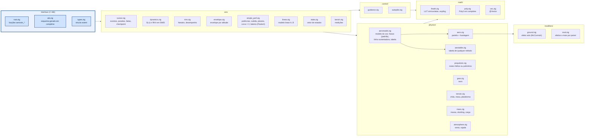

# core/ — núcleo de simulação em Zig

Integra a dinâmica 6GDL com RK4 (dt = 1 ms), calcula equilíbrios (trimagem) e entrega o registro em
fatias. Toda a memória é estática (`src/limits.zig`); nada é alocado em tempo de execução.

Cada pasta tem um README com o que os arquivos fazem, as equações (com a fonte) e como chamar:

| pasta | o que tem |
|---|---|
| [`src/physics/`](src/physics/README.md) | aerodinâmica por faixas, tabela de voo, propulsão, trem, massa e sloshing, vento |
| [`src/sim/`](src/sim/README.md) | equações do movimento e RK4, corrida, trimagem, modelo linear, envelope, desempenho por fórmula |
| [`src/control/`](src/control/README.md) | guiamento, piloto automático e ajuste automático dos ganhos |
| [`src/loads/`](src/loads/README.md) | linha sustentadora (Phillips e Snyder; Goates e Hunsaker) para as cargas e o voo |
| [`src/modifiers/`](src/modifiers/README.md) | efeito solo e esteira da hélice, desligáveis por avião |
| [`src/collision/`](src/collision/README.md) | o que fica dentro do tubo de cada hélice |
| [`src/sizing/`](src/sizing/README.md) | dimensionamento inicial (mini-MDO) e os otimizadores |
| [`src/math/`](src/math/README.md) | seno, exp, log por tabela e polinômio; vetores SIMD; polinômio de tração |

## Como chamar

### Compilar e testar

```sh
python -m ziglang build --release=fast        # zig-out/lib/libaerosim.so (dll/dylib)
python -m ziglang build --release=fast -Dfast_math=false   # funções da std no lugar das LUTs
python -m ziglang build test                  # todos os testes
python -m ziglang build test-math             # só math/: LUTs, polinômio, vetores
python -m ziglang build test-physics          # physics/
python -m ziglang build test-control          # control/
python -m ziglang build test-sim              # sim/, abi, bench (decolagem, checkpoint, trimagem...)
python -m ziglang build test-sizing           # sizing/: estágios, tipos de aeronave, otimizadores, fuzzing
python -m ziglang build test -Dfuzz=200000 -Dseed=7   # fuzzing mais longo das interfaces (padrão 2000)
```

Opções: `-Dfast_math` (padrão `true`), `-Dstrip` (padrão: sim fora do Debug), `-Dcpu` (padrão
`x86_64_v3` em x86, ver abaixo), `-Dopt` (otimizações em avaliação, desligadas por padrão: `-Dopt=peak,cse`; o que
cada uma faz e o que se mediu está em [`OTIMIZACOES.md`](OTIMIZACOES.md)).

### Pelo Zig (módulo)

Programas em Zig importam o núcleo direto (é o que o `aerodrive` faz), sem passar pela ABI C:

```zig
// build.zig.zon: .aerosim = .{ .path = "../core" }
// build.zig:     .imports = &.{ .{ .name = "aerosim", .module = b.dependency("aerosim", .{ .target = target, .release = true }).module("aerosim") } }
const core = @import("aerosim");
var inst: core.runner.Instance = .{};         // grande: prefira gpa.create
inst.p = parametros;                          // core.types.Params
try core.runner.configure(&inst);
try core.runner.resetGround(&inst);
var buf: [256]core.types.LogRow = undefined;
var n: usize = 0;
const status = core.runner.run(&inst, 10.0, &buf, &n);
```

### Pela ABI C (o que o Python chama)

| função | faz |
|---|---|
| `aerosim_schema()` | texto com o layout de todas as structs (gerado por reflexão em comptime) e os limites |
| `aerosim_acquire()` / `aerosim_release(slot)` | pega/devolve uma das `max_instances` simulações estáticas |
| `aerosim_params(slot)` / `aerosim_params_reset` / `aerosim_configure` | escreve os parâmetros direto na struct e calcula os derivados |
| `aerosim_reset_ground` / `aerosim_reset_air(seg)` | começa parado na pista ou em voo equilibrado |
| `aerosim_run(slot, t_limit, buf, cap, &n)` | avança até parar, até `t_limit` ou até encher `buf` |
| `aerosim_snapshot_save/load` | checkpoint = bytes do estado (os parâmetros vêm da configuração nova) |
| `aerosim_trim`, `aerosim_performance` | equilíbrio e tabela de desempenho por V |
| `aerosim_envelope`, `aerosim_envelope_curve` | envelope por altitude (V_min, V_max, V_e, V*, V_cru, teto) e as curvas T_d, T_r |
| `aerosim_simple_perf` | desempenho por cálculo (sem instância): por V, C_L, C_D, T_d/T_r, P_d/P_r, RC, γ, planeio, R(φ), limites de estol e de tração, autonomia e alcance (Peukert); resumo com V_min/V_max, RC máx., E máx., R mín. |
| `aerosim_aero_coeffs`, `aerosim_prop_point`, `aerosim_mass_props` | polar, curva de tração, massa/CG/inércia |
| `aerosim_aero_coeffs_ex` | coeficientes com rotação (p, q, r) e momentos em qualquer ponto (derivadas de amortecimento, ponto neutro, momento no trem) |
| `aerosim_linearize(slot, V, &LinModel)` | trima nivelado (Levenberg-Marquardt em α, δe, acelerador, φ, δa, δr; longitudinal com peso maior) e devolve A (8×8) e B (8×4) do corpo rígido com comandos congelados |
| `aerosim_sizing_defaults(&cfg, &opts)` | os padrões de `SizingCfg` e `OptOpts` (as structs ctypes nascem zeradas) |
| `aerosim_sizing_eval(&cfg, x, &out)` | dimensionamento inicial de um vetor de projeto: grandezas (S, b, V_S, corrida, V_max, subida, PV, CP, EE, MTOW...), violação das restrições, curva de tração e arrasto no MTOW |
| `aerosim_sizing_optimize(&cfg, &opts, buf, cap, &n, &best, progress, ctx)` | otimiza (`opts.method`: PSO ou busca aleatória) e guarda cada avaliação em `buf`; `progress(ctx, iteração, n)` a cada iteração (≠ 0 para parar) |
| `aerosim_sizing_name(o_que, i)` | nomes dos índices: 0 grandezas, 1 variáveis, 2 tipos de aeronave, 3 otimizadores |
| `aerosim_bench_math`, `aerosim_bench_dynamics` | medições (ver abaixo) |

Erros: dentro do núcleo são *error unions* do Zig (`ConfigError`, `StateError`); só na fronteira viram
códigos negativos (`configCode`, `stateCode` em `root.zig`). Para acrescentar um campo: ponha em
`types.zig` — o esquema e o Python se ajustam sozinhos.

## Como funciona




### Modelo aerodinâmico do voo (`physics/aeromodel.zig`)

A dinâmica, a trimagem e a linearização pedem as forças a `aeromodel.compute`, que escolhe por `Params.aero_model`:

| `aero_model` | modelo | onde |
|---|---|---|
| 0 (padrão) | faixas: o C_Lα de Helmbold por painel, downwash ε0 + dε/dα α, estol, fuselagem por coeficientes | `physics/aero.zig` |
| 1 | linha sustentadora: a conta das faixas com as forças dos painéis trocadas pelas da linha (Phillips e Snyder; Goates e Hunsaker com `llt_joint`, `llt_blend`) | `loads/llt.zig` (`compute`) |
| 2 | tabela do avião inteiro (C_L, C_D, C_m em α e derivadas lineares) de qualquer método, mais a fuselagem do núcleo | `physics/aerotable.zig` |

- **Com 0, as contas são as de sempre, bit a bit:** a regressão dos exemplos confere. O AeroDrive monta os `Params`
  com os padrões e por isso continua nas faixas.
- **No Python:** `ac.sim.aero_model` ("faixas", "llt", "llt_gh", "tabela") e `ac.sim.aero_table`, montada por
  `aerosim/aero/flight_table.py`.
- **Para comparar os voos:** `tools/aero/missao.py`.

### Dimensionamento inicial (`sizing/`)

O mini-MDO inteiro roda no núcleo; o Python só monta a configuração e desenha. Os estágios, as equações e como
acrescentar um tipo de aeronave ou um otimizador estão em [`src/sizing/README.md`](src/sizing/README.md).

### Tração polinomial (comptime)

`math/poly.zig` define `Poly2(grau)`: a tabela de expoentes, na ordem do `poly55` do MATLAB, e o laço de avaliação são
resolvidos pelo compilador. Cada unidade propulsora escolhe `model = prop_motor` (motor + hélice, com a rotação como
estado) ou `prop_poly`. As equações estão em [`src/physics/README.md`](src/physics/README.md) e em
[`src/math/README.md`](src/math/README.md). A ordem dos termos sai no esquema (`poly_terms`), e o teste
`tests/core/test_abi.py` confere que é a mesma do Python.

### Funções matemáticas e tempo de conta

`math/fmath.zig` tem as duas implementações lado a lado (`lut`, por tabela e polinômio, e `ref`, a da std), e
`bench.zig` mede cada função isolada e a avaliação de f(t, x). O que se aprendeu:

- as tabelas cabem no cache, então o tamanho delas não muda o tempo;
- em x86 o padrão é `x86_64_v3`: com AVX-512 (`-Dcpu=native` num Xeon) o LLVM gera código pior para as tabelas;
- o gargalo não são as funções matemáticas, e sim a cadeia de dependências do laço dos painéis em `aero.zig`;
- a rotação de equilíbrio do motor usa *regula falsi* com a modificação de Illinois em vez de bisseção.

As medidas, com a máquina e a data, ficam em [`OTIMIZACOES.md`](OTIMIZACOES.md). Para medir: `python -m pytest -m bench -s`.
