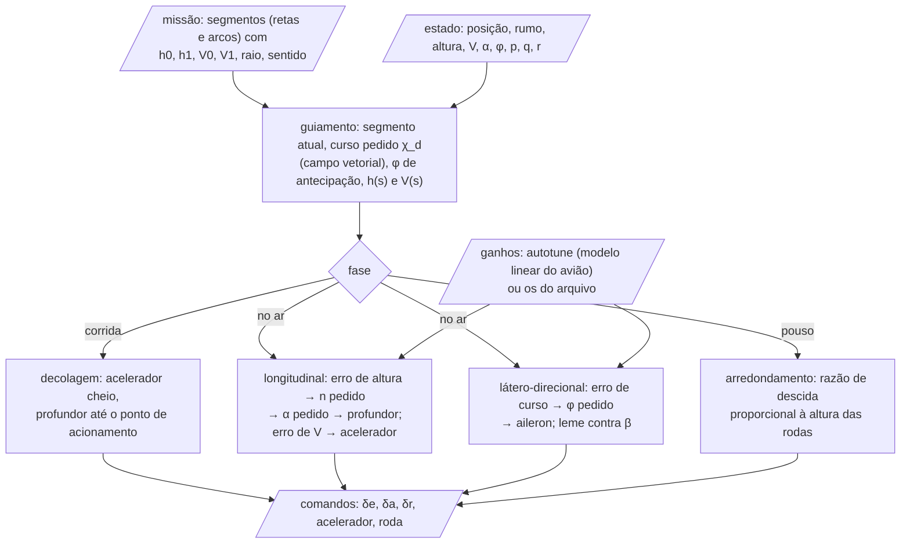
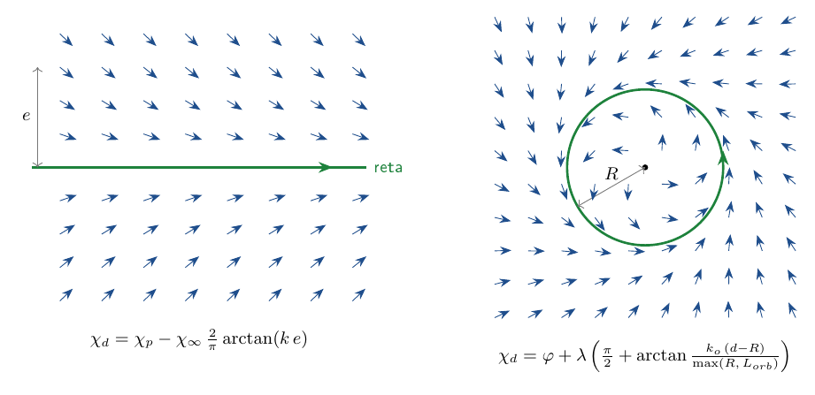

# core/src/control — piloto automático, guiamento e ajuste de ganhos

Esta é a parte do núcleo que pilota o avião nas simulações. Ela recebe o percurso da missão (retas e curvas, com
altura e velocidade) e decide, a cada instante, para onde o avião deve apontar e quanto mexer em cada comando. Não é
um controlador para um avião real: é o piloto de um simulador, pensado para que qualquer avião projetado complete a
missão sem que alguém precise escrever ganhos à mão.

O trabalho se divide em três camadas, uma em cima da outra. O guiamento diz o que se quer (o rumo, a altura e a
velocidade em cada ponto do percurso). O piloto automático transforma isso em comandos de profundor, aileron, leme,
acelerador e roda. O ajuste dos ganhos calcula, a partir do modelo linear do próprio avião, quanto cada malha do
piloto deve reagir.

| arquivo | o que faz |
|---|---|
| `guidance.zig` | o percurso (retas e arcos) e o curso, a altura e a velocidade pedidos em cada ponto |
| `autopilot.zig` | os comandos (profundor, aileron, leme, acelerador, roda) a partir do que o guiamento pede |
| `autotune.zig` | os ganhos das malhas internas a partir do modelo linear do avião |

## O piloto, passo a passo

A cada avaliação de $`f(t, x)`$, o piloto passa por três camadas:



## Guiamento (`guidance.zig`)

O percurso é uma corrente de segmentos (retas e arcos). Para não depender de um ponto alvo, o curso pedido vem de um
campo vetorial (Beard e McLain, *Small Unmanned Aircraft*, cap. 10, a conferir no PDF).

**Reta.** Com $`\chi_p`$ o rumo da reta, $`e`$ a distância lateral até ela e $`\chi_\infty`$ o ângulo de aproximação de longe:

```math
\chi_d = \chi_p - \chi_\infty\,\frac{2}{\pi}\arctan(k\,e)
```

**Arco.** Com $`\varphi`$ o ângulo do avião em torno do centro, $`d`$ a distância ao centro, $`R`$ o raio e $`\lambda = \pm 1`$ o
sentido; o ganho da órbita é limitado em raio pequeno ($`L_{orb}`$):

```math
\chi_d = \varphi + \lambda\left(\frac{\pi}{2} + \arctan\frac{k_o\,(d - R)}{\max(R, L_{orb})}\right)
```



A inclinação de antecipação de um arco de raio $`R`$ a uma velocidade $`V`$ é a da curva coordenada:

```math
\phi_{ff} = \lambda\arctan\frac{V^2}{g R}
```

**Altura e velocidade** de cada segmento vão de $`(h_0, V_0)`$ a $`(h_1, V_1)`$ por uma curva cosseno na fração $`s`$ do
segmento (sem degrau no começo nem no fim):

```math
h(s) = h_0 + (h_1 - h_0)\,\frac{1 - \cos(\pi s)}{2}
```

No segmento de pouso a altura cai em rampa até as rodas tocarem o ponto de toque.

## Piloto automático (`autopilot.zig`)

**Decolagem** (Riboldi et al., 2022, a conferir no PDF): acelerador cheio, profundor $`\delta_{e0}`$ até a velocidade (ou
a distância) de rotação e $`\delta_{e1}`$ depois, com a taxa do servo; no chão, leme e roda direcionável seguem a pista.

Esse comando é fixo até o piloto automático assumir, e aí um avião leve e com muita tração passa do estol antes disso:
a asa voadora chegava a 32° de α com o elevon todo cabrando, e o tandem, depois de sair do chão, subia o nariz até
estolar e cair. Por isso a **proteção de α na decolagem** é sempre ligada (o aerosim e o AeroDrive mandam
`takeoff.alpha_guard = 1`; o 0 só existe para o teste que mostra a diferença). A mesma lei de α e $`q`$ do voo entra
nessa fase e só pica: ela nunca cabra mais que $`\delta_{e1}`$. O α pedido é o do estol de cada avião, não um número
fixo: no `configure`, o núcleo varre α em voo livre e guarda o primeiro em que a superfície mais carregada chega a
$`k_{CL}`$ do $`C_{L,max}`$ dela (`alpha_guard_lim`, $`k_{CL}`$ = 0,95). Com o $`\alpha_{max}`$ do voo (11°) no lugar, o
monoplano, que sai do chão perto de 14°, não decolava mais na pista dele.

**Longitudinal, no ar.** A altura vira fator de carga vertical. Da cinemática $`\ddot h = g\,(n\cos\phi - \cos\gamma)`$, o
piloto pede:

```math
n\cos\phi = \cos\gamma_{ref} + K_{n,h}\,e_h + K_{n,\dot h}\,e_{\dot h} + K_{n,ih}\int e_h\,dt
```

O fator de carga vira $`C_L`$ e o $`C_L`$ vira $`\alpha`$ pedido, limitado por $`\alpha_{max}`$ (proteção de estol):

```math
C_{L,c} = \frac{n}{\cos\phi}\,\frac{m g}{q S}
\qquad
\alpha_c = \frac{C_{L,c} - C_{L0}}{C_{L\alpha}}
```

O profundor segue o $`\alpha`$ pedido, com amortecimento em $`q`$ (descontada a arfagem de uma curva nivelada) e integrador:

```math
\delta_e = K_{\alpha e}\,(\alpha - \alpha_c) + K_{qe}\,(q - q_{curva}) + K_{I\alpha}\int(\alpha - \alpha_c)\,dt
\qquad
q_{curva} = \frac{g}{V}\,\frac{\sin^2\phi}{\cos\phi}
```

A velocidade é do acelerador, com o erro de altura somado (energia total) e integrador que para quando satura:

```math
\delta_t = \delta_{t,trim} + K_V\,(V_c - V) + K_{IV}\int(V_c - V)\,dt + K_{HT}\,e_h
```

**Arredondamento.** Abaixo da altura de arredondamento, a razão de descida pedida é proporcional à altura das rodas
($`\tau`$ é a constante de tempo), e o acelerador vai a zero perto do chão:

```math
\dot h_c = -\frac{h_{rodas}}{\tau}
```

**Látero-direcional, no ar.** O curso vira inclinação (somada à de antecipação), limitada pela inclinação que a asa
sustenta sem perder altura ($`1/\cos\phi \le n_{max}`$); o aileron segue a inclinação e o leme zera a derrapagem:

```math
\phi_c = \phi_{ff} + K_\chi\,(\chi_d - \chi)
\qquad
\delta_a = K_{\phi a}\,(\phi_c - \phi) - K_{pa}\,p
\qquad
\delta_r = -K_\beta\,\beta
```

No chão, o rumo pedido segue a linha central da pista e vai para o leme e para a roda.

## Ajuste dos ganhos (`autotune.zig`)

Em vez de ganhos no arquivo de cada avião, o núcleo lineariza o avião no voo nivelado (`sim/linear.zig`) e escolhe os
ganhos para que as malhas internas tenham sempre a mesma resposta. Os modelos reduzidos de cada malha saem das
derivadas dimensionais da matriz $`A`$ e de $`B`$ (a forma dos modelos reduzidos, em Beard e McLain, cap. 5 e 6, a conferir
no PDF):

**Arfagem.** Com $`\delta_e = K_{\alpha e}(\alpha - \alpha_c) + K_{qe}\,q`$:

```math
\dot\alpha = Z_\alpha\,\alpha + q \qquad \dot q = M_\alpha\,\alpha + M_q\,q + M_{\delta_e}\,\delta_e
```

$`K_{\alpha e}`$ é escolhido para o regime seguir uma fração fixa do $`\alpha`$ pedido (ou uma frequência mínima do curto
período), e $`K_{qe}`$ para um amortecimento fixo.

**Rolagem.** Com $`\delta_a = K_{\phi a}(\phi_c - \phi) - K_{pa}\,p`$, a malha fechada é de segunda ordem, e os dois
ganhos saem de $`\omega_n`$ e $`\zeta`$ escolhidos:

```math
\dot p = L_p\,p + L_{\delta_a}\,\delta_a
```

**Guinada.** O leme reforça a rigidez direcional até uma frequência mínima do dutch roll; sem leme, $`K_\beta = 0`$:

```math
N'_\beta = N_\beta - N_{\delta_r}\,K_\beta \ge \omega_{dr}^2
```

**Motor.** $`\dot u = X_{\delta_t}\,\delta_t`$, então $`K_V = \omega_V / X_{\delta_t}`$; $`K_{IV}`$ e $`K_{HT}`$ seguem na mesma
proporção.

As malhas de fora (altura → fator de carga, curso → inclinação) são cinemáticas e não dependem do avião. Uma derivada
que não dá para usar (comando sem efeito, valor absurdo) deixa o ganho do arquivo como está, e o resultado diz qual.

## Como chamar

O piloto roda dentro da simulação; pelo Python, o que se escolhe é a missão e se os ganhos são ajustados sozinhos:

```python
from aerosim.backend.zig import ZigBackend
from aerosim.model.mission import circuit
from aerosim.model.templates import conventional
from aerosim.model.universal import build_model

ac = conventional()
be = ZigBackend()
with be.session_for(build_model(ac), circuit()) as s:
    g = s.autotune(14.0)            # autotune.zig: ganhos para 14 m/s (e o que não deu para ajustar)
    s.reset_ground()
    status, log = s.run(t_limit=30.0)
    print(status, log["h"].max())
```

Testes: `python -m ziglang build test -Dgrupo=control` (dentro de `core/`).
