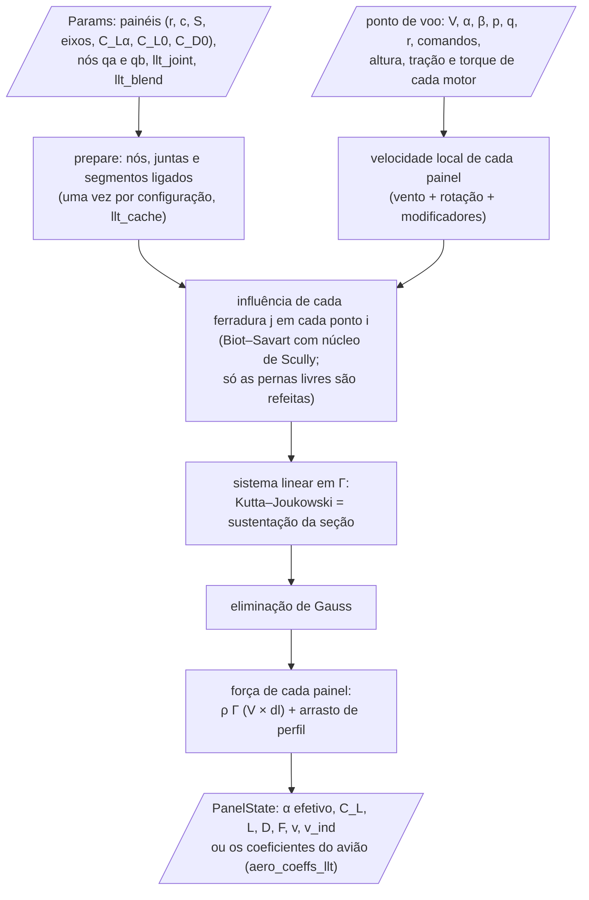
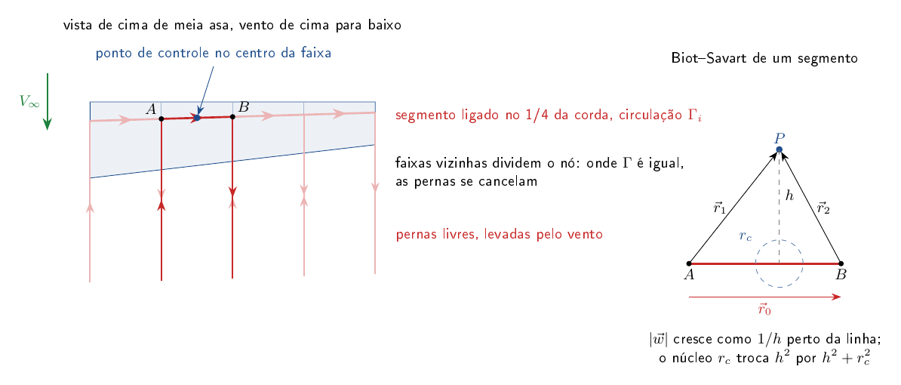
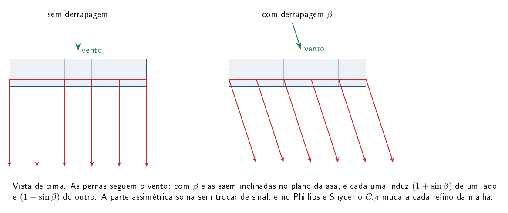

# core/src/loads — distribuição de carga ao longo da envergadura

Esta é a parte do núcleo que diz como a sustentação se distribui ao longo da asa e da cauda, da raiz até a ponta. Essa
distribuição é o que importa para a estrutura (o momento fletor na raiz, a carga em cada nervura) e para saber onde o
estol começa. Ela nasceu para a aba Cargas, e o voo também pode usá-la, escolhendo `Params.aero_model = 1`
(`physics/aeromodel.zig`). Com o padrão, que são as faixas, a simulação não chama nada daqui, e as corridas, a
trimagem e o AeroDrive ficam iguais.

O README começa explicando por que esta pasta existe. Depois apresenta o método de Phillips e Snyder, que é o padrão,
e o de Goates e Hunsaker, uma correção ligável para asas enflechadas e para voo com derrapagem. Depois vem a versão não
linear, também ligável, em que cada faixa estola pela curva do seu perfil. Em seguida vêm o cache
que deixa a conta rápida, os limites do método, os testes, como validar e as referências. No fim, como chamar.

## Por que existe

A simulação por faixas dá a cada faixa a mesma inclinação de sustentação, a da superfície inteira (Helmbold com o
alongamento dela). Assim o alongamento muda a sustentação total, mas a carga sai plana ao longo da envergadura: a
ponta carrega tanto quanto a raiz. Para voar isso basta, porque o que importa é a soma. Para cargas está errado,
porque a ponta de uma asa real descarrega, e quanto menor o alongamento, mais a forma da carga muda.

## Uma avaliação, passo a passo

Uma avaliação da linha sustentadora começa com o avião já configurado (os painéis e os nós que o tradutor preencheu)
e o ponto de voo. O fluxo abaixo mostra o que entra, o que é montado uma vez por configuração e o que é refeito a
cada chamada:



## Método de Phillips e Snyder (`llt.zig`)

A linha sustentadora numérica de Phillips e Snyder (*Modern Adaptation of Prandtl's Classic Lifting-Line Theory*,
Journal of Aircraft 37(4), 662–670, 2000) troca cada painel do núcleo por uma ferradura de vórtice: um segmento ligado
ao longo do 1/4 de corda da faixa e duas pernas que seguem o escoamento até longe. A circulação de cada ferradura é a
incógnita, e a carga de cada faixa sai dela.

Os dois nós de cada ferradura ficam nos pontos de 1/4 de corda das bordas da faixa (`qa` e `qb` do painel, que o
tradutor preenche). Faixas vizinhas dividem o nó, então as pernas se cancelam onde a circulação é igual, também com
enflechamento e diedro. Sem os nós (`qa = qb = 0`, painéis montados à mão), o segmento sai do centro `r` com a largura
`S/c`, perpendicular à corda, e só fecha as ferraduras numa superfície sem enflechamento. As pernas são retas e
seguem o escoamento livre, e o ponto de controle fica no centro `r` do painel, no meio do segmento ligado. A asa, a
EH, a EV e os dispositivos entram juntos, e por isso o downwash da asa na cauda sai das pernas da asa, e não do ε
empírico da simulação.

**Biot–Savart.** A velocidade induzida num ponto $`P`$ por um segmento reto de vórtice de $`A`$ a $`B`$, com circulação
unitária, $`\vec r_1 = P - A`$, $`\vec r_2 = P - B`$ e $`\vec r_0 = B - A`$ (Katz e Plotkin, *Low-Speed Aerodynamics*, 2ª ed.,
cap. 10; número da equação a conferir no PDF):

```math
\vec w = \frac{1}{4\pi}\,\frac{\vec r_1\times\vec r_2}{\lVert\vec r_1\times\vec r_2\rVert^2 + r_c^2\,\lVert\vec r_0\rVert^2}\;\vec r_0\cdot\left(\frac{\vec r_1}{\lVert\vec r_1\rVert} - \frac{\vec r_2}{\lVert\vec r_2\rVert}\right)
```

Como $`\lVert\vec r_1\times\vec r_2\rVert = h\,\lVert\vec r_0\rVert`$, com $`h`$ a distância do ponto à linha, o termo
$`r_c^2\lVert\vec r_0\rVert^2`$ é o núcleo de Scully, $`h^2 \to h^2 + r_c^2`$ (abaixo). Sem núcleo, $`r_c = 0`$. Uma
ferradura soma três segmentos: a perna que vem de longe até $`A`$, o ligado de $`A`$ a $`B`$ e a perna de $`B`$ para longe.



**Equação, por painel.** A sustentação de Kutta–Joukowski no segmento ligado iguala a da seção, com o ângulo de ataque
tirado do que todas as ferraduras induzem no ponto de controle (Phillips e Snyder 2000):

```math
\rho\,\lVert\vec V_i\rVert\,\Gamma_i = \tfrac12\,\rho\,\lVert\vec V_i\rVert^2\,c_i\,\eta_i\,a_i\left(\alpha_{g,i} - \alpha_{0,i} - \frac{\vec w_i\cdot\hat e_{z,i}}{\lVert\vec V_i\rVert}\right)
\qquad
\vec w_i = \sum_j \Gamma_j\,\vec w_{ij}
```

Aqui $`\vec V_i`$ é a velocidade local, já com os modificadores (esteira, solo); $`\alpha_{g,i}`$ é o ângulo do painel sem
o downwash empírico, com os comandos; $`\alpha_{0,i} = -C_{L0}/C_{L\alpha}`$; e $`\vec w_{ij}`$ é a velocidade que a
ferradura $`j`$ com $`\Gamma_j = 1`$ induz no ponto de controle $`i`$, pelo Biot–Savart acima.

A inclinação 2D $`a_i`$ sai do $`C_{L\alpha}`$ 3D do núcleo invertendo Helmbold, que é o que o tradutor usou (com
$`1 - 2C_{L\alpha}/(\pi AR) \le 0`$, usa $`2\pi`$):

```math
a = \frac{C_{L\alpha}}{\sqrt{1 - \dfrac{2\,C_{L\alpha}}{\pi\,AR}}}
```

**Sistema linear.** Uma equação por painel, linear em $`\Gamma`$; resolvido por eliminação de Gauss com pivô.

**Força.** Kutta–Joukowski no segmento ligado, com $`d\vec l`$ de nó a nó (inclui o enflechamento), mais o arrasto de
perfil:

```math
\vec F_i = \rho\,\Gamma_i\,(\vec V_i\times d\vec l_i) + q_i\,S_i\,C_{D0}\,\hat d_i
```

**Segmentos ligados.** Como em Phillips e Snyder, entram os segmentos ligados de todas as ferraduras, menos o do
próprio painel (a linha não induz nela mesma). São eles que fazem o enflechamento tirar sustentação: o segmento da
outra meia asa induz downwash perto da raiz. Antes, a ferradura era montada em torno do centro da faixa e
perpendicular à corda, e numa superfície enflechada as ferraduras vizinhas não se encontravam: o pedaço de vórtice
solto entre elas, cujo efeito cresce como $`\tan\Lambda`$ dividido pela largura da faixa, carregava a ponta em vez de
descarregá-la. Com os nós divididos, o winglet descarrega na ponta e a asa enflechada perde sustentação, na mesma
tendência do VLM do AeroSandbox.

**Núcleo dos vórtices entre superfícies.** Modelo de Scully (Vatistas, Kozel e Mih, *A simpler model for concentrated
vortices*, Experiments in Fluids 11, 1991, $`n = 1`$), com o raio do núcleo proporcional à corda de quem solta o
vórtice:

```math
\frac{1}{h^2} \;\to\; \frac{1}{h^2 + r_c^2}
\qquad
r_c = k\,c
```

Sem ele, a perna da raiz de uma EV que encosta na EH passa a milímetros dos pontos de controle da EH e induz uma
velocidade absurda, que cresce como $`1/h`$. Numa faixa larga de $`k`$ o resultado quase não muda. Dentro da mesma
superfície não há núcleo, porque a queda na ponta depende das pernas das faixas vizinhas, mais estreitas que qualquer
núcleo dessa ordem.

## Método de Goates e Hunsaker (ligável, `llt_joint` e `llt_blend`)

O método de Phillips e Snyder tem um problema em duas situações comuns, e a correção de Goates e Hunsaker existe para
elas. A primeira é o voo com derrapagem, quando o vento chega de lado no avião (o ângulo $`\beta`$), como numa curva mal
coordenada ou com vento cruzado. A segunda é a asa com enflechamento ou diedro. Nas duas, o resultado de Phillips e
Snyder muda cada vez que se refina a malha, em vez de se aproximar de um valor. Na prática, isso quer dizer que não dá
para confiar no momento de rolagem que a derrapagem produz (o $`C_{l\beta}`$, que decide a estabilidade lateral) nem na
carga perto da raiz de uma asa enflechada.

A causa está na geometria das ferraduras. Em derrapagem, as pernas seguem o vento e saem inclinadas no plano da asa;
cada perna induz $`(1 + \sin\beta)`$ de um lado e $`(1 - \sin\beta)`$ do outro, e a parte assimétrica soma
$`\Delta\Gamma/|\Delta y|`$ sem trocar de sinal, então o $`C_{l\beta}`$ da asa plana cresce com o logaritmo da malha. Com
enflechamento ou diedro, o problema é a quina da raiz, descrita em Limites, abaixo.



Goates e Hunsaker (*Practical Implementation of a General Numerical Lifting-Line Method*, AIAA SciTech 2021, a forma
prática do método de Reid e Hunsaker 2020) resolvem isso com três correções, implementadas também pelos autores no
MachUpX (github.com/usuaero/MachUpX), que serviu de referência nos testes.

**As três correções** (só com `Params.llt_joint > 0` ou `Params.llt_blend > 0`):

1. **Junta** (eq. 3 e 17). Cada perna sai do nó por um trecho de comprimento $`\delta\,c_{nó}`$ no plano da asa,
   perpendicular à linha sustentadora ($`\hat u_{a\Lambda}`$, eq. 12–15), e só depois segue o escoamento livre.
   $`\delta`$ é `llt_joint`.

2. **Linha sustentadora efetiva** (eq. 7). Para cada ponto de controle $`i`$, os nós da mesma asa são misturados com a
   reta tangente à linha em $`i`$, com o peso abaixo; sem curvatura em $`i`$, a quina deixa de ser singular. $`s`$ é o
   comprimento ao longo da linha projetado em y-z, em metros; $`b_{seg}`$ a semienvergadura; $`\Delta`$ é `llt_blend` (a
   forma dimensional do MachUpX, `airplane.py`; o artigo escreve com $`s`$ adimensional, eq. 8):

```math
w(s) = e^{-\sigma\,(s - s_i)^2}
\qquad
\sigma = \left(\frac{2}{b_{seg}\,\Delta\,\cos\Lambda_i}\right)^2
\qquad
\vec q_j^{\,ef} = w(s_j)\,\left(\vec P_i + \vec D_i\,(s_j - s_i)\right) + \left(1 - w(s_j)\right)\vec q_j
```

   $`\vec q_j`$ é um nó original, $`\vec P_i`$ o ponto de controle e $`\vec D_i = d\vec r/ds`$ a direção da linha em $`i`$: perto
   de $`i`$ o nó vai para a reta tangente, longe fica onde estava.

   As juntas também usam o $`\hat u_a`$ misturado.

3. **Seção no plano normal à linha** (§IV). O $`\alpha`$ da seção é tomado com a velocidade projetada nesse plano
   (eq. 24–27), e a corda, o ângulo de sustentação nula e o comando mudam com o enflechamento local $`\Lambda`$:

```math
c_\Lambda = c\cos\Lambda \;\text{(eq. 21)}
\qquad
\alpha_{0,\Lambda} = \frac{\alpha_0}{\cos\Lambda} \;\text{(eq. 35)}
\qquad
\delta_{f\Lambda} = \arcsin(\cos\Lambda\,\sin\delta_f) \;\text{(eq. 23)}
```

As asas são as cadeias de painéis do mesmo grupo que dividem nós. Um ponto de controle vê as outras asas com a geometria
original (G-H §III.A). A corda num nó é a média dos dois painéis que o dividem.

**Contra o MachUpX.** Nas asas de teste de `tools/aero` (retangular, com diedro, trapezoidal e enflechada), o
$`C_{L\alpha}`$ e o $`C_{l\beta}`$ de Goates e Hunsaker ficam perto dos do MachUpX e convergem com a malha; os de Phillips e
Snyder em derrapagem não convergem. Os números esperados estão em `tests/tools/test_aero_perfis.py`. O $`C_{l\beta}`$
positivo da asa plana é do modelo de esteira alinhada ao vento (o MachUpX dá o mesmo); o AVL e o VLM põem a esteira no
eixo x e dão zero.

Para ligar, use `Params.llt_joint` e `Params.llt_blend` (os valores usados estão em
`aerosim.aero.span_loads.GOATES_HUNSAKER`, que vai como `overrides` da sessão); a aba Cargas tem o método "linha
sustentadora (Goates e Hunsaker)" (`llt_gh`). Com os dois em 0 (o padrão), a linha sustentadora é a de Phillips e
Snyder, com as mesmas contas de antes.

## Versão não linear (ligável, `llt_nonlinear`)

Aqui se liga o estol de cada faixa: com `Params.llt_nonlinear = 1`, a sustentação de cada seção segue a curva
$`c_l(\alpha)`$ do seu perfil, que sobe em reta e cai depois do estol. Com isso a linha sustentadora mostra onde o estol
começa ao longo da envergadura e para quanto o $`C_L`$ da asa satura, o que importa para o caso de carga de $`C_{L,max}`$.

Sem ela, a seção é a reta $`c_l = a\,(\alpha - \alpha_0)`$ sem limite. Num α alto a carga continua subindo, a raiz de uma
asa retangular passa do $`c_{l,max}`$ do perfil sem perder nada e o momento fletor sai maior do que o avião consegue
produzir. A simulação por faixas tem estol, mas a carga dela é plana, então não diz qual parte da asa estola primeiro.

**A curva da seção.** É a mesma mistura que as faixas usam (Beard e McLain, `aero.sigmaStall`), a reta da seção
misturada com a placa plana pelo peso $`\sigma`$, que vai de 0 antes do estol a 1 depois:

```math
c_l(\alpha) = \left(1 - \sigma\right)\,a\,(\alpha - \alpha_0) + \sigma\;2\,\mathrm{sgn}(\alpha)\,\sin^2\alpha\,\cos\alpha
```

O ângulo de estol de $`\sigma`$ é escolhido, por bisseção, para que o pico da curva seja o $`c_{l,max}`$ do perfil. Esse
$`c_{l,max}`$ sai do $`C_{L,max}`$ que a faixa recebe do tradutor, desfazendo o fator que ele aplicou (Raymer, *Aircraft
Design: A Conceptual Approach*, eq. 12.15; número a conferir no PDF):

```math
c_{l,max} = \frac{C_{L,max}}{0{,}9}
```

O ângulo de estol de cada painel é calculado uma vez, em `prepare`, e fica no cache.

**O sistema.** Com o $`c_l`$ não linear, a equação de cada painel deixa de ser linear em $`\Gamma`$. O resíduo de cada
painel é a diferença entre a circulação e a que a seção dá na velocidade que ela vê (Phillips e Snyder 2000, versão não
linear; Hunsaker e Snyder, eq. 4 a 15; números das equações a conferir no PDF):

```math
R_i(\Gamma) = \Gamma_i - \tfrac12\,c_i\,\eta_i\,\lVert\vec V_i\rVert\,c_{l,i}(\alpha_i)
\qquad
\vec V_i = \vec v_i - \sum_j \Gamma_j\,\vec w_{ij}
```

Aqui $`\vec v_i`$ é a velocidade do painel sem o que as ferraduras induzem, e $`\alpha_i`$ é o ângulo de $`\vec V_i`$ no plano
da seção, mais o comando. O Newton parte da solução linear e usa o jacobiano analítico, com $`u = \vec V_i\cdot\hat e_x`$ e
$`w = \vec V_i\cdot\hat e_z`$:

```math
\frac{\partial R_i}{\partial \Gamma_j} = \delta_{ij} - \tfrac12\,c_i\,\eta_i\left(c_l\,\frac{\partial\lVert\vec V_i\rVert}{\partial\Gamma_j} + \lVert\vec V_i\rVert\,c_l'\,\frac{\partial\alpha_i}{\partial\Gamma_j}\right)
\qquad
\frac{\partial\lVert\vec V_i\rVert}{\partial\Gamma_j} = -\frac{u\,\vec w_{ij}\cdot\hat e_x + w\,\vec w_{ij}\cdot\hat e_z}{\lVert\vec V_i\rVert}
\qquad
\frac{\partial\alpha_i}{\partial\Gamma_j} = -\frac{u\,\vec w_{ij}\cdot\hat e_z - w\,\vec w_{ij}\cdot\hat e_x}{\lVert\vec V_i\rVert^2}
```

A derivada $`c_l'`$ é tirada por diferença central. O passo é amortecido: se o resíduo cresce, ele cai pela metade, até
dez vezes. Depois do estol a força de cada faixa ganha também o arrasto da placa plana das faixas,
$`\sigma\,1{,}2\,\sin^2\alpha`$. Com Goates e Hunsaker ligado, a seção é a do plano normal à linha, como na versão
linear.

**Depois do estol (`llt_viscosity`).** Quando a curva do perfil passa do pico, $`c_l`$ cai com $`\alpha`$ e cada faixa
tem duas respostas possíveis, uma de cada lado do pico. As faixas se acoplam pelo downwash: uma que estola perde
$`\Gamma`$ e muda o $`\alpha`$ das vizinhas. O sistema passa a ter muitas soluções. Só com o Newton, metade dos ângulos
depois do estol não convergia (o passo parava num mínimo local do resíduo) e os que convergiam tinham faixas estoladas
salteadas, uma sim e outra não, com a sustentação da asa subindo e descendo de um ângulo para o outro. Duas correções
resolvem isso.

A primeira é a viscosidade artificial de Chattot, que soma ao resíduo um termo que espalha $`\Gamma`$ entre as faixas
vizinhas e escolhe a solução suave. Na forma discreta, o coeficiente precisa crescer com o quadrado do número de
faixas para o resultado não mudar com a malha (*Relaxation limits and artificial viscosity for lifting-line
simulations of uniformly discretized rectangular wings in pre- and post-stall conditions*, 2026; a conferir no PDF).
Por isso aqui ele entra na forma contínua, com a corda como escala de comprimento, e pesado pela mistura $`\sigma`$ do
estol, que é quase 0 antes do estol, para o trecho linear ficar como estava:

```math
R_i \;\to\; R_i - \sigma_i\,\nu\,c_i^2\,\frac{d^2\Gamma}{ds^2}\bigg|_i
```

$`s`$ é a distância ao longo da envergadura (projetada em y-z) e $`\nu`$ é `llt_viscosity`. A segunda derivada usa a
diferença de espaçamento desigual entre os centros das faixas vizinhas da mesma asa, com $`\Gamma = 0`$ no nó da ponta.
A forma contínua e o peso $`\sigma`$ são escolhas nossas; a ideia do termo é a de Chattot.

A segunda é a continuação em pseudo-tempo, usada quando o Newton para sem convergir. Em vez do passo de Newton,
resolve-se

```math
\left(\frac{I}{\tau} + J\right)\Delta\Gamma = -R
```

com $`\tau`$ crescendo à medida que o resíduo cai (Kelley e Keyes, *Convergence analysis of pseudo-transient
continuation*, SIAM J. Numer. Anal. 35, 1998; regra SER de Mulder e van Leer, 1985; a conferir no PDF). Com $`\tau`$
pequeno o passo é curto e segue $`-R`$, o que atravessa os mínimos locais; com $`\tau`$ grande vira o Newton.

O $`\nu`$ do método `llt_nl` foi escolhido numa varredura na asa retangular dos testes: o menor valor com que todos os
ângulos convergiram, nas duas malhas, sem saltos de $`c_l`$ entre faixas vizinhas.

Para ligar, a aba Cargas tem o método "linha sustentadora não linear (estol por perfil)" (`llt_nl`), e o voo usa a
mesma conta com `ac.sim.aero_model = "llt_nl"`. Com `llt_nonlinear = 0`, o padrão, a conta é a linear de sempre.

## Cache da geometria (`prepare`, `Params.llt_cache`)

A cada avaliação, a linha sustentadora precisava da influência de cada ferradura $`j`$ em cada ponto de controle $`i`$, e
no método de Goates e Hunsaker também refazia, para cada $`i`$, a linha efetiva, as tangentes e as juntas. O perfil de
uma decolagem (`tools/time_profile.py`) mostrou que a maior parte do tempo ia em recalcular essa geometria, seguida
pelo Biot–Savart, com a eliminação de Gauss quase de graça. Só as duas pernas livres dependem do escoamento, porque
seguem o vento; os nós, as juntas e o segmento ligado são fixos para uma configuração. O MachUpX também monta a linha
efetiva e as juntas uma vez, ao montar o avião (`machupX/airplane.py`).

Por isso `prepare(p)`, chamado em `runner.configure` logo depois de `aero.init`, guarda para cada par $`(i, j)`$ de onde
saem as pernas livres e os segmentos fixos (as juntas e o ligado), em memória estática no `Params`. Com o cache,
`apply` calcula só as duas pernas livres e soma na mesma ordem de antes, e o resultado é o mesmo, bit a bit; o teste
"cache da geometria" confere isso em derrapagem e com diedro, nos dois métodos. Sem o cache, faz a conta inteira de
sempre, o que acontece com painéis montados à mão nos testes, no AeroDrive ou quando um painel fica sem escoamento no
instante (isso muda as cadeias de Goates e Hunsaker). Com o cache, o método de Goates e Hunsaker ficou da ordem do de
Phillips e Snyder; as medidas estão em [`core/OTIMIZACOES.md`](../../OTIMIZACOES.md).

Ainda dá para ganhar tempo trocando a ordem das somas, o que muda o último dígito: a perna livre como vórtice
semi-infinito por fórmula fechada (o 1º termo da eq. 3 de Goates e Hunsaker), uma perna por nó no Phillips e Snyder
($`n + 1`$ pernas em vez de $`2n`$) e SIMD no Biot–Savart.

## Limites conhecidos

- **Quinas (raiz de asa com diedro ou enflechamento):** ali a linha sustentadora de Phillips e Snyder é singular. O
  segmento ligado da outra meia asa passa perto do ponto de controle da faixa da raiz, e o valor na raiz depende da
  malha (com diedro, um pico; com enflechamento, um vale), embora a sustentação total convirja. A correção é a linha
  sustentadora efetiva de Goates e Hunsaker (acima), ligável. Em derrapagem vale o mesmo para as pernas inclinadas.
- **Alongamento baixo:** a linha sustentadora superestima o $`C_{L\alpha}`$ (numa EV sozinha de alongamento pequeno, o
  $`C_{Y\beta}`$ fica acima do AVL mesmo convergido).
- **Estol:** a versão de sempre é linear, $`c_l = a\,(\alpha - \alpha_0)`$, sem estol; perto do $`C_{L,max}`$ a carga real é
  menor. A versão não linear tem o estol, mas a curva depois dele é a da placa plana, e a seção estolada não tem a
  histerese nem o arrasto de uma asa real estolando. Bem depois do pico (uns 6° na asa retangular dos testes), a asa
  pula para a solução toda estolada, e o ângulo em que isso acontece depende da malha.
- **Pernas retas:** não se enrolam nem se desviam pela esteira da hélice.
- **Trimagem:** $`\alpha`$ e profundor vêm da trimagem da simulação. A soma das cargas pode ficar um pouco fora do peso,
  e o momento de arfagem não fica exatamente zerado.
- **Discretização:** a convergência é lenta com faixas iguais. `span_loads` refina com faixas mais estreitas na ponta,
  como Phillips e Snyder recomendam, com $`t`$ uniforme em $`[0, 1]`$ ao longo do trecho:

```math
y(t) = y_0 + (y_1 - y_0)\,\sin\frac{\pi t}{2}
```

## Testes (`zig build test -Dgrupo=physics`)

- Helmbold invertido volta à inclinação 2D do perfil.
- Um segmento muito longo dá $`\Gamma/(2\pi h)`$, o vórtice infinito.
- Na asa retangular, a ponta fica descarregada, a carga é simétrica e o $`C_L`$ fica perto de Helmbold. Com alongamento
  menor, o $`C_L`$ também é menor.
- Com diedro, a raiz não salta (o VLM do AeroSandbox dá um salto pequeno, na mesma direção).
- Núcleo de Scully: finito em cima da linha e metade do valor sem núcleo a $`h = r_c`$.
- Cauda em T: o painel da EH ao lado da raiz da EV não salta. Sem o núcleo, esse painel leva várias vezes a carga dos
  vizinhos, e o teste falha.
- Derrapagem: o $`C_{l\beta}`$ de Phillips e Snyder muda muito ao dobrar a malha (não converge); o de Goates e Hunsaker
  quase não muda e fica perto do MachUpX.
- Goates e Hunsaker desligado por padrão.
- Cache da geometria: o mesmo resultado, bit a bit, com e sem o cache.
- Não linear: a curva da seção tem o pico no $`c_{l,max}`$ pedido; em α pequeno a asa fica com a linear; numa varredura
  em α o $`C_L`$ para abaixo do $`c_{l,max}`$ da seção e, depois do estol, cai abaixo da linear; a raiz da asa retangular
  chega ao estol antes da ponta; com e sem o cache, o mesmo resultado bit a bit; desligada por padrão.
- Viscosidade: o trecho antes do estol fica igual; depois do estol a carga é suave e o $`C_L`$ com 24 e 48 faixas fica
  perto; sem ela, as faixas estolam salteadas.

Em `tests/tools/test_aero_perfis.py`: o $`C_{L\alpha}`$ e o $`C_{l\beta}`$ de Goates e Hunsaker contra o MachUpX nas quatro
asas de teste, com a tolerância e os números esperados no teste.

Em Python (`tests/aero/test_span_loads.py`):
- o winglet enflechado da asa voadora descarrega na ponta, com e sem β;
- a versão não linear carrega quase o mesmo que a linear no cruzeiro e menos que ela 14° acima;
- o enflechamento tira sustentação (tendência do VLM do AeroSandbox; os números não precisam bater, o VLM resolve a
  corda e a linha sustentadora não);
- a sustentação da asa converge ao refinar a malha.

## Como validar (o que é referência e o que não é)

- **Consistência do método:** o resultado tem de convergir com o refino. Um valor que muda com a malha (a quina da
  raiz) é erro do método, não física.
- **Outro método (só tendência):** o VLM do AeroSandbox (`aero/asb_solver.py`). Ele resolve a corda e dá números
  diferentes; serve para conferir o sentido dos efeitos (enflechamento, winglet, diedro).
- **Ensaio (o número esperado no teste):**
  - Stuper, J., *Effect of Propeller Slipstream on Wing and Tail*, NACA TM 874, 1938: asa retangular com e sem o jato
    da hélice, em vários α. Usado por Hunsaker e Snyder (abaixo) para validar exatamente este método;
  - Montoya, L. C., Flechner, S. G. e Jacobs, P. F., *Effect of an Alternate Winglet on the Pressure and Spanwise
    Load Distributions of a First-Generation Jet Transport Wing*, NASA TM 78786, 1978: cargas ao longo da envergadura
    com e sem winglet (o winglet aumenta a carga perto da ponta da asa). Modelo transônico e enflechado: serve para a
    tendência.

## Referências

- Phillips, W. F. e Snyder, D. O., *Modern Adaptation of Prandtl's Classic Lifting-Line Theory*, Journal of Aircraft
  37(4), 662–670, 2000. O método.
- Hunsaker, D. F. e Snyder, D. O., *A Lifting-Line Approach to Estimating Propeller/Wing Interactions*, AIAA. O mesmo
  método com nós no 1/4 de corda (eq. 4 a 15, versão não linear por Newton), mais a esteira por elemento de pá
  (eq. 21 a 24), validados contra Stuper. Conclusão deles: com hélice, "qualitativamente correto, quantitativamente
  otimista".
- Reid, J. T. e Hunsaker, D. F., *General Approach to Lifting-Line Theory, Applied to Wings with Sweep*, Journal of
  Aircraft, 2020, doi:10.2514/1.C035994. A base do Goates e Hunsaker (não temos o PDF; as equações usadas são as do
  Goates e Hunsaker).
- Goates, C. D. e Hunsaker, D. F., *Practical Implementation of a General Numerical Lifting-Line Method*, AIAA
  SciTech 2021. As equações implementadas (eq. 3, 7, 12–17, 21, 23–27, 35) e a referência numérica (MachUpX).
- Katz, J. e Plotkin, A., *Low-Speed Aerodynamics*, 2ª ed., Cambridge, 2001, cap. 10. Segmento de vórtice reto.
- Vatistas, G. H., Kozel, V. e Mih, W. C., *A simpler model for concentrated vortices*, Experiments in Fluids 11,
  1991. Núcleo de Scully.

Os PDFs não ficam no repositório (regra 7 do `.claude/CLAUDE.md`): só a citação.

## Como chamar

O export é `aerosim_panel_states_llt` (em `root.zig`), com os mesmos argumentos de `aerosim_panel_states`; ele devolve
os mesmos `PanelState`, com `alpha` (efetivo), `CL`, `L`, `D`, `F` e `v`/`vind` da linha sustentadora. No Python,
`session.panel_states(..., llt=True)` e `aerosim.aero.span_loads.LoadCase(method="llt")`, que é o padrão da aba Cargas:

```python
import numpy as np
from aerosim.backend.zig import ZigBackend
from aerosim.model.templates import conventional
from aerosim.model.universal import build_model

ac = conventional()
with ZigBackend().session_for(build_model(ac)) as s:
    faixas = s.panel_states(14.0, np.radians(4.0))             # carga plana da simulação
    linha = s.panel_states(14.0, np.radians(4.0), llt=True)    # linha sustentadora de Phillips e Snyder
    c = s.aero_coeffs_llt(14.0, np.radians(4.0))               # coeficientes do avião com a linha sustentadora
print(faixas["L"].sum(), linha["L"].sum())
```

Os coeficientes do avião inteiro com a linha sustentadora saem de `aerosim_aero_coeffs_llt` (`llt.coeffs`), com os
mesmos argumentos de `aerosim_aero_coeffs_at` (taxas p, q, r; altura sobre o chão; tração e torque de cada motor; ponto
dos momentos). Ele faz a conta da simulação (`aero.computeTrace`) e troca só as forças dos painéis pelas de `apply`,
então a fuselagem, o $`c_m`$ das seções, o efeito solo e a esteira continuam os da simulação; o $`C_{Di}`$ sai NaN. No Python,
`session.aero_coeffs_llt(...)`, e `method="faixas"` dá a carga plana da simulação.
