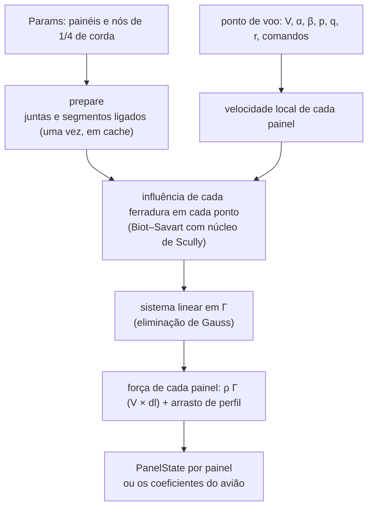

# core/src/loads — distribuição de carga ao longo da envergadura

Esta parte do núcleo diz como a sustentação se distribui ao longo da asa e da cauda, da raiz até a ponta. É a linha
sustentadora numérica: cada faixa vira uma ferradura de vórtice, e a circulação de todas sai de um sistema linear. A
simulação por faixas dá a mesma inclinação a toda a superfície, e por isso a carga dela sai plana. Aqui a ponta
descarrega, como numa asa real.

## Para que serve

- **Cargas na estrutura.** O momento fletor na raiz e a carga em cada nervura saem desta distribuição (aba Cargas).
- **Onde o estol começa.** Na versão não linear, cada faixa segue a curva do seu perfil e estola sozinha.
- **Voar com ela.** Com `Params.aero_model = .lifting_line`, a simulação usa estas forças. O padrão continua sendo as
  faixas, e com ele nada daqui é chamado.
- **Analisar asas como num túnel.** A varredura em α de uma asa, de um biplano ou de um tandem (subaba Analisar).

## Como funciona



A equação de cada painel iguala a sustentação de Kutta–Joukowski no segmento ligado à da seção, com o ângulo
induzido por todas as ferraduras (Phillips e Snyder, *Journal of Aircraft* 37(4), 2000):

```math
\rho\,\lVert\vec V_i\rVert\,\Gamma_i = \tfrac12\,\rho\,\lVert\vec V_i\rVert^2\,c_i\,a_i\left(\alpha_{i} - \alpha_{0,i} - \frac{\vec w_i\cdot\hat e_{z,i}}{\lVert\vec V_i\rVert}\right)
\qquad
\vec w_i = \sum_j \Gamma_j\,\vec w_{ij}
```

Há três métodos, escolhidos em `Params.llt_method`:

| método | quando usar |
|---|---|
| `.phillips_snyder` (padrão) | asa reta, sem derrapagem |
| `.goates_hunsaker` | asa enflechada ou com diedro, e voo com derrapagem: converge com a malha e fica perto do MachUpX (Goates e Hunsaker, 2021) |
| `.nonlinear` | carga de $`C_{L,max}`$: cada seção segue a curva $`c_l(\alpha)`$ do perfil, com estol (Beard e McLain) |

## Exemplo

```python
import numpy as np
from aerosim.backend.zig import ZigBackend
from aerosim.model.templates import conventional
from aerosim.model.universal import build_model

with ZigBackend().session_for(build_model(conventional())) as s:
    faixas = s.panel_states(14.0, np.radians(4.0))               # carga plana da simulação
    linha = s.panel_states(14.0, np.radians(4.0), llt=True)      # linha sustentadora
print(faixas["L"].sum(), linha["L"].sum())
```

Os exports são `aerosim_panel_states_llt` (a carga por painel), `aerosim_aero_coeffs_llt` (os coeficientes do avião)
e `aerosim_wing_sweep` (a varredura em α). Testes: `cd core && python -m ziglang build test -Dgrupo=physics`.

## O que isso influencia

A forma da carga muda o momento fletor na raiz, que é o que dimensiona a longarina. A mesma asa, no voo nivelado:
pelas faixas a carga é plana, e pela linha sustentadora ela é maior na raiz e cai na ponta.


Ela alimenta a aba Cargas (`aerosim/aero/span_loads.py`), a vista 3D das forças e o voo com
`aero_model = .lifting_line`.
