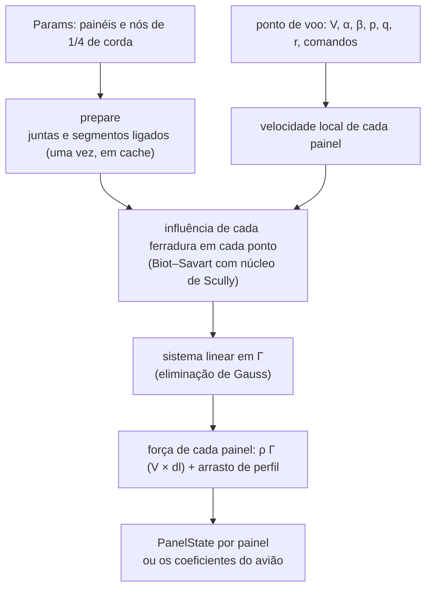
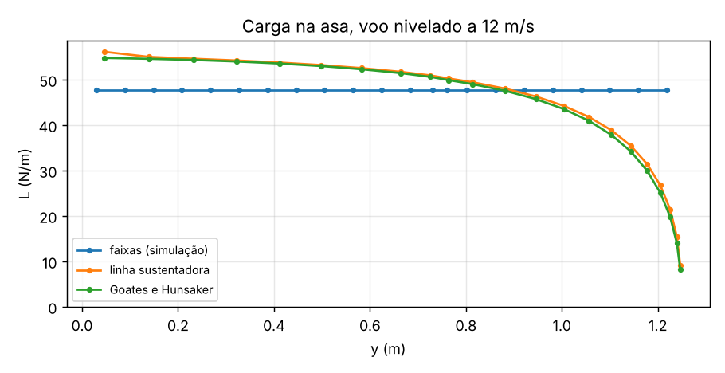

# core/src/loads — distribuição de carga ao longo da envergadura

Esta parte do núcleo diz como a sustentação se distribui ao longo da asa e da cauda, da raiz até a ponta. É a linha
sustentadora numérica: cada faixa vira uma ferradura de vórtice, e a circulação de todas sai de um sistema linear. A
simulação por faixas dá a mesma inclinação a toda a superfície, e a carga dela sai plana; aqui a ponta descarrega,
como numa asa real. Daqui saem o momento fletor na raiz e a carga em cada nervura (aba Cargas), onde o estol começa
ao longo da asa (na versão não linear) e a varredura em α de uma asa, de um biplano ou de um tandem (subaba Analisar).
A simulação também pode voar com estas forças (`Params.aero_model = .lifting_line`); com o padrão, que são as faixas,
nada daqui é chamado.



A equação de cada painel iguala a sustentação de Kutta–Joukowski no segmento ligado à da seção, com o ângulo
induzido por todas as ferraduras (Phillips e Snyder, *Journal of Aircraft* 37(4), 2000):

```math
\rho\,\lVert\vec V_i\rVert\,\Gamma_i = \tfrac12\,\rho\,\lVert\vec V_i\rVert^2\,c_i\,a_i\left(\alpha_{i} - \alpha_{0,i} - \frac{\vec w_i\cdot\hat e_{z,i}}{\lVert\vec V_i\rVert}\right)
\qquad
\vec w_i = \sum_j \Gamma_j\,\vec w_{ij}
```

| `Params.llt_method` | quando usar |
|---|---|
| `.phillips_snyder` (padrão) | asa reta, sem derrapagem |
| `.goates_hunsaker` | asa enflechada ou com diedro, e voo com derrapagem: converge com a malha e fica perto do MachUpX (Goates e Hunsaker, 2021) |
| `.nonlinear` | carga de $`C_{L,max}`$: cada seção segue a curva $`c_l(\alpha)`$ do perfil, com estol (Beard e McLain) |

O avião dos testes a 14 m/s e α = 4°, pelas faixas e pela linha sustentadora:

```zig
const std = @import("std");
const core = @import("aerosim");

var instance: core.runner.Instance = .{};

pub fn main() !void {
    core.test_aircraft(&instance.p); // o monomotor dos testes
    try core.runner.configure(&instance); // monta também a geometria da linha sustentadora
    const alpha = 4.0 * std.math.rad_per_deg;
    const strips = core.aero.coeffs(&instance.p, 14.0, alpha, 0, .{ 0, 0, 0 }, .{ 0, 0, 0 });
    const line = core.llt.coeffs(&instance.p, 14.0, alpha, 0, .{ 0, 0, 0 }, .{ 0, 0, 0 }, .{ 0, 0, 0 }, 100, null);
    std.debug.print("C_L do avião: faixas {d:.3}, linha sustentadora {d:.3}\n", .{ strips.CL, line.CL });
    std.debug.print("C_L da asa:   faixas {d:.3}, linha sustentadora {d:.3}\n", .{ strips.CL_wing, line.CL_wing });
}
```

```
C_L do avião: faixas 0.729, linha sustentadora 0.794
C_L da asa:   faixas 0.758, linha sustentadora 0.811
```

As faixas tratam cada pedaço da asa com o $`C_{L\alpha}`$ da asa inteira; a linha sustentadora acha a circulação de
cada seção com a influência das outras, e neste avião dá uns 9 % a mais de sustentação. O exemplo está em `exemplo.zig` e roda com
`cd core && python -m ziglang build exemplo -Dexemplo=loads`.

A pasta também tem as cargas que dimensionam a estrutura: o diagrama V-n com a rajada de Pratt e os casos de carga
(`vn.zig`), o cortante, o fletor, o torsor, a flecha e o giro ao longo da envergadura (`internal.zig`), a divergência e
a reversão do aileron (`aeroelastic.zig`) o flutter por p-k com a aerodinâmica de Theodorsen (`flutter.zig`) e o estol por estação, que acopla o VLM à polar 2D
de cada estação no seu Reynolds e diz o $`C_{L,max}`$ e onde o estol começa (`stall.zig`). A
norma, as rajadas e os materiais vêm sempre do usuário.

O total muda pouco; o que muda é onde a carga está. Os exports são `aerosim_panel_states_llt` (a carga por painel),
`aerosim_aero_coeffs_llt` (os coeficientes do avião) e `aerosim_wing_sweep` (a varredura em α), e os testes rodam com
`cd core && python -m ziglang build test -Dgrupo=physics`.

A forma da carga muda o momento fletor na raiz, que é o que dimensiona a longarina. No voo nivelado, pelas faixas a
carga é plana, e pela linha sustentadora ela é maior na raiz e cai na ponta. Isso alimenta a aba Cargas, a vista 3D
das forças e o voo com `aero_model = .lifting_line`:


