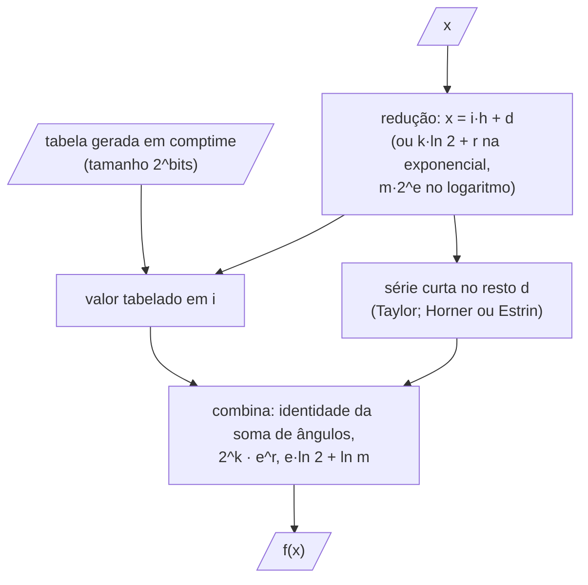
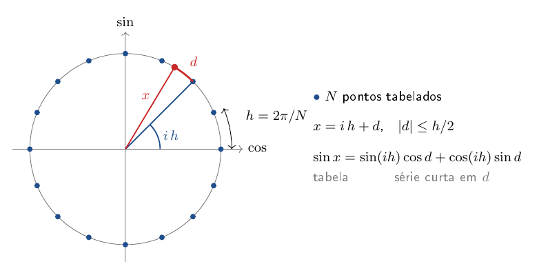

# core/src/math — funções matemáticas, vetores e polinômios

Esta é a base de todas as contas do núcleo. A simulação chama seno, cosseno, exponencial e logaritmo milhões de vezes
por missão, então aqui ficam versões rápidas dessas funções, os vetores 3D que cabem nos registradores do processador
e o polinômio de tração, que o compilador monta antes de o programa rodar.

O README começa pelas funções trigonométricas por tabela, segue para o arco tangente, a exponencial e o logaritmo, e
mostra a alternativa sem tabela para o seno. Depois vêm o polinômio de tração, os vetores e as rotações e, por último, os autovalores de uma matriz simétrica.

| arquivo | o que tem |
|---|---|
| `fmath.zig` | `sin`, `cos`, `atan2`, `exp`, `log`, `pow`, `tanh`... por tabela e polinômio (`lut`) ou pela std (`ref`) |
| `vec.zig` | vetores 3D em registradores SIMD (`@Vector`), matrizes 3×3 por linhas, a matriz corpo → NED |
| `linalg.zig` | álgebra linear de tamanho fixo: LU com pivoteamento parcial, Cholesky, as soluções de A x = b e os autovalores de uma matriz simétrica (Jacobi), para o aeroopt |
| `poly.zig` | polinômio em duas variáveis de grau N gerado em comptime (`Poly2`), na ordem do MATLAB |
| `fmath_test.zig` | erro de cada função contra a std em muitos pontos |

As funções públicas usam `lut` ou `ref` conforme `-Dfast_math` (padrão: `lut`). As otimizações em avaliação
(`-Dopt`) trocam partes daqui; os nomes e os bits estão no enum `Opt` de [`../opt.zig`](../opt.zig), e o código pergunta
por nome, `optOn(.minimax)`. O que cada uma faz e o que se mediu está em [`core/OTIMIZACOES.md`](../../OTIMIZACOES.md).

## Como uma função por tabela é avaliada

Todas as funções por tabela seguem o mesmo caminho: reduzir o argumento a um ponto da tabela mais um resto pequeno e
corrigir o resto por uma série curta.



## Seno e cosseno por tabela (`SinLut`)

Uma tabela de $`N = 2^{bits}`$ valores de $`\sin`$ numa volta é gerada pelo compilador. O argumento é escrito como o ponto
da tabela mais um resto pequeno, $`x = i\,h + d`$ com $`h = 2\pi/N`$ e $`|d| \le h/2`$, e a identidade da soma de ângulos
corrige o resto:

```math
\sin x = \sin(ih)\cos d + \cos(ih)\sin d
\qquad
\cos x = \cos(ih)\cos d - \sin(ih)\sin d
```

O $`\cos(ih)`$ é a mesma tabela deslocada de um quarto de volta. $`\sin d`$ e $`\cos d`$ vêm da série de Taylor, curta porque
$`d`$ é pequeno:

```math
\cos d \approx 1 - \frac{d^2}{2} + \frac{d^4}{24} - \frac{d^6}{720}
\qquad
\sin d \approx d\left(1 - \frac{d^2}{6} + \frac{d^4}{120}\right)
```



A tabela padrão é pequena o bastante para ficar no cache L1; aumentá-la não muda o tempo.

## Arco tangente

Tabela de $`\arctan`$ em $`[0, 1]`$ e correção de 2ª ordem pela série de Taylor em torno do ponto $`a`$ da tabela, com
$`g = 1/(1 + a^2)`$:

```math
\arctan(a + d) \approx \arctan a + d\,g - a\,d^2 g^2
```

Fora de $`[0, 1]`$, $`\arctan x = \pi/2 - \arctan(1/x)`$; o `atan2` acerta o quadrante pelos sinais.

## Exponencial

Redução de argumento por potência de 2: $`k`$ é o inteiro mais próximo de $`x/\ln 2`$ e o resto fica pequeno. O
$`2^k`$ é montado direto nos bits do expoente do `f64`:

```math
e^x = 2^k\,e^r \qquad r = x - k\ln 2 \qquad |r| \le \frac{\ln 2}{2}
\qquad
e^r \approx \sum_{n=0}^{10}\frac{r^n}{n!}
```

O polinômio é avaliado por Horner (Knuth, *The Art of Computer Programming*, v. 2, 3ª ed., §4.6.4), que faz uma
multiplicação-soma por coeficiente, cada uma esperando a anterior:

```math
p(r) = c_0 + r\,(c_1 + r\,(c_2 + \dots + r\,c_{10}))
```

Com `-Dopt=estrin`, o mesmo polinômio é avaliado por Estrin (Knuth, mesma seção): os termos são agrupados em pares
$`(c_{2i} + c_{2i+1}\,r)`$ e os pares somados com $`r^2, r^4, r^8`$. As contas são as mesmas em número, mas a cadeia de
dependência fica mais curta.

## Logaritmo

O `f64` já guarda $`x = m\,2^e`$; com a mantissa levada a $`[\sqrt2/2, \sqrt2]`$, o logaritmo da mantissa vem da série do
$`\operatorname{atanh}`$, que converge rápido porque $`s`$ é pequeno:

```math
\ln x = e\,\ln 2 + \ln m
\qquad
\ln m = 2\operatorname{atanh} s = 2\left(s + \frac{s^3}{3} + \frac{s^5}{5} + \dots + \frac{s^{13}}{13}\right)
\qquad
s = \frac{m - 1}{m + 1}
```

A potência é $`x^y = e^{y\ln x}`$, e a tangente hiperbólica é $`\tanh x = (e^{2x} - 1)/(e^{2x} + 1)`$, com a série
$`x - x^3/3`$ perto de zero.

## Seno e cosseno sem tabela (`-Dopt=minimax`)

O argumento é reduzido ao quadrante, $`x = k\,\pi/2 + r`$ com $`|r| \le \pi/4`$ ($`\pi/2`$ em duas partes, como em Cody e
Waite, para não perder dígitos em $`r`$), e $`\sin r`$, $`\cos r`$ vêm de polinômios minimax (ímpar de grau 15 e par de grau
16; coeficientes de L. Schlör, *Fast MiniMax Polynomial Approximations of Sine and Cosine*, gist
publik-void/067f7f2fef32dbe5c27d6e215f824c91). O quadrante $`k \bmod 4`$ troca seno com cosseno e o sinal:

```math
(\sin x, \cos x) = (s, c),\ (c, -s),\ (-s, -c),\ (-c, s) \quad\text{para } k \bmod 4 = 0, 1, 2, 3
```

## Polinômio de tração (`poly.zig`)

$`P(x, y)`$ de grau $`N`$ nas duas variáveis, com os coeficientes na ordem dos ajustes `poly55` do MATLAB
($`p_{00}, p_{10}, p_{01}, p_{20}, p_{11}, p_{02}, \dots`$):

```math
P(x, y) = \sum_{i + j \le N} p_{ij}\,x^i\,y^j
```

A tabela de expoentes e o laço de avaliação são resolvidos pelo compilador: em execução sobra uma sequência de
multiplicações-somas com as potências calculadas uma vez. A derivada em $`x`$ (a inclinação $`dT/dV`$, por exemplo) é
gerada do mesmo jeito.

## Vetores e rotações (`vec.zig`)

`V3` é um `@Vector(3, f64)`, então somas e produtos por escalar viram instruções SIMD. A
matriz corpo → NED vem dos ângulos de Euler na sequência 3-2-1 ($`\psi`$, $`\theta`$, $`\phi`$; Etkin e Reid, *Dynamics of
Flight*, cap. 4, a conferir no PDF):

```math
R = \begin{pmatrix}
c_\theta c_\psi & s_\phi s_\theta c_\psi - c_\phi s_\psi & c_\phi s_\theta c_\psi + s_\phi s_\psi \\
c_\theta s_\psi & s_\phi s_\theta s_\psi + c_\phi c_\psi & c_\phi s_\theta s_\psi - s_\phi c_\psi \\
-s_\theta & s_\phi c_\theta & c_\phi c_\theta
\end{pmatrix}
```

com $`c_\theta = \cos\theta`$, $`s_\theta = \sin\theta`$ etc. O sistema 3×3 $`A\,x = b`$ é resolvido pela inversa escrita com
produtos vetoriais das linhas $`a_1, a_2, a_3`$ de $`A`$:

```math
x = \frac{(a_2\times a_3)\,b_1 + (a_3\times a_1)\,b_2 + (a_1\times a_2)\,b_3}{a_1\cdot(a_2\times a_3)}
```

## Autovalores de uma matriz simétrica (`linalg.symEigen`)

Aqui se decompõe uma matriz simétrica $A$ de até $N \times N$ nos autovalores $w$ e nos autovetores $V$, com
$A = V \operatorname{diag}(w)\, V^\top$. Quem usa isso é o CMA-ES do aeroopt (`../optim/cmaes.zig`). A cada
geração ele precisa dos eixos e dos comprimentos da elipse de sorteio, que são os autovetores e os autovalores da
matriz de covariância.

O método é o de Jacobi cíclico (Golub e Van Loan, *Matrix Computations*, 4ª ed., 2013, seção 8.5, algoritmo 8.5.1; a
conferir no PDF). Ele foi escolhido porque a matriz é pequena (até 32 × 32), sempre simétrica, e o código cabe em
poucas linhas sem alocar nada. Os métodos mais rápidos para matrizes grandes (tridiagonalizar e depois QR) só
compensam bem acima desse tamanho. O Jacobi também devolve autovetores ortogonais com precisão de máquina, mesmo com
autovalores quase iguais, e isso é o que mantém a elipse do CMA-ES bem formada.

A ideia é zerar os termos fora da diagonal um par de cada vez. Para cada par $(p, q)$, uma rotação de Givens $J$ no
plano $p, q$ escolhida para zerar $A_{pq}$ troca $A$ por $J^\top A J$. Essa troca não muda os autovalores. O ângulo
sai de

$$\tau = \frac{A_{qq} - A_{pp}}{2 A_{pq}}, \qquad t = \frac{\operatorname{sinal}(\tau)}{\lvert\tau\rvert + \sqrt{1 + \tau^2}}, \qquad c = \frac{1}{\sqrt{1 + t^2}}, \qquad s = t\, c,$$

onde $t$ é a tangente do ângulo, e a raiz menor de $t^2 + 2\tau t - 1 = 0$ é a que se escolhe, porque com ela a
rotação é a menor possível (abaixo de 45°) e o arredondamento não cresce. Zerar um par desfaz um pouco os pares já
zerados, mas a soma dos quadrados fora da diagonal sempre cai. Por isso se varre todos os pares várias vezes (as
varreduras), e cada uma deixa essa soma bem menor que a anterior. A busca para quando a soma fica abaixo de
$10^{-30}$ vezes a soma de todos os quadrados de $A$, ou depois de 64 varreduras. As mesmas rotações, acumuladas em
$V$ (que começa na identidade), dão os autovetores nas colunas. Os autovalores são a diagonal que sobra.

O teste monta uma matriz 4 × 4 simétrica e confere que $V$ é ortogonal ($V^\top V = I$), que $V
\operatorname{diag}(w)\, V^\top$ devolve a matriz original e que a soma dos autovalores é o traço.

## Como chamar

```zig
const fm = @import("math/fmath.zig");
const sc = fm.sincos(0.3);          // seno e cosseno de uma vez (sc.s, sc.c)
const a = fm.atan2(1.0, 2.0);
const vec = @import("math/vec.zig");
const v = vec.V3{ 1, 0, 0 };
const w = vec.cross(v, vec.V3{ 0, 1, 0 });   // (0, 0, 1)
```

Pelo Python, só as medições: `python -m pytest -m bench -s tests/core/test_lut.py`.

Testes: `python -m ziglang build test-math` (dentro de `core/`).
