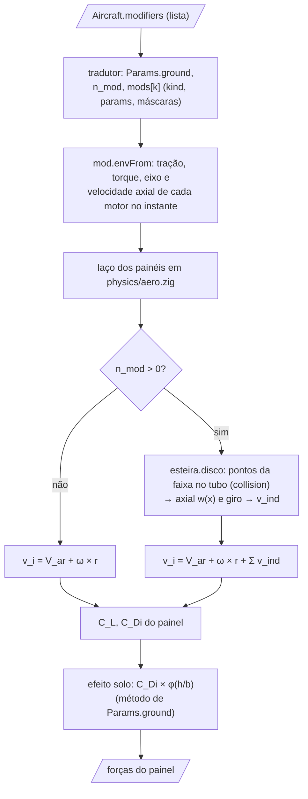
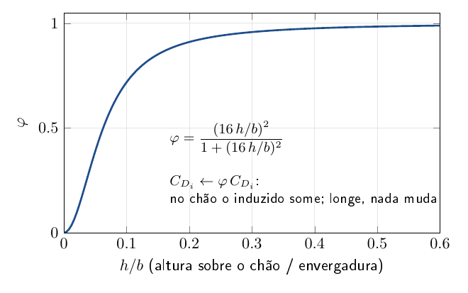
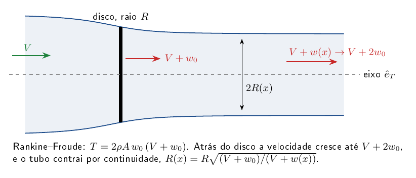

# core/src/modifiers — modificadores

Os modificadores são métodos da literatura que mudam a aerodinâmica do avião inteiro e que se ligam ou desligam por
avião, sem mexer no resto do núcleo. Hoje são dois. O primeiro é o efeito solo: perto do chão, a asa produz menos
arrasto induzido, e isso muda a decolagem e o pouso. O segundo é a esteira da hélice: o ar que a hélice joga para trás
passa mais rápido e girando sobre a asa e a cauda, o que muda a sustentação e o momento dessas superfícies com o
motor ligado. Depois podem vir tabelas de correção (VSPAERO, CFD, túnel).

O avião descreve os modificadores numa lista (`Aircraft.modifiers`, em `aerosim/model/modifiers.py`), que a GUI
edita na Montagem. O tradutor (`aerosim/backend/zig/translator.py`) leva essa lista para os campos `ground`, `n_mod` e
`mods` de `Params`, e quem calcula é este módulo, com um `switch` por tipo conhecido, código estático e sem alocação.
Toda fórmula tem a fonte no comentário do código e na seção de equações abaixo.

O README apresenta primeiro os arquivos e como os números da ABI viram nomes dentro do núcleo. Depois explica as duas
categorias de modificador, o que garante que nada muda sem pedir e, no meio, as equações de cada método. No fim vêm o
exemplo e como acrescentar um modificador novo.

```
aerosim/model/modifiers.py   Modifier(kind, enabled, name, params, targets, props)    ← GUI (Montagem) só edita
        │  backend/zig/translator.py: modifiers.native(...)
        ▼
Params.ground   (método do efeito solo: um por vez)
Params.n_mod / Params.mods[max_mods]   (efeitos a mais: vazios por padrão)
        │
        ▼
physics/aero.zig, em cada painel i (centro r):
    v_i  = V_ar + ω × r  [+ Σ modifiers.induced(p, env, i, r)   só se n_mod > 0]
    C_Di ← modifiers.ground.factor(p.ground, h_i, b) · C_Di      (painéis não verticais)
```

## Os modificadores numa avaliação

Dentro de uma avaliação de forças, os modificadores entram em dois pontos do laço dos painéis:



## Arquivos

| arquivo | o que tem |
|---|---|
| `types.zig` | `Modifier` (extern struct: `kind`, `enabled`, `surf_mask[2]`, `prop_mask`, `params[16]`) e os enums que dão nome aos números: `Ground` (método do efeito solo), `Kind` (tipo do efeito a mais) e `SlipstreamParam` (o que cada `params[k]` da esteira quer dizer) |
| `ground.zig` | métodos do efeito solo (`factor`, `mccormick`) |
| `slipstream.zig` | esteira por disco atuador (`diskInduced`, `axialAt`, `radiusAt`, `swirlRate`, `at`); `shape`/`TubeShape.tube` montam o tubo que contrai para `collision/` |
| `mod.zig` | entrada do módulo: `Env` (tração, torque, eixo e velocidade axial de cada motor no instante; `envFrom`), `induced` (soma dos efeitos a mais por painel, como média de uma grade `chord_samples × strip_samples` de pontos da faixa; quem está dentro do tubo é dito por `collision/`), `hits` / `hitsProp` (máscaras) |
| `README.md` | este arquivo |

## Números na ABI, nomes no núcleo

O Python escreve números (`Params.ground`, `Modifier.kind`, `params[k]`), porque a ABI só leva tipos C. Dentro do núcleo
cada número vira um enum, e o código decide por nome:

```zig
switch (m.kindOf()) {                        // Modifier.kind → Kind
    .slipstream_disk => slipstreamStrip(p, env, m, s),
    .none, _ => vec.zero,                    // vazio ou de outra versão: nada
}
const ax = m.slip(.axial_on) != 0;           // params[0], pelo nome
```

Número desconhecido (um arquivo de uma versão mais nova) cai no `_` do enum e é ignorado. Um tipo novo é um campo novo
no fim do enum, com o próximo número, e o mesmo número em `aerosim/model/modifiers.py` (`KINDS[...].core_id`).

As máscaras `surf_mask` e `prop_mask` são outra coisa: o bit $`i`$ é o painel (ou o motor) $`i`$, e zero quer dizer todos.

## Dois jeitos de entrar

| categoria | onde | padrão | exemplo |
|---|---|---|---|
| **solo**: método de um efeito que sempre existe; um por vez | `Params.ground` (número de `Ground`) | `Ground.mccormick` (o que o núcleo sempre fez) | `solo.mccormick`; sem nenhum na lista = desligado |
| **aditivo**: efeito a mais, somado em cada painel | `Params.mods[0..n_mod]` (`kind` = número de `Kind`) | nenhum (`n_mod = 0`: o laço nem roda) | `esteira.disco`, `tabela` (próxima etapa) |

## Compatibilidade (nada muda sem pedir)

Um `.json` antigo, sem a chave `modifiers`, abre com `default_modifiers()`, que é `[solo.mccormick]`: o mesmo
comportamento de antes. Os exemplos de `data/aircraft` foram conferidos bit a bit antes e depois (coeficientes em
α × β × V, resumo e registro completo da decolagem), e os testes de `tests/model/test_modifiers.py` garantem que todos
continuam abrindo com o padrão. O `.cfg` e a planilha não têm onde guardar modificadores, então abrem com o padrão;
ao gravar nesses formatos com uma lista fora do padrão, a GUI avisa o que fica de fora (`modifiers.not_exported`). O
AeroDrive monta os `Params` com os padrões do Zig (`ground = Ground.mccormick`, `n_mod = 0`) e o leitor de JSON dele
ignora a chave `modifiers`, então ele não muda. Um tipo desconhecido, vindo de um arquivo de uma versão mais nova,
fica guardado no `.json`, mas é ignorado com um aviso (`modifiers.problems`).

## Métodos e equações

### `solo.mccormick` (padrão)

Perto do chão, o arrasto induzido de cada painel horizontal é multiplicado por um fator que vai de 0 (no chão) a 1
(longe dele). Com $`h`$ a altura do painel acima do chão no passo ($`h - z_{painel}`$) e $`b`$ a envergadura de referência
(B. W. McCormick, *Aerodynamics, Aeronautics, and Flight Mechanics*, Wiley; a mesma expressão em J. D. Anderson,
*Aircraft Performance and Design*, McGraw-Hill, que cita o McCormick; número da equação e página a conferir no PDF):

```math
\varphi = \frac{(16\,h/b)^2}{1 + (16\,h/b)^2}
\qquad
C_{D_i} \leftarrow \varphi\,C_{D_i}
```

Altura menor que 1 cm é tratada como 1 cm (o painel não atravessa o chão). Testes: `ground.zig` (o valor da fórmula em
$`h/b = 0{,}1`$ e os limites 0 e 1); `tests/model/test_modifiers.py` (desligar muda a decolagem).



### `esteira.disco` (aditivo, desligado por padrão)

Por motor, com a tração $`T`$ e o torque $`Q`$ do instante, carga uniforme num disco de raio $`R`$ e área $`A = \pi R^2`$, e
$`V`$ a velocidade axial através do disco.

**1. Velocidade induzida no disco**, pela teoria do momento de Rankine–Froude (McCormick, *Aerodynamics, Aeronautics,
and Flight Mechanics*; Glauert, "Airplane Propellers", em Durand, *Aerodynamic Theory* IV, 1935):

```math
T = 2\,\rho\,A\,w_0\,(V + w_0)
\quad\Rightarrow\quad
w_0 = -\frac{V}{2} + \sqrt{\frac{V^2}{4} + \frac{T}{2\rho A}}
```

**2. Desenvolvimento ao longo do eixo.** O disco com carga uniforme é um cilindro de vórtices semi-infinito; com $`x`$
medido a partir do disco, positivo para trás (McCormick, *Aerodynamics of V/STOL Flight*; Veldhuis, ICAS 2004 e tese TU
Delft 2005):

```math
w(x) = w_0\left(1 + \frac{x}{\sqrt{x^2 + R^2}}\right)
\qquad
w(0) = w_0,\quad w(\infty) = 2\,w_0,\quad w(-\infty) = 0
```

**3. Contração do tubo**, por continuidade:

```math
(V + w(x))\,R(x)^2 = (V + w_0)\,R^2
```

**4. Giro.** O fluxo de momento angular que atravessa o disco é o torque (balanço de Glauert). Com rotação de corpo
rígido $`v_t = \Omega\,r`$ (hipótese desta implementação) e conservando o momento angular no tubo que contrai:

```math
Q = \int_A \rho\,(V + w_0)\,v_t\,r\,dA
\quad\Rightarrow\quad
\Omega_0 = \frac{2\,Q}{\pi\,\rho\,(V + w_0)\,R^4}
\qquad
\Omega(x) = \Omega_0\left(\frac{R}{R(x)}\right)^2
```

O giro tem o sentido da rotação da hélice (só atrás do disco).

**5. No painel.** A velocidade que o painel vê soma a axial ao longo do eixo de tração $`\hat e_T`$ e tira o giro, com os
ganhos de calibração (`SlipstreamParam.axial_gain`, `swirl_gain`; 1 é a teoria), em média nos pontos da faixa dentro do
tubo (`collision/`). N motores somam por superposição:

```math
\Delta\vec v = k_{ax}\,w\,\hat e_T - k_{giro}\,\vec v_{giro}
```

Equações e páginas a conferir nos PDFs. Testes: `slipstream.zig` (a teoria do momento; o caso estático; $`w(0) = w_0`$ e
$`w(\infty) = 2w_0`$; a contração; a integral do momento angular igual a $`Q`$; fora do tubo nada; o sentido inverte o giro)
e `tests/model/test_slipstream.py` (tração zero é idêntico bit a bit; o giro sozinho espelha $`C_l`$ ao inverter o sentido;
bimotor simétrico com sentidos opostos dá $`C_l = C_n = C_Y = 0`$; superposição; máscara de motores; a sonda bate com a
teoria do momento).



### `interferencia.asas` (aditivo, desligado por padrão)

As faixas tratam cada painel sozinho. Num tandem, isso quer dizer que a asa de trás não sente o downwash da da frente;
num biplano, que as duas asas não se induzem. A linha sustentadora do núcleo (`loads/llt.zig`) resolve as circulações
de todos os painéis juntas e já tem esse efeito. Este modificador traz para as faixas só a parte entre as duas asas
ligadas (as duas primeiras do grupo da asa principal), numa passada, sem montar o sistema.

**1. Circulação de cada painel.** Pela relação de Kutta–Joukowski, a sustentação por unidade de envergadura é
$`\rho V \Gamma`$, e a da faixa é $`\tfrac12 \rho V^2 c\,\eta\,c_l`$. Igualando as duas (o mesmo passo da linha
sustentadora em `llt.zig`):

```math
\Gamma_j = \tfrac12\,V_j\,c_j\,\eta_j\,C_{L,j}
```

com o $`\alpha`$ do painel calculado sem esta interferência (os outros modificadores, o downwash empírico e os comandos
entram).

**2. Velocidade induzida pela outra asa.** Cada painel $`j`$ é uma ferradura: o segmento ligado no quarto da corda e as
duas pernas retas na direção do vento relativo. No ponto de controle $`i`$ de uma asa somam-se só as ferraduras da outra:

```math
\vec w_i = \sum_{j \,\in\, \text{outra asa}} \Gamma_j\,\vec w_{ij}
```

$`\vec w_{ij}`$ é a velocidade de uma ferradura de circulação unitária, pela lei de Biot–Savart de segmento reto (Katz e
Plotkin, *Low-Speed Aerodynamics*, 2ª ed., cap. 10; número da equação a conferir no PDF), com o núcleo de vórtice
entre superfícies de `llt.core_frac`.

**3. No painel.** O painel vê $`\vec v = \vec V_{ar} + \vec\omega\times\vec r - k\,\vec w_i`$, com $`k`$ o ganho
(`PairParam.gain`; 1 é a teoria). Daí sai outro $`\alpha`$ e a força girada; o arrasto induzido da interferência vem
da inclinação da sustentação, como na linha sustentadora.

A própria asa fica de fora, porque a faixa já tem o seu $`C_{D_i} = C_L^2/(\pi e A\!R)`$. Com o voo pela linha
sustentadora (`aero_model` ≠ 0) o modificador não faz nada, e a comparação com a linha sustentadora em `llt.compute`
o desliga (`Env.no_pair`) para não contar o efeito duas vezes.

Números de referência (avião de teste em tandem, C_Lα por radiano e ponto neutro em % da CMA de referência):

| modelo | C_Lα | ponto neutro |
|---|---|---|
| faixas, sem o modificador | 4,47 | +28 % |
| faixas, com o modificador | 3,48 | −21 % |
| linha sustentadora (Goates e Hunsaker) | 3,44 | −23 % |

Testes: `wingpair.zig` (as máscaras de cada asa do par).

### Limites conhecidos do `solo.mccormick`

São as razões para ter outros métodos depois:

- só reduz o arrasto induzido: não aumenta $`C_{L\alpha}`$ e não muda o downwash na cauda perto do chão;
- a altura do painel usa o z dele no corpo, sem girar pela arfagem e pelo rolamento;
- usa o `b` de referência até para a EH.

### Limites conhecidos do `esteira.disco`

- velocidade axial do eixo aplicada igual em toda a seção do tubo (perfil "chapéu"; Conway 1995 dá a carga
  não uniforme);
- o tubo segue o eixo do motor: não é desviado pelo α nem pela asa;
- sem interação hélice → hélice (tandem: a de trás não vê a esteira da da frente no J dela) e asa → hélice
  (upwash, força normal na hélice);
- só onde há tração do instante: na simulação (decolagem, missão) sim; trimagem, linearização e envelope
  ainda chamam a aerodinâmica sem motores (`Env.none`), então não veem a esteira;
- esteiras que se cruzam somam (a superposição deixa de ser exata);
- a parte da faixa fora do tubo (acima ou abaixo da linha de tração, ou fora da envergadura do tubo) não recebe nada: a
  faixa é amostrada numa grade e só os pontos dentro do tubo (`collision.Tube.contains`) somam.

### Limites conhecidos do `interferencia.asas`

- uma passada: a asa da frente do tandem não recebe de volta o efeito da de trás pelo próprio $`\alpha`$; no biplano,
  onde a influência é mútua, a passada é só a primeira iteração do sistema da linha sustentadora;
- só as duas primeiras asas do grupo (um triplano usa as duas primeiras);
- as pernas da ferradura são retas na direção do vento relativo: a esteira não enrola nem desce com o downwash;
- no biplano as faixas sem o modificador já ficam abaixo do VLM e da linha sustentadora no $`C_{L\alpha}`$; com ele, o
  valor cai entre os dois, mas a diferença entre os métodos ainda é grande (a conferir com dados de túnel).

### Próximos tipos (planejados; só entram com a fonte conferida)

| tipo | ideia | fontes a conferir |
|---|---|---|
| `solo.imagem` (categoria solo) | método da imagem: sistema de vórtices espelhado abaixo do chão; mexe em $`C_L`$, $`C_{Di}`$ e no downwash da cauda, e usa a altura de cada painel com a atitude | Katz e Plotkin, *Low-Speed Aerodynamics*; Phillips e Hunsaker, *Lift and Drag of Wings in Ground Effect* (J. Aircraft, 2013) |
| `esteira.conway` (aditivo) | o mesmo com carga não uniforme no disco | Conway (J. Fluid Mech., 1995) |
| `tabela` (aditivo) | correção por painel (Δα, fator de pressão dinâmica, ΔC_L) em função de α, β, J e comandos, gerada fora da simulação (VSPAERO, CFD, túnel); o núcleo só interpola | a fonte é a de quem gerou a tabela (fica guardada no modificador) |

## Como testar sem GUI

```
python tools/probe.py solo --b 2.2 --h 0.02:1.0:0.02                  # CSV na tela
python tools/probe.py solo --b 2.2 --h 0.02:1.0:0.02 --png solo.png   # e o gráfico
python tools/modcheck.py data/aircraft/Convencional_original.json --sem-solo
python tools/probe.py esteira --T 30 --Q 1.2 --D 0.38 --V 10 --x=-0.3:1.5:0.02 --png esteira.png   # ao longo do eixo
python tools/probe.py esteira --T 30 --Q 1.2 --D 0.38 --V 10 --x 0.5 --r 0:0.25:0.005               # corte radial
python tools/modcheck.py data/aircraft/Convencional_original.json --com esteira.disco
```

- O `probe` chama as funções de sonda do núcleo, sem simulação (`aerosim_probe_ground` e
  `aerosim_probe_slipstream` em `root.zig`; `ZigBackend.probe_ground`/`probe_slipstream` no Python). Nenhuma
  conta é feita em Python.
- `aerosim_aero_coeffs_thrust` (sessão: `aero_coeffs_thrust(V, α, β, T[], Q[])`) dá os coeficientes do avião com a
  tração e o torque de cada motor, para estudar a esteira sem simular.
- `aerosim_panel_states` (sessão: `panel_states(V, α, β, T[], Q[])`) dá o estado de cada faixa (`PanelState`: centro,
  área, corda, grupo, α e velocidade locais, $`C_L`$, $`C_D`$, sustentação e arrasto em N), saído de `aero.computeTrace`, o
  mesmo laço da simulação. Com ele, `tools/span_load.py` desenha a carga ao longo da envergadura (y em metros) da
  asa e da EH com e sem um modificador:

```
python tools/span_load.py data/aircraft/Bimotor_convencional_tubo_cauda_em_V.json --com esteira.disco --png carga.png
```
- O `modcheck` roda a decolagem com os modificadores do avião, sem cada um e, com `--sem-solo`, sem efeito
  solo, e mostra a diferença.

Pelo Python, sem a linha de comando:

```python
from aerosim.backend.zig import ZigBackend
from aerosim.model.modifiers import Modifier, describe
from aerosim.model.templates import conventional

ac = conventional()
print(describe(ac))                                  # ["efeito solo: McCormick (padrão)"]
ac.modifiers.append(Modifier(kind="esteira.disco"))  # liga a esteira da hélice
phi = ZigBackend().probe_ground(1, [0.1, 0.5, 2.0], 2.2)   # φ de McCormick (Ground.mccormick = 1) em três alturas
print(describe(ac), phi)
```

Testes do módulo: `zig build test-physics` (inclui `modifiers/`), `pytest tests/model/test_modifiers.py`.

## Como adicionar um modificador

1. **Fonte primeiro:** obra, equação, página. Sem isso não entra.
2. Em `types.zig`: um campo novo em `Kind` (aditivo) ou em `Ground` (solo), com o próximo número, e um enum com o que
   cada `params[k]` quer dizer (como `SlipstreamParam`).
3. Em `mod.zig` (aditivo, um caso no `switch` de `induced`) ou em `ground.zig` (solo, um caso em `factor`):
   a fórmula, com a referência no comentário. Teste Zig que reproduz um número publicado.
4. Uma sonda em `root.zig` (`aerosim_probe_*`) e o subcomando em `tools/probe.py`.
5. Em `aerosim/model/modifiers.py`: a entrada em `KINDS` (título, categoria, `core_id`, referência,
   parâmetros com unidade).
6. Testes de invariância (desligado = sem efeito; sentido invertido espelha; simetria; superposição).
7. Uma linha na tabela "Métodos e referências" acima.

## Outras mudanças no núcleo que vieram junto

- **Propulsão antes da aerodinâmica** (`sim/dynamics.zig`): a tração e o torque do instante vão para os
  modificadores em `Env`. As duas contas são independentes, então o resultado não muda (conferido bit a
  bit).
- **`aero.computeEnv`:** `aero.compute` com o `Env`. O `compute` antigo continua e chama este com
  `Env.none`; trimagem, linearização, envelope e coeficientes seguem por ele.
- **ABI:**
  - `Modifier` entra no esquema e `limit mods` no cabeçalho;
  - o hash FNV-1a do esquema (`aerosim_schema_hash`) já confere que o Python e a biblioteca falam do
    mesmo layout;
  - biblioteca de uma versão anterior recompila sozinha.
- **`lib.zig`** exporta `modifiers` para programas Zig (AeroDrive) que quiserem usar.
