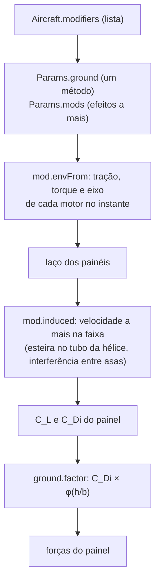

# core/src/modifiers — modificadores

Os modificadores são métodos da literatura que mudam a aerodinâmica do avião e que se ligam ou desligam por avião, sem
mexer no resto do núcleo. Eles respondem a duas perguntas. A primeira é qual método calcula um efeito que sempre
existe, um por vez: o efeito solo, que perto do chão tira arrasto induzido e muda a decolagem e o pouso (McCormick, o
padrão). A segunda é quais efeitos a mais estão ligados, somados: a esteira da hélice (o ar que a hélice joga para trás
passa mais rápido e girando sobre a asa e a cauda, pelo disco atuador), a interferência entre as asas de um biplano ou
tandem e o momento próprio dos comandos. Os efeitos a mais vêm desligados, e com eles desligados a simulação e o
AeroDrive ficam bit a bit iguais.

O avião descreve os modificadores numa lista (`Aircraft.modifiers`), que a tela edita na Montagem e que vai para
`Params`, e o laço dos painéis consulta os modificadores em dois pontos: na velocidade de cada faixa e no
arrasto induzido.



O fator de efeito solo de McCormick multiplica o arrasto induzido de cada painel pela altura relativa à envergadura
(McCormick, *Aerodynamics, Aeronautics and Flight Mechanics*, 1995):

```math
\varphi = \frac{(16\,h/b)^2}{1 + (16\,h/b)^2}
```

O fator do solo em três alturas, para uma envergadura de 2,2 m, e a esteira ligada no avião dos testes, com a hélice
puxando (`exemplo.zig`, `python -m ziglang build exemplo -Dexemplo=modifiers`):

```zig
const std = @import("std");
const core = @import("aerosim");

var instance: core.runner.Instance = .{};

/// o C_L do avião a 10 m/s e α = 4°, com a hélice dando 25 N e 0,4 N·m
fn liftWithThrust() f64 {
    const thrusts = [_]f64{25.0};
    const torques = [_]f64{0.4};
    const coefficients = core.aero.coeffsEnv(&instance.p, 10.0, 4.0 * std.math.rad_per_deg, 0, .{ 0, 0, 0 }, .{ 0, 0, 0 }, .{ 0, 0, 0 }, .{ &thrusts, &torques });
    return coefficients.CL;
}

pub fn main() !void {
    core.test_aircraft(&instance.p);
    std.debug.print("efeito solo: {s}; φ a 0,1, 0,5 e 2 m (b = 2,2 m):", .{@tagName(instance.p.ground)});
    for ([_]f64{ 0.1, 0.5, 2.0 }) |height| std.debug.print(" {d:.3}", .{core.modifiers.ground.mccormick(height, 2.2)});
    std.debug.print("\n", .{});

    try core.runner.configure(&instance);
    const without = liftWithThrust();
    instance.p.n_mod = 1;
    instance.p.mods[0] = .{ .kind = .slipstream_disk }; // liga a esteira da hélice
    instance.p.mods[0].params[0] = 1; // ganho da velocidade axial (1 = a teoria; `SlipstreamSettings`)
    instance.p.mods[0].params[1] = 1; // ganho do giro
    try core.runner.configure(&instance);
    std.debug.print("C_L com a hélice puxando: sem a esteira {d:.3}, com a esteira {d:.3}\n", .{ without, liftWithThrust() });
}
```

```
efeito solo: mccormick; φ a 0,1, 0,5 e 2 m (b = 2,2 m): 0.346 0.930 0.995
C_L com a hélice puxando: sem a esteira 0.729, com a esteira 0.773
```

A 10 cm do chão o arrasto induzido cai para um terço, e a 2 m o efeito já some. Com a esteira, as faixas dentro do tubo da
hélice veem o ar mais rápido, e o $`C_L`$ sobe 6 %. Um modificador novo só entra com a fonte (obra, equação, página), um caso no `switch` de
`mod.induced` ou de `ground.factor`, a entrada na lista de modificadores da Montagem e um teste que reproduz um número
publicado.

O efeito solo encurta a corrida de decolagem, e a esteira muda a sustentação e a eficácia da cauda atrás da hélice. O
fator de McCormick ao longo da altura:


