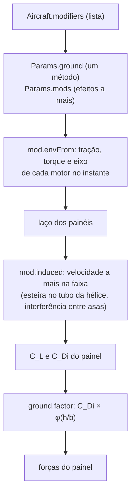
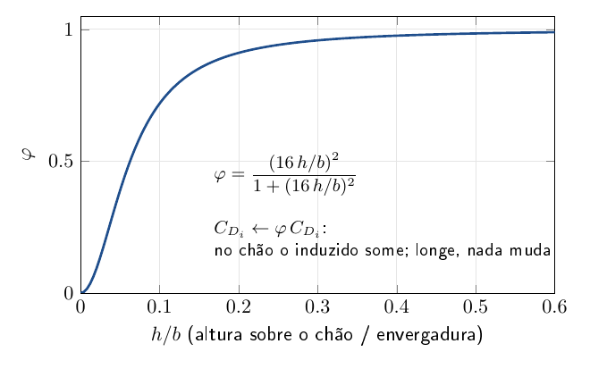

# core/src/modifiers — modificadores

Os modificadores são métodos da literatura que mudam a aerodinâmica do avião e que se ligam ou desligam por avião, sem
mexer no resto do núcleo. Eles respondem a duas perguntas. A primeira é qual método calcula um efeito que sempre
existe, um por vez: o efeito solo, que perto do chão tira arrasto induzido e muda a decolagem e o pouso (McCormick, o
padrão). A segunda é quais efeitos a mais estão ligados, somados: a esteira da hélice (o ar que a hélice joga para trás
passa mais rápido e girando sobre a asa e a cauda, pelo disco atuador), a interferência entre as asas de um biplano ou
tandem e o momento próprio dos comandos. Os efeitos a mais vêm desligados, e com eles desligados a simulação e o
AeroDrive ficam bit a bit iguais.

O avião descreve os modificadores numa lista (`Aircraft.modifiers`), que a GUI edita na Montagem. O tradutor leva a
lista para `Params`, e o laço dos painéis consulta os modificadores em dois pontos: na velocidade de cada faixa e no
arrasto induzido.



O fator de efeito solo de McCormick multiplica o arrasto induzido de cada painel pela altura relativa à envergadura
(McCormick, *Aerodynamics, Aeronautics and Flight Mechanics*, 1995):

```math
\varphi = \frac{(16\,h/b)^2}{1 + (16\,h/b)^2}
```

Ligando a esteira e pedindo o fator do solo em três alturas, para uma envergadura de 2,2 m:

```python
from aerosim.backend.zig import ZigBackend
from aerosim.model.modifiers import Modifier, describe
from aerosim.model.templates import conventional

ac = conventional()
print(describe(ac))
ac.modifiers.append(Modifier(kind="esteira.disco"))           # liga a esteira da hélice
phi = ZigBackend().probe_ground(1, [0.1, 0.5, 2.0], 2.2)      # McCormick a h = 0,1, 0,5 e 2 m
print(describe(ac), [round(float(x), 3) for x in phi])
```

```
['efeito solo: McCormick (padrão)']
['efeito solo: McCormick (padrão)', 'esteira da hélice: disco atuador'] [0.346, 0.93, 0.995]
```

A 10 cm do chão o arrasto induzido cai para um terço, e a 2 m o efeito já some. Um modificador novo só entra com a fonte (obra, equação, página), um caso no `switch` de
`mod.induced` ou de `ground.factor`, a entrada em `aerosim/model/modifiers.py` e um teste que reproduz um número
publicado.

O efeito solo encurta a corrida de decolagem, e a esteira muda a sustentação e a eficácia da cauda atrás da hélice. O
fator de McCormick ao longo da altura:


