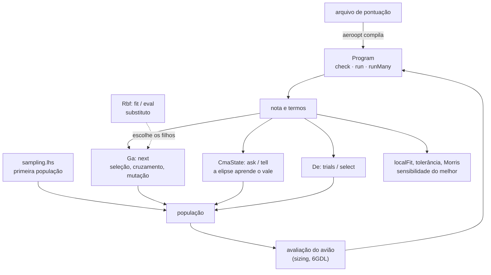

# core/src/optim — as contas do aeroopt no núcleo

Esta parte do núcleo tem o que o otimizador (`aeroopt/`) usa para buscar o melhor avião. O arquivo de pontuação de um
regulamento vira um programa curto de pilha, e daqui sai a nota e cada termo dela, para milhares de candidatos de uma
vez e sem alocar memória, para mostrar por que um avião ganhou. Aqui também estão as buscas: o genético para as
escolhas discretas (perfil, conjunto), o CMA-ES e a evolução diferencial para as contínuas (envergadura, área,
diedro). O hipercubo latino espalha a primeira população, o substituto RBF escolhe quais filhos valem uma avaliação de
verdade e a busca guiada pela falha conserta primeiro o que reprova o avião. Depois da busca, o modelo local, a
tolerância e Morris dizem quais variáveis mexem mais na nota do melhor.



O CMA-ES existe porque, no avião, as variáveis boas andam juntas: aumentar a envergadura só ajuda se a área cresce
junto, e a região boa vira um vale estreito e inclinado. O genético mexe numa variável de cada vez e cai fora do vale;
o CMA-ES sorteia de uma elipse e a gira e estica na direção em que a nota sobe (Hansen, *The CMA Evolution Strategy: A
Tutorial*, 2016). O CMA-ES achando o ótimo de um problema de teste em três variáveis (`exemplo.zig`):

```zig
const std = @import("std");
const cmaes = @import("aerosim").optim.cmaes;

pub fn main() !void {
    const dims = 3;
    var state: cmaes.CmaState = .{};
    cmaes.init(&state, dims, &.{ 0.2, 0.2, 0.2 }, 0.3, 0, 1); // média inicial, passo, λ padrão, semente
    const lambda: usize = @intCast(state.lambda);
    var points: [cmaes.max_lambda * dims]f64 = undefined;
    var scores: [cmaes.max_lambda]f64 = undefined;
    for (0..60) |_| {
        cmaes.ask(&state, points[0 .. lambda * dims]); // λ × n em [0, 1]
        for (0..lambda) |k| { // maior é melhor; o ótimo é 0,7 em cada variável
            scores[k] = 0;
            for (points[k * dims ..][0..dims]) |x| scores[k] -= (x - 0.7) * (x - 0.7);
        }
        cmaes.tell(&state, points[0 .. lambda * dims], scores[0..lambda]);
    }
    std.debug.print("média {d:.3} {d:.3} {d:.3}, passo {d:.5}\n", .{ state.mean[0], state.mean[1], state.mean[2], state.sigma });
}
```

```
média 0.700 0.700 0.700, passo 0.00052
```

O CMA-ES chega ao ótimo com o passo já pequeno. Os outros métodos seguem o mesmo jeito de pedir e devolver
(`ga.next`, `de.trials` e `de.select`, o hipercubo latino, o substituto RBF, o modelo local e Morris), e a nota de
cada candidato vem do programa do arquivo de pontuação, que o aeroopt compila (`expr.zig`). O exemplo roda com
`cd core && python -m ziglang build exemplo -Dexemplo=optim` e os testes com `python -m ziglang build test -Dgrupo=optim`.

É isso que decide quais aviões o aeroopt avalia e qual ele entrega. O CMA-ES num vale inclinado como o de envergadura
e área, com a elipse deitando no vale e encolhendo perto do ótimo:


