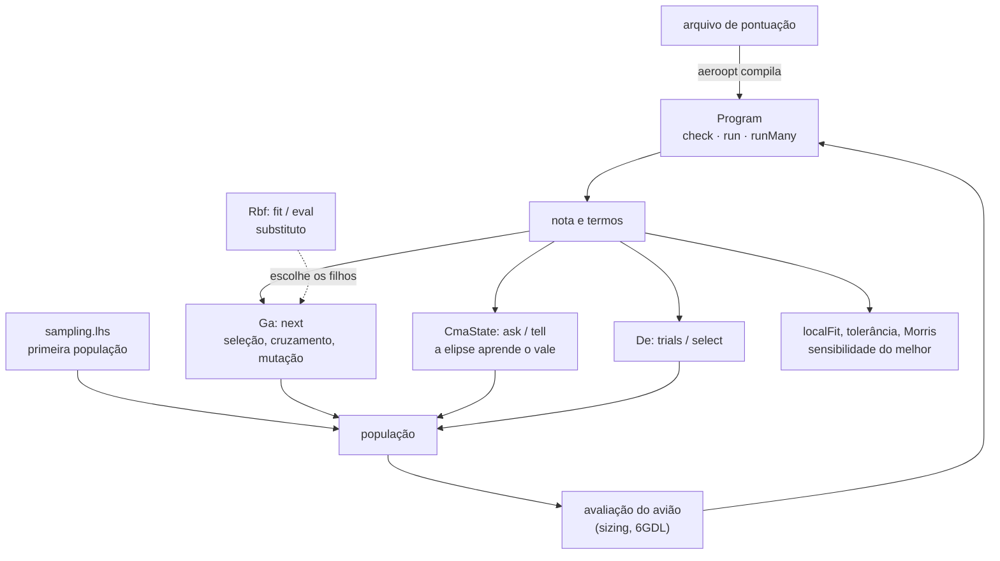
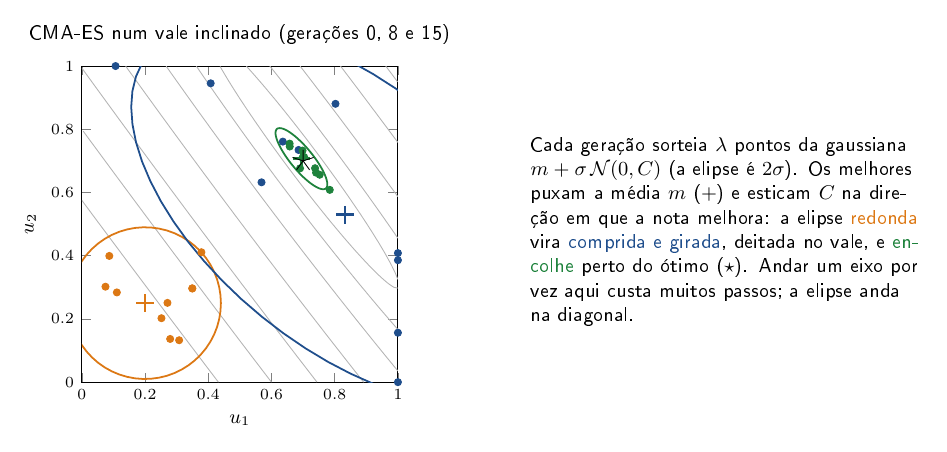
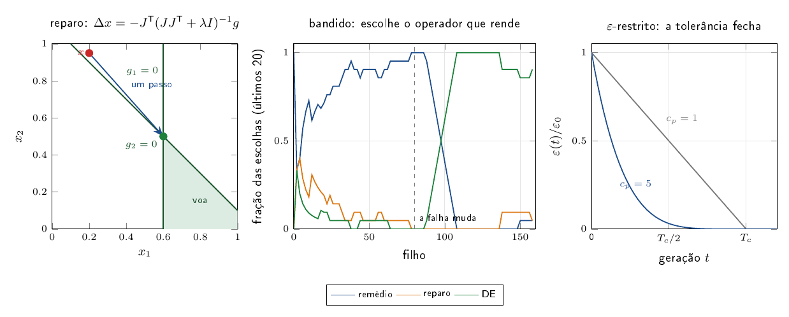

# core/src/optim — as contas do aeroopt no núcleo

Esta parte do núcleo tem o que o otimizador (`aeroopt/`) usa para buscar o melhor avião. Ela executa a nota de um
regulamento para milhares de candidatos de uma vez, sem alocar memória. Ela também tem os métodos de busca (o
genético, o CMA-ES e a evolução diferencial) e os métodos que dizem o quanto a nota do melhor avião muda em volta dele.

## Para que serve

- **Dar a nota de um avião.** O arquivo de pontuação de um regulamento vira um programa curto de pilha, e daqui sai a
  nota e cada termo dela, para mostrar por que um avião ganhou.
- **Buscar as variáveis.** O genético para as escolhas discretas (perfil, conjunto). O CMA-ES e a evolução diferencial
  para as contínuas (envergadura, área, diedro), quando elas só melhoram juntas.
- **Gastar menos avaliações.** O hipercubo latino espalha a primeira população. O substituto RBF escolhe quais
  filhos valem uma avaliação de verdade. A busca guiada pela falha conserta primeiro o que reprova o avião.
- **Medir a robustez.** O modelo local, a tolerância e Morris dizem quais variáveis mexem mais na nota.

## Como funciona



O CMA-ES existe porque, no avião, as variáveis boas andam juntas. Aumentar a envergadura só ajuda se a área cresce
junto, e a região boa vira um vale estreito e inclinado. O genético mexe numa variável de cada vez e cai fora do vale.
O CMA-ES sorteia de uma elipse e a gira e estica na direção em que a nota sobe (Hansen, *The CMA Evolution Strategy:
A Tutorial*, 2016).

## Exemplo

A nota de um candidato e o CMA-ES num problema de teste:

```python
from aeroopt.scoring import evaluate, scoring_for
from aerosim.backend.zig import ZigBackend

r = evaluate(scoring_for("sae_br_2026_micro"),
             dict(c_lapes=1.0, c_liq=1.2, pv=0.5, m_bat=0.30, s_to=3.5, b=1.8))[0]
print(round(r["nota"], 2), r["termos"], r["valido"])

be = ZigBackend()
st = be.cma_init([0.2, 0.2, 0.2], 0.3)
for _ in range(60):
    X = be.cma_ask(st)                                  # λ × n em [0, 1]
    be.cma_tell(st, X, -((X - 0.7) ** 2).sum(axis=1))   # maior é melhor
print(st.mean, st.sigma)                                # ≈ 0,7 0,7 0,7, passo pequeno
```

Os outros: `be.ga_init` e `ga_next`, `be.de_init`, `de_trials` e `de_select`, `be.lhs`, `be.rbf_fit` e `rbf_eval`,
`be.local_fit`, `be.morris_design` e `morris_effects`. Testes: `cd core && python -m ziglang build test -Dgrupo=optim`
e `python -m pytest -q tests/aeroopt`.

## O que isso influencia

É isso que decide quais aviões o aeroopt avalia e qual ele entrega. O CMA-ES no vale inclinado, com a elipse deitando
no vale e encolhendo perto do ótimo:



A busca guiada pela falha, que conserta primeiro a variável que reprova o avião:


