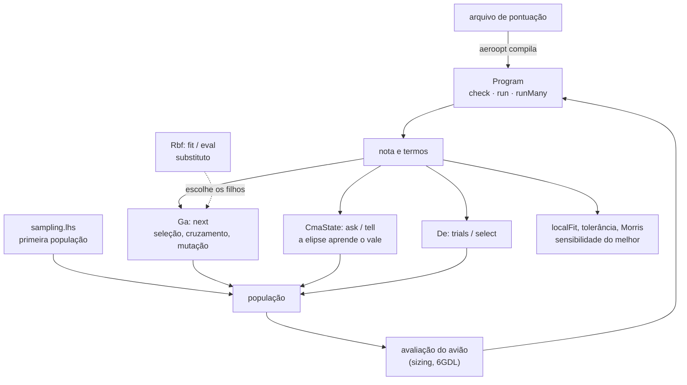

# core/src/optim — as contas do aeroopt no núcleo

Esta parte do núcleo tem o que o otimizador (`aeroopt/`) usa para buscar o melhor avião. O arquivo de pontuação de um
regulamento vira um programa curto de pilha, e daqui sai a nota e cada termo dela, para milhares de candidatos de uma
vez e sem alocar memória, para mostrar por que um avião ganhou. Aqui também estão as buscas: o genético para as
escolhas discretas (perfil, conjunto), o CMA-ES e a evolução diferencial para as contínuas (envergadura, área,
diedro). O hipercubo latino espalha a primeira população, o substituto RBF escolhe quais filhos valem uma avaliação de
verdade e a busca guiada pela falha conserta primeiro o que reprova o avião. Depois da busca, o modelo local, a
tolerância e Morris dizem quais variáveis mexem mais na nota do melhor.



O CMA-ES existe porque, no avião, as variáveis boas andam juntas: aumentar a envergadura só ajuda se a área cresce
junto, e a região boa vira um vale estreito e inclinado. O genético mexe numa variável de cada vez e cai fora do vale;
o CMA-ES sorteia de uma elipse e a gira e estica na direção em que a nota sobe (Hansen, *The CMA Evolution Strategy: A
Tutorial*, 2016). A nota de um candidato da Micro 2026 e o CMA-ES achando o ótimo de um problema de teste:

```python
import numpy as np
from aeroopt.scoring import evaluate, scoring_for
from aerosim.backend.zig import ZigBackend

r = evaluate(scoring_for("sae_br_2026_micro"),
             dict(c_lapes=1.0, c_liq=1.2, pv=0.5, m_bat=0.30, s_to=3.5, b=1.8))[0]
print("nota", round(r["nota"], 2), {k: round(v, 3) for k, v in r["termos"].items()}, r["valido"])

be = ZigBackend()
st = be.cma_init([0.2, 0.2, 0.2], 0.3)
for _ in range(60):
    X = be.cma_ask(st)                                  # λ × n em [0, 1]
    be.cma_tell(st, X, -((X - 0.7) ** 2).sum(axis=1))   # maior é melhor; o ótimo é 0,7
print("média", np.round(st.mean[:3], 3), "passo", round(st.sigma, 5))
```

```
nota 224.67 {'cp_m': 2.0, 'ee': 4.0, 'f_bat': 0.99, 'p_m': 224.674, 'pd': 0.0} True
média [0.7 0.7 0.7] passo 0.00052
```

A nota vem com cada termo do regulamento, e o CMA-ES chega ao ótimo com o passo já pequeno. Os outros métodos seguem
o mesmo jeito (`be.ga_init` e `ga_next`, `be.de_init`, `de_trials` e `de_select`, `be.lhs`, `be.rbf_fit`,
`be.local_fit`, `be.morris_design`), e os testes rodam com `cd core && python -m ziglang build test -Dgrupo=optim`.

É isso que decide quais aviões o aeroopt avalia e qual ele entrega. O CMA-ES num vale inclinado como o de envergadura
e área, com a elipse deitando no vale e encolhendo perto do ótimo:


