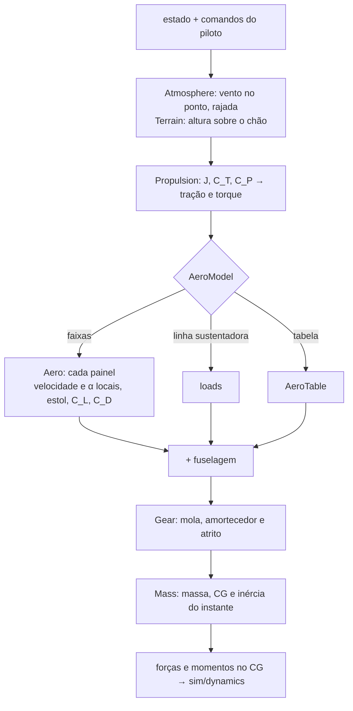
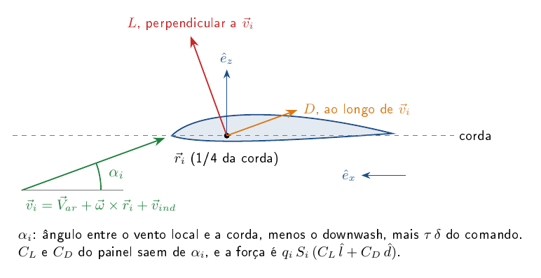
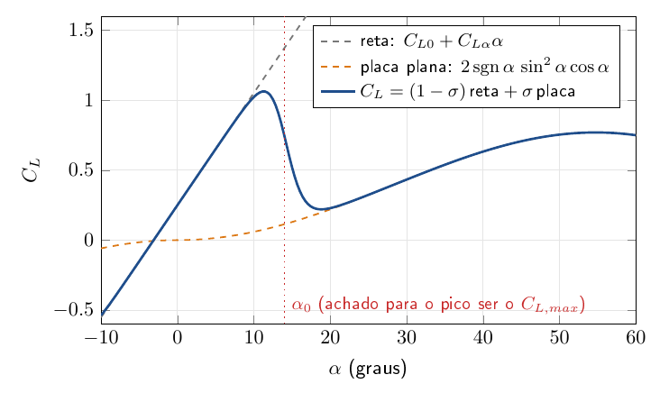

# core/src/physics — forças e massas do avião num instante

Esta parte do núcleo sabe quanto o avião é empurrado e puxado. Dado o estado agora (posição, velocidade, atitude,
rotação, comandos), ela devolve as forças e os momentos da aerodinâmica, dos motores, do trem de pouso e do vento, e
diz onde estão a massa, o CG e a inércia, com o líquido que balança nos tanques e a carga lançada. Ela não avança no
tempo (quem soma e integra é a dinâmica, em `sim/`) e não aloca memória. É o que a Missão 6GDL, a trimagem, o modelo
linear da Estabilidade e o AeroDrive chamam a cada passo.

A aerodinâmica padrão é por faixas: o avião é uma lista de painéis (meias asas, EH, EV, dispositivos), cada um com
centro, corda, área e eixos próprios. Não há derivadas de estabilidade prontas: o amortecimento e os efeitos de diedro
e de cauda saem sozinhos, porque cada painel vê a velocidade do ponto onde está. O modelo do voo pode trocar as faixas
pela linha sustentadora (`loads/`) ou por uma tabela de qualquer método. A polar 2D de cada perfil vem do modelo
(`section.zig`, inclinação, c_l máximo e estol suave) ou de arquivos do XFLR5 e do XFOIL, um por Reynolds:
`parsePolar` lê o texto exportado e `atReynolds` interpola entre os dois Reynolds vizinhos, sem extrapolar.



A velocidade do ar em cada painel é a do avião mais a rotação, mais o que os modificadores induzem (a esteira da
hélice), e o estol de cada faixa é a reta misturada com a placa plana por uma sigmoide (Beard e McLain, *Small
Unmanned Aircraft*, 2012):

```math
\vec v_i = \vec V_{ar} + \vec\omega \times \vec r_i + \sum_k \vec v_{ind,k}(\vec r_i)
```

Os coeficientes do avião dos testes a 12 m/s e α = 0,05 rad, o motor 0 com o acelerador cheio e a massa
(`exemplo.zig`, `python -m ziglang build exemplo -Dexemplo=physics`):

```zig
const std = @import("std");
const core = @import("aerosim");

var instance: core.runner.Instance = .{};

pub fn main() !void {
    core.test_aircraft(&instance.p);
    try core.runner.configure(&instance); // aero.init, propulsion.init e as massas, uma vez
    const center = core.trim.Ctx.init(&instance.p, &instance.r.f).rcg; // os momentos no CG
    const coefficients = core.aero.coeffs(&instance.p, 12.0, 0.05, 0, center, .{ 0, 0, 0 }); // V, α (rad), β
    std.debug.print("C_L {d:.3}  C_D {d:.3}  C_m {d:.3}  C_Di {d:.3}\n", .{ coefficients.CL, coefficients.CD, coefficients.Cm, coefficients.CDi });

    const motor = core.propulsion.point(&instance.p, &instance.p.prop[0], 12.0, 1.0); // motor 0 a 12 m/s, acelerador cheio
    const zero_state = [_]f64{0} ** core.state.nx;
    const body = core.mass.compute(instance.ctx(), &zero_state);
    std.debug.print("{d:.0} rpm  T {d:.1} N  P no eixo {d:.0} W | massa {d:.2} kg\n", .{ motor.rpm, motor.T, motor.P_shaft, body.m });
}
```

```
C_L 0.635  C_D 0.073  C_m 0.075  C_Di 0.028
6541 rpm  T 19.5 N  P no eixo 393 W | massa 12.00 kg
```

Na simulação (é o que o AeroDrive faz), `core.aero.init(&params)` roda uma vez e `core.aero.compute(&params, ...)` a
cada passo, que devolve a força e o momento no CG. Os testes rodam com `cd core && python -m ziglang build
test -Dgrupo=physics`.

Tudo o que voa passa por aqui. Uma faixa, com o vento local, o ângulo induzido e as forças, e o estol pela sigmoide:




