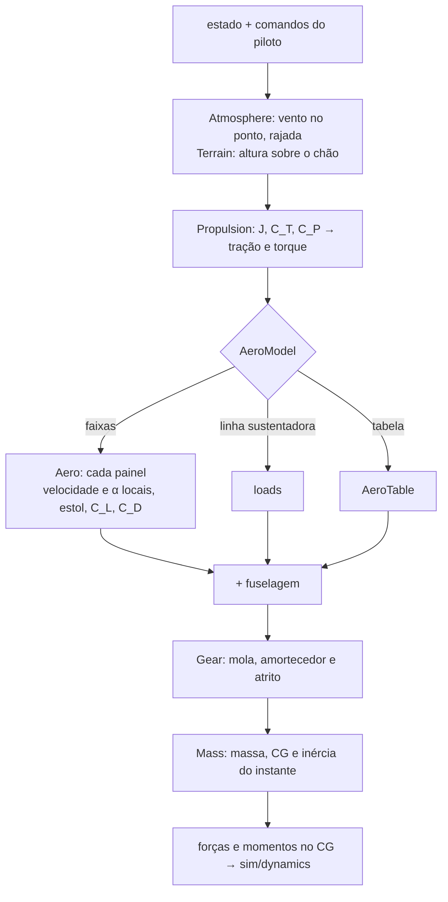

# core/src/physics — forças e massas do avião num instante

Esta parte do núcleo sabe quanto o avião é empurrado e puxado. Dado o estado agora (posição, velocidade, atitude,
rotação, comandos), ela devolve as forças e os momentos da aerodinâmica, dos motores, do trem de pouso e do vento, e
diz onde estão a massa, o CG e a inércia, com o líquido que balança nos tanques e a carga lançada. Ela não avança no
tempo (quem soma e integra é a dinâmica, em `sim/`) e não aloca memória. É o que a Missão 6GDL, a trimagem, o modelo
linear da Estabilidade e o AeroDrive chamam a cada passo.

A aerodinâmica padrão é por faixas: o avião é uma lista de painéis (meias asas, EH, EV, dispositivos), cada um com
centro, corda, área e eixos próprios. Não há derivadas de estabilidade prontas: o amortecimento e os efeitos de diedro
e de cauda saem sozinhos, porque cada painel vê a velocidade do ponto onde está. O modelo do voo pode trocar as faixas
pela linha sustentadora (`loads/`) ou por uma tabela de qualquer método. A polar 2D de cada perfil vem do modelo
(`section.zig`, inclinação, c_l máximo e estol suave) ou de arquivos do XFLR5 e do XFOIL, um por Reynolds:
`parsePolar` lê o texto exportado e `atReynolds` interpola entre os dois Reynolds vizinhos, sem extrapolar.



A velocidade do ar em cada painel é a do avião mais a rotação, mais o que os modificadores induzem (a esteira da
hélice), e o estol de cada faixa é a reta misturada com a placa plana por uma sigmoide (Beard e McLain, *Small
Unmanned Aircraft*, 2012):

```math
\vec v_i = \vec V_{ar} + \vec\omega \times \vec r_i + \sum_k \vec v_{ind,k}(\vec r_i)
```

Os coeficientes do avião a 12 m/s e α = 0,05 rad, o motor 0 com o acelerador cheio, e a massa:

```python
from aerosim.backend.zig import ZigBackend
from aerosim.data import load_aircraft
from aerosim.model.universal import build_model

ac = load_aircraft("data/aircraft/conventional.cfg")
with ZigBackend().session_for(build_model(ac)) as s:
    c = s.aero_coeffs(12.0, 0.05, 0.0)          # V, α (rad), β
    pt = s.prop_point(0, 12.0, thr=1.0)          # motor 0 a 12 m/s
    mp = s.mass_props()
print({k: round(c[k], 3) for k in ("CL", "CD", "Cm", "CDi")})
print({k: round(pt[k], 1) for k in ("rpm", "T", "P_shaft")}, "| massa", mp["m"], "kg")
```

```
{'CL': 0.635, 'CD': 0.073, 'Cm': 0.071, 'CDi': 0.028}
{'rpm': 6537.6, 'T': 19.6, 'P_shaft': 397.2} | massa 12.39 kg
```

Pelo Zig é o mesmo, direto (é o que o AeroDrive faz): `core.aero.init(&params)` uma vez e `core.aero.compute(&params,
...)` a cada passo, que devolve a força e o momento no CG. Os testes rodam com `cd core && python -m ziglang build
test -Dgrupo=physics`.

Tudo o que voa passa por aqui. Uma faixa, com o vento local, o ângulo induzido e as forças, e o estol pela sigmoide:


