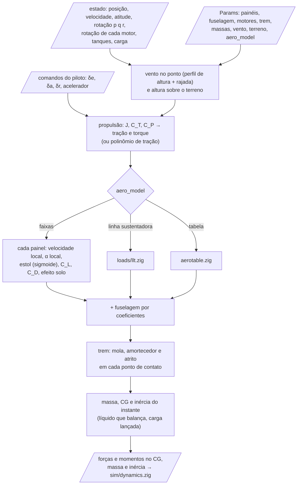
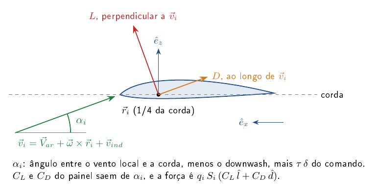
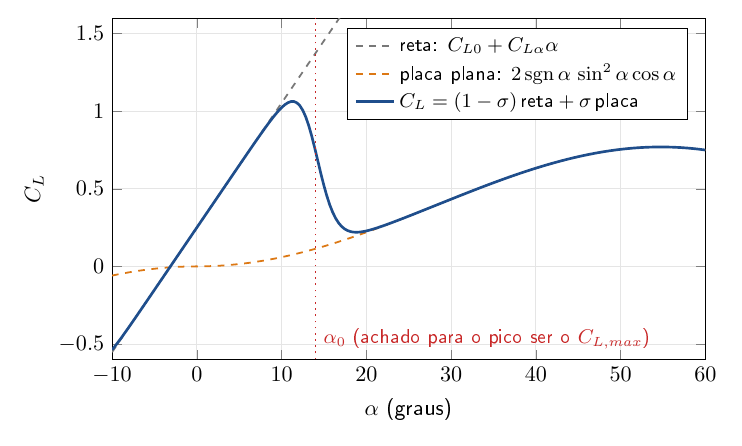

# core/src/physics — forças e massas do avião num instante

Esta é a parte do núcleo que sabe quanto o avião é empurrado e puxado. Dado o estado agora (posição, velocidade,
atitude, rotação, comandos), ela devolve as forças e os momentos da aerodinâmica, dos motores, do trem de pouso e do
vento, e diz onde estão a massa, o CG e a inércia. Ela não avança no tempo: quem soma tudo e integra é
`sim/dynamics.zig`. Também não aloca memória, porque os vetores têm o tamanho dos limites de `limits.zig`.

O README segue a ordem das forças. Primeiro vem a aerodinâmica por faixas, que é o modelo padrão do voo, e logo
depois a escolha do modelo aerodinâmico e a tabela de voo, as duas alternativas a ele. Em seguida vêm a propulsão
(motor elétrico e hélice, ou um polinômio de tração), o trem de pouso, a massa (com o líquido que balança nos tanques
e a carga lançada), o vento e, por último, o terreno sob o avião.

| arquivo | o que calcula |
|---|---|
| `aero.zig` | forças e momentos aerodinâmicos por faixas (painéis) e fuselagem; coeficientes do avião (`coeffs*`) |
| `aeromodel.zig` | escolhe o modelo aerodinâmico do voo (`Params.aero_model`): faixas, linha sustentadora ou tabela |
| `aerotable.zig` | o avião inteiro por uma tabela de coeficientes vinda de qualquer método |
| `propulsion.zig` | motor elétrico + hélice (ou polinômio de tração), rotação de equilíbrio, curva de tração |
| `gear.zig` | trem de pouso: mola-amortecedor e atrito em cada ponto de contato |
| `terrain.zig` | altura do chão (plano, com mesas e plataformas) |
| `mass.zig` | massa, CG e inércia variáveis; sloshing dos tanques; carga lançada |
| `atmosphere.zig` | vento com perfil de altura e rajada |

## Como uma avaliação de forças acontece

A cada instante, a dinâmica pede as forças a esta pasta. O fluxo mostra o que entra, a ordem em que cada parte é
calculada e o que volta:



## Aerodinâmica por faixas (`aero.zig`)

O avião é uma lista de painéis (faixas de meia asa, EH, EV, dispositivos). Cada painel tem centro aerodinâmico,
corda, área e eixos próprios. Não há derivadas de estabilidade prontas: o amortecimento e os efeitos de diedro e de
cauda saem sozinhos, porque cada painel vê a velocidade do ponto onde está.

A velocidade do ar no painel $`i`$, no eixo do corpo, é a do avião mais a rotação, mais o que os modificadores induzem
(esteira da hélice; ver `modifiers/`):

```math
\vec v_i = \vec V_{ar} + \vec\omega \times \vec r_i + \sum_k \vec v_{ind,k}(\vec r_i)
```

onde $`\vec V_{ar}`$ é a velocidade do avião em relação ao ar, $`\vec\omega = (p, q, r)`$ a rotação e $`\vec r_i`$ o centro do
painel. Com ela, o ângulo de ataque local é tomado no plano da corda ($`\hat e_x`$) e da normal ($`\hat e_z`$) do painel,
descontado o downwash da asa (só nos painéis que o sentem) e somada a deflexão do comando:

```math
\alpha_i = \operatorname{atan2}(\vec v_i \cdot \hat e_z,\ \vec v_i \cdot \hat e_x) - (\varepsilon_0 + \tfrac{d\varepsilon}{d\alpha}\,\alpha) + \tau\,(m_e\,\delta_e + m_a\,\delta_a + m_r\,\delta_r)
```

$`\varepsilon_0`$ e $`d\varepsilon/d\alpha`$ são o downwash da asa na cauda (dados do painel), $`\alpha`$ é o ângulo de ataque do
avião, $`\tau`$ a efetividade da superfície de comando e $`m_e, m_a, m_r`$ a mistura (profundor, aileron, leme; cobre
elevon, ruddervator e flaperon).



**Estol.** O $`C_L`$ do painel mistura a reta e a placa plana por uma sigmoide, como em Beard e McLain, *Small Unmanned
Aircraft: Theory and Practice* (Princeton, 2012), cap. 4 (número da equação a conferir no PDF):

```math
\sigma(\alpha) = \frac{1 + e^{-M(\alpha - \alpha_0)} + e^{M(\alpha + \alpha_0)}}{\left(1 + e^{-M(\alpha - \alpha_0)}\right)\left(1 + e^{M(\alpha + \alpha_0)}\right)}
```

```math
C_L(\alpha) = (1 - \sigma)\,(C_{L0} + C_{L\alpha}\,\alpha) + \sigma\; 2\,\operatorname{sgn}(\alpha)\,\sin^2\alpha\,\cos\alpha
```

$`\sigma`$ vale 0 antes do estol e 1 depois; $`M`$ diz quão abrupta é a transição. O ângulo $`\alpha_0`$ não é dado: `init`
procura, por bisseção, o $`\alpha_0`$ que faz o pico de $`C_L(\alpha)`$ ser o $`C_{L,max}`$ pedido. O $`C_{L\alpha}`$ 3D de cada
superfície vem do Python (Helmbold; ver `aerosim/model`).



**Arrasto.** Polar parabólica antes do estol (Anderson, *Aircraft Performance and Design*, cap. 2, a conferir no PDF) e
o arrasto de placa plana depois, com o efeito solo $`\varphi(h)`$ multiplicando o induzido nos painéis horizontais:

```math
C_{D,i} = \frac{(1 - \sigma)\,C_L^2}{\pi\,e\,AR}\;\varphi(h)
\qquad
C_D = C_{D0} + C_{D,i} + 1{,}2\,\sigma\,\sin^2\alpha
```

$`e`$ é o fator de Oswald e $`AR`$ o alongamento da superfície inteira. O coeficiente da placa plana depois do estol vem do
modelo de Beard e McLain (a conferir no PDF). O $`\varphi(h)`$ está em `modifiers/ground.zig`.

**Forças.** A sustentação é perpendicular à velocidade local, o arrasto é paralelo a ela, e o momento soma o braço até o
CG com o momento do perfil:

```math
q_i = \tfrac12\,\rho\,\lVert \vec v_i \rVert^2\,\eta_i\,S_i
\qquad
\vec F_i = q_i\,(C_L\,\hat l_i + C_D\,\hat d_i)
\qquad
\vec M_i = (\vec r_i - \vec r_{cg}) \times \vec F_i + q_i\,c_i\,C_{m,ac}\,\hat e_y
```

$`\eta_i`$ é a razão de pressão dinâmica, $`\hat l_i`$ e $`\hat d_i`$ as direções de sustentação e de arrasto no plano do
painel. A força total é a soma de todos os painéis mais a fuselagem.

**Fuselagem.** Por coeficientes digitados pelo usuário (área de arrasto $`C_D S`$, $`C_{Y\beta}`$, $`C_{m\alpha}`$,
$`C_{n\beta}`$), com $`\beta = \arcsin(v/V)`$:

```math
\vec F_f = -\tfrac12\,\rho\,V\,(C_DS)\,\vec V_{ar} + q S\,C_{Y\beta}\,\beta\,\hat y
\qquad
M_{y} \mathrel{+}= q S c\,C_{m\alpha}\,\alpha
\qquad
M_{z} \mathrel{+}= q S b\,C_{n\beta}\,\beta
```

## Modelo aerodinâmico do voo (`aeromodel.zig`)

A dinâmica, a trimagem e a linearização pedem as forças a `aeromodel.compute`, que escolhe por `Params.aero_model`:

| `aero_model` | modelo | onde |
|---|---|---|
| 0 (padrão) | faixas (acima) | `aero.zig` |
| 1 | as faixas com a força de cada painel trocada pela da linha sustentadora | `loads/llt.zig` |
| 2 | tabela do avião inteiro, mais a fuselagem do núcleo se a tabela não a tem | `aerotable.zig` |

Com 0 as contas são exatamente as de antes, e o AeroDrive, que usa os padrões, fica nas faixas.

## Tabela de voo (`aerotable.zig`)

Os coeficientes do avião inteiro vêm de uma tabela montada por qualquer método (`aerosim/aero/flight_table.py`). A parte
longitudinal estática é interpolada em $`\alpha`$; o resto é o modelo linear de derivadas de estabilidade (Etkin e Reid,
*Dynamics of Flight*, cap. 5, a conferir no PDF). Com as taxas adimensionais

```math
\hat p = \frac{p\,b}{2V} \qquad \hat q = \frac{q\,c}{2V} \qquad \hat r = \frac{r\,b}{2V}
```

os coeficientes são:

```math
C_L = C_L(\alpha) + C_{Lq}\,\hat q + C_{L\delta_e}\,\delta_e
\qquad
C_D = C_D(\alpha)
\qquad
C_m = C_m(\alpha) + C_{mq}\,\hat q + C_{m\delta_e}\,\delta_e
```

```math
C_Y = C_{Y\beta}\,\beta + C_{Yp}\,\hat p + C_{Yr}\,\hat r + C_{Y\delta_r}\,\delta_r
```

```math
C_l = C_{l\beta}\,\beta + C_{lp}\,\hat p + C_{lr}\,\hat r + C_{l\delta_a}\,\delta_a + C_{l\delta_r}\,\delta_r
```

```math
C_n = C_{n\beta}\,\beta + C_{np}\,\hat p + C_{nr}\,\hat r + C_{n\delta_a}\,\delta_a + C_{n\delta_r}\,\delta_r
```

Fora da faixa da tabela vale o valor da ponta. A força volta aos eixos do corpo pelas mesmas definições de
`aero.coeffsAt` ($`C_L`$ perpendicular ao vento no plano de simetria, $`C_D`$ ao longo dele). A tabela não tem efeito solo
nem esteira: é de voo livre.

## Propulsão (`propulsion.zig`)

Cada unidade é uma hélice por tabela $`C_T(J)`$, $`C_P(J)`$ ligada a um motor elétrico e a uma bateria, ou um polinômio de
tração ajustado. A rotação $`n`$ (rps) é um estado da simulação.

**Hélice.** Razão de avanço com a velocidade do ar no cubo ao longo do eixo de tração, e tração e torque pelos
coeficientes da hélice (McCormick, *Aerodynamics, Aeronautics, and Flight Mechanics*, cap. 6, a conferir no PDF):

```math
J = \frac{(\vec V_{ar} + \vec\omega\times\vec r_p)\cdot\hat e_T}{n\,D}
\qquad
T = C_T(J)\,\rho\,n^2 D^4
\qquad
Q = \frac{C_P(J)}{2\pi}\,\rho\,n^2 D^5
```

$`C_T`$ e $`C_P`$ são interpolados linearmente na tabela (busca binária em $`J`$).

**Motor e bateria.** O acelerador $`u`$ escala a tensão da bateria; a corrente do motor sai do equilíbrio elétrico com a
força contraeletromotriz $`K_e\,\omega`$ (modelo de motor de corrente contínua sem escovas, a conferir na fonte), limitada
a $`[0, I_{max}]`$:

```math
I = \frac{u\,V_{oc} - K_e\,\omega}{R_m + u^2 R_{int}}
\qquad
I_{bat} = u\,I
\qquad
V_{bus} = V_{oc} - R_{int}\,I_{bat}
```

**Rotação.** O torque do motor menos o atrito viscoso, o atrito seco e o torque da hélice acelera o rotor:

```math
2\pi\,(J_m + I_p)\,\frac{dn}{dt} = K_e\,I - B\,\omega - \tau_c - Q
\qquad \omega = 2\pi n
```

**Força e momentos no avião.** A tração age no cubo ao longo do eixo; o torque reage no sentido contrário ao giro
(`sense`), e o rotor girando dá o momento giroscópico:

```math
\vec F = T\,\hat e_T
\qquad
\vec M = (\vec r_p - \vec r_{cg})\times\vec F - s\,Q\,\hat e_T - \vec\omega\times\vec H
\qquad
\vec H = s\,(I_p + J_m)\,\omega\,\hat e_T
```

**Rotação de equilíbrio** ($`dn/dt = 0`$, usada na trimagem, na curva de tração e no envelope). Como $`dn/dt`$ cai com $`n`$,
a raiz é única num intervalo; ela é achada por *regula falsi* com a modificação de Illinois (Dowell e Jarratt, BIT 11,
1971, a conferir no PDF), que converge em poucas avaliações.

**Tração por polinômio.** Sem motor nem bateria, $`T`$ é um polinômio em duas variáveis escolhidas (V, acelerador,
altura, densidade ou constante), na ordem dos ajustes `poly55` do MATLAB (`math/poly.zig`):

```math
T = g\;P(x, y)\;\left(\frac{\rho}{\rho_0}\right)^{k}
\qquad
P(x, y) = \sum_{i + j \le N} p_{ij}\,x^i y^j
```

$`g`$ é o ganho e $`k`$ o expoente da densidade. Se nem $`x`$ nem $`y`$ for o acelerador, $`T`$ é multiplicada por ele; $`T \ge 0`$.

## Trem de pouso (`gear.zig`)

Cada ponto de contato é uma mola-amortecedor vertical que só empurra. Com $`d`$ a compressão (o ponto abaixo do terreno)
e $`\dot d`$ a velocidade de compressão:

```math
N = \max(0,\ k\,d + c\,\dot d)
```

O atrito de rolamento (ao longo da roda) e o lateral são proporcionais a $`N`$. O $`\tanh`$ suaviza a troca de sinal perto
de velocidade zero, para o integrador não oscilar (escolha desta implementação, sem fonte da literatura):

```math
F_l = -\mu\,N\,\tanh\!\left(\frac{v_l}{v_0}\right)
\qquad
F_t = -\mu_{lat}\,N\,\tanh\!\left(\frac{v_t}{v_0}\right)
```

$`\mu`$ muda com o estado: rolamento, freio (rodas principais), pouso ou patim. A roda direcionável gira com o comando
do leme.

## Massa, CG e inércia (`mass.zig`)

A massa seca (com a inércia dada no CG dela), o líquido dos tanques e a carga somam como massas pontuais. A inércia de
cada uma é levada a um eixo comum pelo teorema dos eixos paralelos (Steiner) e depois ao CG do conjunto:

```math
\mathbf I_O = \sum_k \mathbf I_k + m_k\left(\lVert\vec r_k\rVert^2\,\mathbf 1 - \vec r_k\,\vec r_k^{\,T}\right)
\qquad
\vec r_{cg} = \frac{\sum_k m_k\,\vec r_k}{\sum_k m_k}
\qquad
\mathbf I_{cg} = \mathbf I_O - m\left(\lVert\vec r_{cg}\rVert^2\,\mathbf 1 - \vec r_{cg}\,\vec r_{cg}^{\,T}\right)
```

**Sloshing.** Cada tanque tem uma parte parada ($`m_0`$) e uma que oscila ($`m_1`$) como pêndulo de dois eixos, com braço
$`l_1`$, amortecimento $`\zeta`$ e frequência $`\omega_1`$ (modelo de pêndulo equivalente; Abramson, *The Dynamic Behavior of
Liquids in Moving Containers*, NASA SP-106, 1966, a conferir no PDF). Em cada eixo, com $`\vec a_{ap}`$ a gravidade
aparente no tanque (gravidade menos a força específica):

```math
l_1\,\ddot\eta = a_{ap,x}\cos\eta - a_{ap,z}\sin\eta - 2\,\zeta\,\omega_1\,l_1\,\dot\eta
```

**Carga lançada.** O paraquedas puxa a carga com uma força externa; ela desliza na baia com atrito $`\mu_b`$. O avião
sente só o atrito e o CG que anda para trás até a carga sair.

## Vento e rajada (`atmosphere.zig`)

O vento tem direção (de onde vem) e elevação dadas, e a intensidade cresce com a altura pela lei de potência de 1/7
(perfil de camada-limite atmosférica, a conferir na fonte), a partir da velocidade $`V_{w,ref}`$ medida na altura
$`h_{ref}`$:

```math
V_w(h) = V_{w,ref}\left(\frac{h}{h_{ref}}\right)^{1/7}
```

A rajada discreta "1 − cos" soma um vetor $`\vec U`$ durante $`T_g`$ segundos a partir de $`t_g`$ (forma de rajada discreta
das normas, a conferir na MIL-F-8785C):

```math
\vec W_g(t) = \frac{\vec U}{2}\left(1 - \cos\frac{2\pi\,(t - t_g)}{T_g}\right) \qquad t_g \le t \le t_g + T_g
```

## Terreno (`terrain.zig`)

Chão plano em $`h = 0`$ com mesas e plataformas retangulares. O trem, o efeito solo e o arredondamento do pouso olham a
altura do terreno sob cada ponto, então a decolagem pode sair de uma mesa e o pouso pode ser numa plataforma.

## Como chamar

Pelo Python, sempre por uma sessão do backend (a ABI chama estas funções):

```python
from aerosim.backend.zig import ZigBackend
from aerosim.data import load_aircraft
from aerosim.model.universal import build_model

ac = load_aircraft("data/aircraft/conventional.cfg")
be = ZigBackend()
with be.session_for(build_model(ac)) as s:
    c = s.aero_coeffs(12.0, 0.05, 0.0)       # aero.zig: C_L, C_D, C_m... a V = 12 m/s, α = 0,05 rad, β = 0
    pt = s.prop_point(0, 12.0, thr=1.0)       # propulsion.zig: motor 0 a 12 m/s, acelerador cheio
    mp = s.mass_props()                       # mass.zig: massa, CG, inércia
```

Pelo Zig, direto (é o que o AeroDrive faz):

```zig
const core = @import("aerosim");
var p: core.types.Params = .{};               // painéis, motores, trem... preenchidos por quem chama
core.aero.init(&p);                   // eixos de cada painel e ângulo de estol
const o = core.aero.compute(&p, Vr, w, rcg, h, d);   // o.F, o.M (corpo, momentos no CG)
```

Testes: `python -m ziglang build test-physics` (dentro de `core/`).
