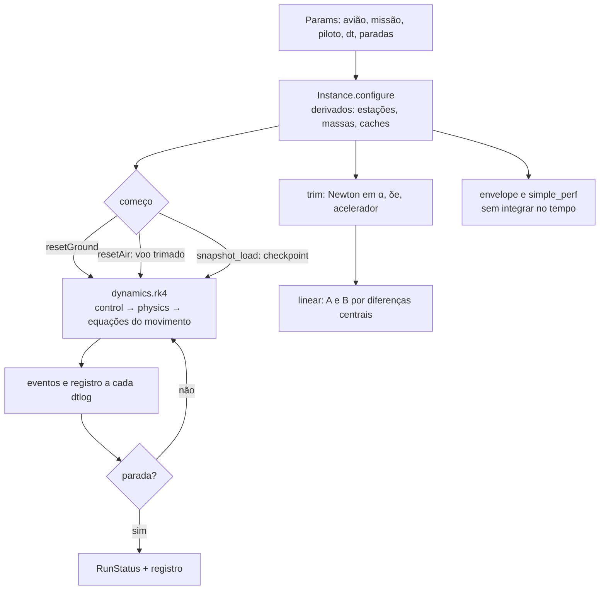

# core/src/sim — integração no tempo, equilíbrio, modelo linear e desempenho

Esta parte do núcleo transforma forças em voo. As forças de `physics/` e os comandos de `control/` entram, e saem o
movimento do avião ao longo do tempo (uma missão inteira, da corrida na pista ao pouso), o equilíbrio em cada
velocidade (a trimagem), o modelo linear com que a Estabilidade acha os modos de voo, a resposta a uma rajada, o
envelope de voo por altitude e o desempenho por fórmula, como numa planilha. Uma corrida se organiza em eventos
(decolou, soltou a carga, tocou o chão), paradas e checkpoints: o estado inteiro é uma struct sem ponteiros, então
copiar os bytes basta para guardar e retomar.



O avião é um corpo rígido de massa variável (a carga sai, o líquido oscila), escrito no CG do instante, com Newton e
Euler nos eixos do corpo (Etkin e Reid, *Dynamics of Flight*, cap. 4), integrado por Runge–Kutta de 4ª ordem com passo
fixo:

```math
m\left(\frac{d\vec V}{dt} + \vec\omega\times\vec V\right) = \sum \vec F + m\,\vec g
\qquad
\mathbf I_{cg}\,\frac{d\vec\omega}{dt} + \vec\omega\times(\mathbf I_{cg}\,\vec\omega) = \sum \vec M_{cg}
```

Vinte segundos de decolagem a partir da cabeceira, o equilíbrio a 14 m/s e os autovalores do modelo linear ali:

```zig
const std = @import("std");
const core = @import("aerosim");

var instance: core.runner.Instance = .{}; // grande: fica fora da pilha
var log: [4096]core.types.LogRow = undefined;

pub fn main() !void {
    const deg = std.math.rad_per_deg;
    core.test_aircraft(&instance.p); // o monomotor dos testes, com a missão que começa na cabeceira
    try core.runner.configure(&instance);
    try core.runner.resetGround(&instance);
    var rows: usize = 0;
    _ = core.runner.run(&instance, 20.0, &log, &rows);
    std.debug.print("20 s depois: V = {d:.1} m/s  h = {d:.1} m\n", .{ log[rows - 1].Va, log[rows - 1].h });

    const point = core.trim.solve(core.trim.Ctx.init(&instance.p, &instance.r.f), .level, 14, 1, null);
    std.debug.print("trimado a 14 m/s: α = {d:.2}°  δe = {d:.2}°  acelerador = {d:.2}\n", .{ point.alpha / deg, point.de / deg, point.thr });

    const model = core.linear.linearize(&instance.p, &instance.r.f, 14);
    var real: [core.linear.nl]f64 = undefined;
    var imaginary: [core.linear.nl]f64 = undefined;
    var matrix: [core.linear.nl][core.linear.nl]f64 = @bitCast(model.A);
    _ = core.linalg.generalEigen(core.linear.nl, &matrix, core.linear.nl, &real, &imaginary);
    std.debug.print("autovalores de A:", .{});
    for (real, imaginary) |re, im| std.debug.print(" {d:.2}{s}{d:.2}j", .{ re, if (im < 0) "-" else "+", @abs(im) });
}
```

```
20 s depois: V = 13.3 m/s  h = 6.3 m
trimado a 14 m/s: α = 6.72°  δe = 1.37°  acelerador = 0.87
autovalores de A: -20.55+0.00j -4.36+5.83j -4.36-5.83j -1.21+3.53j -1.21-3.53j -0.08+0.79j -0.08-0.79j 0.15+0.00j
```

Cada par complexo é um modo de voo (período curto, rolagem holandesa, fugóide) e a parte real negativa diz que ele
amortece; o único real positivo, pequeno, é a espiral, que diverge devagar e é comum num avião sem piloto automático.
O exemplo está em `exemplo.zig` e roda com `cd core && python -m ziglang build exemplo -Dexemplo=sim`; os canais do
registro são os campos de `types.LogRow`, e os testes rodam com `cd core && python -m ziglang build test -Dgrupo=sim`.

Daqui saem a Missão 6GDL, a decolagem otimizada, a Estabilidade dinâmica, o envelope do Desempenho e o voo do
AeroDrive, que chama o mesmo passo a 120 Hz. O passo do RK4, com as quatro inclinações:


