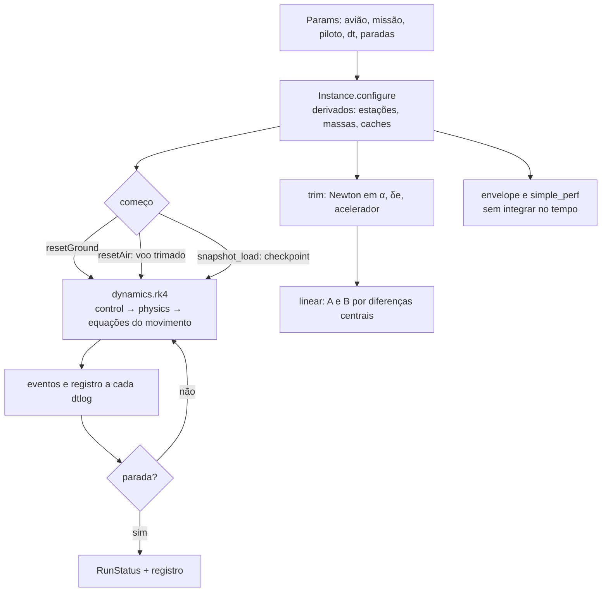
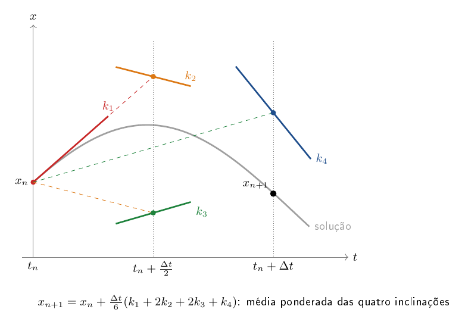

# core/src/sim — integração no tempo, equilíbrio, modelo linear e desempenho

Esta parte do núcleo transforma forças em voo. As forças de `physics/` e os comandos de `control/` entram, e saem o
movimento do avião ao longo do tempo (uma missão inteira, da corrida na pista ao pouso), o equilíbrio em cada
velocidade (a trimagem), o modelo linear com que a Estabilidade acha os modos de voo, a resposta a uma rajada, o
envelope de voo por altitude e o desempenho por fórmula, como numa planilha. Uma corrida se organiza em eventos
(decolou, soltou a carga, tocou o chão), paradas e checkpoints: o estado inteiro é uma struct sem ponteiros, então
copiar os bytes basta para guardar e retomar.



O avião é um corpo rígido de massa variável (a carga sai, o líquido oscila), escrito no CG do instante, com Newton e
Euler nos eixos do corpo (Etkin e Reid, *Dynamics of Flight*, cap. 4), integrado por Runge–Kutta de 4ª ordem com passo
fixo:

```math
m\left(\frac{d\vec V}{dt} + \vec\omega\times\vec V\right) = \sum \vec F + m\,\vec g
\qquad
\mathbf I_{cg}\,\frac{d\vec\omega}{dt} + \vec\omega\times(\mathbf I_{cg}\,\vec\omega) = \sum \vec M_{cg}
```

Vinte segundos de decolagem a partir da cabeceira, o equilíbrio a 14 m/s e os autovalores do modelo linear ali:

```python
import numpy as np
from aerosim.backend.zig import ZigBackend
from aerosim.interfaces.backend import TrimKind
from aerosim.model.mission import takeoff_runway
from aerosim.model.templates import conventional
from aerosim.model.universal import build_model

with ZigBackend().session_for(build_model(conventional()), takeoff_runway()) as s:
    s.reset_ground()
    status, log = s.run(t_limit=20.0)
    print("20 s depois:", "V =", round(float(log["Va"][-1]), 1), "m/s  h =", round(float(log["h"][-1]), 1), "m")
    eq = s.trim(TrimKind.LEVEL, 14.0)
    print("trimado a 14 m/s: α =", round(np.degrees(eq["alpha"]), 2), "°  δe =", round(np.degrees(eq["de"]), 2),
          "°  acelerador =", round(eq["thr"], 2))
    print("autovalores de A:", np.round(np.linalg.eigvals(s.linearize(14.0)["A"]), 2))
```

```
20 s depois: V = 14.2 m/s  h = 9.3 m
trimado a 14 m/s: α = 7.18 °  δe = 0.12 °  acelerador = 0.88
autovalores de A: [-20.93+0.j    -4.29+6.27j  -4.29-6.27j  -1.23+3.53j  -1.23-3.53j
  -0.08+0.81j  -0.08-0.81j   0.15+0.j  ]
```

Cada par complexo é um modo de voo (período curto, rolagem holandesa, fugóide) e a parte real negativa diz que ele
amortece; o único real positivo, pequeno, é a espiral, que diverge devagar e é comum num avião sem piloto automático.
Os canais do registro saem de `ZigBackend().log_channels()`, e os testes rodam com `cd core && python -m ziglang build
test -Dgrupo=sim`.

Daqui saem a Missão 6GDL, a decolagem otimizada, a Estabilidade dinâmica, o envelope do Desempenho e o voo do
AeroDrive, que chama o mesmo passo a 120 Hz. O passo do RK4, com as quatro inclinações:


