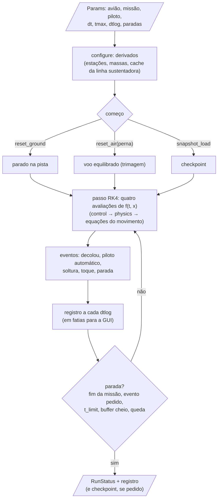
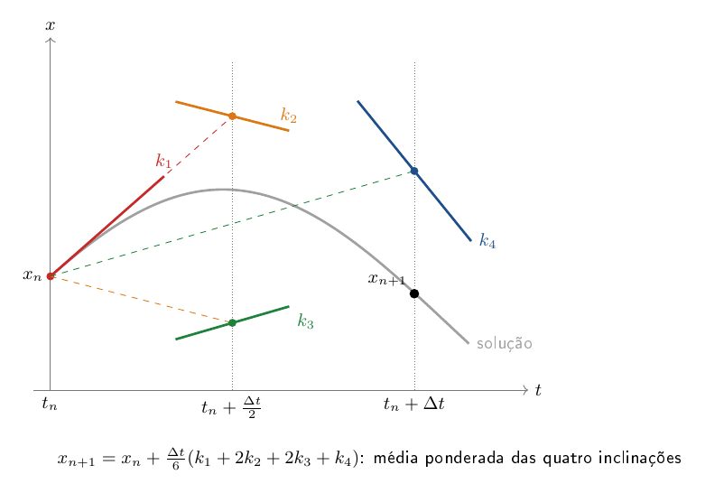

# core/src/sim — integração no tempo, equilíbrio, modelo linear e desempenho

Esta é a parte do núcleo que transforma forças em voo. As forças de `physics/` e os comandos de `control/` entram, e
saem o movimento do avião ao longo do tempo, o equilíbrio em cada velocidade, o modelo linear para estudar a
estabilidade, o envelope de voo por altitude e o desempenho por fórmula. É aqui que uma missão inteira, da corrida na
pista ao pouso, é simulada.

O README começa pelas equações do movimento e pelo integrador, que são a base de tudo. Depois vem a corrida, que
organiza uma simulação em eventos, paradas e checkpoints. As seções seguintes respondem perguntas sem integrar no
tempo: o equilíbrio (trimagem), o modelo linear, o envelope por altitude e, por último, o desempenho por fórmula,
como numa planilha.

| arquivo | o que faz |
|---|---|
| `state.zig` | layout do vetor de estados (em comptime, a partir dos limites) e o estado discreto de uma corrida |
| `dynamics.zig` | a equação mestre $`\dot x = f(t, x)`$ e o passo RK4 |
| `runner.zig` | eventos, paradas, registro em fatias e checkpoint (o estado inteiro é POD: copiar os bytes basta) |
| `trim.zig` | equilíbrio longitudinal por Newton e a tabela de desempenho por V |
| `linear.zig` | trimagem nivelada e as matrizes A, B por diferenças centrais |
| `gust.zig` | resposta no tempo a uma rajada em voo nivelado, com o líquido livre ou travado, em fatias |
| `envelope.zig` | $`V_{min}`$, $`V_{max}`$, $`V_e`$, V*, $`V_{cru}`$ e teto por altitude |
| `simple_perf.zig` | polar parabólica, potências, subida, planeio, curva e bateria por fórmula |
| `tests.zig` | testes do grupo "sim" (decolagem, checkpoint, trimagem) |

## Uma corrida, passo a passo

Uma corrida começa com os parâmetros escritos numa instância e segue em passos fixos até uma condição de parada:



## Equações do movimento (`dynamics.zig`)

O avião é um corpo rígido de massa variável (a carga sai, o líquido oscila) escrito no CG do instante. Newton e Euler
nos eixos do corpo (Etkin e Reid, *Dynamics of Flight*, cap. 4, a conferir no PDF):

```math
m\left(\frac{d\vec V}{dt} + \vec\omega\times\vec V\right) = \vec F_{aero} + \vec F_{prop} + \vec F_{solo} + \vec F_{líquido} + \vec F_{carga} + m\,\vec g
```

```math
\mathbf I_{cg}\,\frac{d\vec\omega}{dt} + \vec\omega\times(\mathbf I_{cg}\,\vec\omega) = \sum \vec M_{cg}
```

$`\vec V = (u, v, w)`$ e $`\vec\omega = (p, q, r)`$ estão nos eixos do corpo; a soma dos momentos inclui o giroscópico dos
rotores. A atitude vem dos ângulos de Euler $`(\phi, \theta, \psi)`$ e a posição da navegação em NED. O vetor de estados
também leva a rotação de cada motor, os pêndulos dos tanques, a posição da carga na baia e os integradores do piloto.

**Integração.** Runge–Kutta de 4ª ordem com passo fixo $`\Delta t`$, feita sobre vetores SIMD do tamanho do estado:

```math
k_1 = f(t, x) \quad k_2 = f(t + \tfrac{\Delta t}{2}, x + \tfrac{\Delta t}{2}k_1) \quad k_3 = f(t + \tfrac{\Delta t}{2}, x + \tfrac{\Delta t}{2}k_2) \quad k_4 = f(t + \Delta t, x + \Delta t\,k_3)
```

```math
x_{n+1} = x_n + \frac{\Delta t}{6}\,(k_1 + 2k_2 + 2k_3 + k_4)
```



## Corrida (`runner.zig`)

`run` avança até uma condição de parada (pousou, caiu, fim do segmento, tempo máximo), até `t_limit` (uma fatia para
a GUI desenhar em tempo real) ou até o registro encher, e pode ser chamada de novo para continuar. Os eventos
discretos (soltar a carga, rajada, arredondamento, freio) mudam só entre passos. Os parâmetros não vão no checkpoint:
ao retomar, vêm da configuração nova, e é assim que se mudam as etapas seguintes de uma missão.

## Equilíbrio (`trim.zig`)

Para cada velocidade, Newton com jacobiano numérico e passo amortecido zera o equilíbrio longitudinal nos eixos do
vento (forças da aerodinâmica e dos motores, momento no CG):

```math
X_w - m g\sin\gamma = 0 \qquad Z_w + n\,m g\cos\gamma = 0 \qquad M_{cg} = 0
```

São três incógnitas por caso: nivelado ($`\alpha`$, $`\delta_e`$, acelerador), subida máxima ($`\alpha`$, $`\delta_e`$,
$`\gamma`$ com acelerador cheio), planeio ($`\alpha`$, $`\delta_e`$, $`\gamma`$ com acelerador zero) e curva ($`\alpha`$,
$`\delta_e`$, acelerador com $`n`$ dado). Em curva nivelada o raio sai do fator de carga:

```math
R = \frac{V^2}{g\sqrt{n^2 - 1}}
```

O $`n`$ máximo é limitado pelo estol da asa ($`C_L / C_{L,max}`$) e, em curva sustentada, pelo acelerador cheio.

## Modelo linear (`linear.zig`)

Em torno do voo nivelado equilibrado, com os comandos congelados (sem piloto, trem, sloshing nem carga solta):

```math
\delta\dot x = A\,\delta x + B\,\delta u
\qquad
x = (u, v, w, p, q, r, \phi, \theta)
\qquad
u = (\delta_e, \delta_a, \delta_r, \text{acelerador})
```

Cada coluna de $`A`$ e de $`B`$ vem de diferenças centrais da mesma física de $`f(t, x)`$:

```math
A_{:,j} = \frac{f(x + h\,e_j) - f(x - h\,e_j)}{2h}
```

O ponto de equilíbrio é achado por Levenberg–Marquardt em seis incógnitas ($`\alpha`$, $`\delta_e`$, acelerador, $`\phi`$,
$`\delta_a`$, $`\delta_r`$), zerando as acelerações do corpo rígido. Sem leme, o látero-direcional fica equilibrado o
melhor possível; o sucesso é o longitudinal equilibrado.

## Resposta a uma rajada (`gust.zig`)

Aqui se pergunta o que acontece com o avião, já equilibrado em voo nivelado, quando passa por uma rajada: quanto o
ângulo de ataque sobe, se ele volta, quanto o líquido dos tanques balança e quanto isso mexe no CG. A conta é a
própria corrida (`runner.zig`) num trecho reto, com a rajada discreta "1 − cos" de `physics/atmosphere.zig` chegando
num instante escolhido. Os comandos podem ficar no equilíbrio (manche fixo, o que mostra a resposta do avião sozinho)
ou com o piloto automático, e o líquido pode estar livre (o pêndulo equivalente de cada tanque) ou travado na mesma
massa, para comparar.

O líquido sai parado no equilíbrio. Num voo equilibrado, a força externa segura o peso, então o pêndulo pende na
direção do peso visto do corpo, a mesma conta do modelo linear com o líquido:

```math
\eta_x = \operatorname{atan2}(-\sin\theta,\ \cos\phi\cos\theta)
\qquad
\eta_y = \operatorname{atan2}(\sin\phi\cos\theta,\ \cos\phi\cos\theta)
```

Sem isso o pêndulo começaria em zero e balançaria antes de a rajada chegar. A rodada anda em fatias (`begin`, depois
`advance` até acabar), para que a tela siga desenhando enquanto ela roda, inclusive no navegador, onde não há thread.

## Envelope por altitude (`envelope.zig`)

Para cada altitude $`h`$, a densidade e onde a tração disponível cruza a requerida ($`P_d = P_r`$): $`V_{min}`$ e $`V_{max}`$. O
teto absoluto é a altitude em que os dois se encontram (bisseção em $`h`$). A densidade é a da troposfera ISA (gradiente
$`\lambda`$, temperatura ao nível do mar $`T_0`$, constante do ar $`R`$):

```math
\rho(h) = \rho_0\left(1 - \frac{\lambda h}{T_0}\right)^{\frac{g}{\lambda R} - 1}
```

O método "planilha" reproduz o `Envelope_main` original (polar parabólica e a mesma expressão de densidade da planilha);
o "modelo completo" trima o avião inteiro em cada $`(h, V)`$, e o acelerador de equilíbrio cruza 1 em $`V_{min}`$ e
$`V_{max}`$. A velocidade de estol e a de manobra:

```math
V_e = \sqrt{\frac{2W}{\rho S C_{L,max}}} \qquad V^* = V_e\sqrt{n}
```

Abaixo do estol, se `below_stall` estiver ligado, a curva de potência continua numa cópia sem estol, só para achar onde
$`P_d = P_r`$; esse trecho não é voável, e o mínimo voável é $`\max(V_{min}, V_e)`$ (Anderson, *Aircraft Performance and
Design*, cap. 5, a conferir no PDF).

## Desempenho por fórmula (`simple_perf.zig`)

Como na "planilha suprema": polar parabólica, tração por tabela ao nível do mar corrigida pela densidade, sem simular.
Para cada V numa altitude (Anderson, *Aircraft Performance and Design*, cap. 5 e 6, a conferir no PDF):

**Potências.** O $`C_L`$ do voo nivelado desconta a parte do peso que a tração inclinada ($`\phi_T`$) sustenta:

```math
C_L = \frac{2\,(W - T\sin\phi_T)}{\rho S V^2}
\qquad
C_D = C_{D0} + K C_L^2
\qquad
T_r = W\,\frac{C_D}{C_L}
\qquad
P_r = T_r V \qquad P_d = T_d V
```

A tração disponível ao nível do mar é corrigida por $`T_d = T_{d,0}\,(\rho/\rho_0)^m`$.

**Subida.**

```math
RC = \frac{P_d - P_r}{W} \qquad \gamma = \arcsin\frac{RC}{V}
```

**Planeio** no $`C_L`$ do ponto:

```math
E = \frac{C_L}{C_D}
\qquad
\gamma = \arctan\frac{1}{E}
\qquad
V = \sqrt{\frac{2W\cos\gamma}{\rho S C_L}}
\qquad
\dot h = V\sin\gamma
```

**Curva.** Raio para cada inclinação $`\phi`$, e os dois limites do fator de carga: estol e tração (curva sustentada):

```math
R = \frac{V^2}{g\tan\phi}
\qquad
n_{estol} = \frac{q\,S\,C_{L,max}}{W}
\qquad
n_{sust} = \sqrt{\frac{q}{K\,W/S}\left(\frac{T}{W} - \frac{q\,C_{D0}}{W/S}\right)}
```

**Bateria.** Autonomia pela lei de Peukert na forma de Traub (*Calculation of Constant Power Lithium Battery Discharge
Curves*, J. Aircraft 48(2), 2011, doi 10.2514/1.C031027), com $`R_t`$ o tempo de descarga nominal, $`n`$ o expoente de
Peukert, $`\eta`$ a eficiência, $`V_{bat}`$ a tensão, $`C`$ a capacidade e $`P`$ a potência elétrica:

```math
t = R_t^{\,1-n}\left(\frac{\eta\,V_{bat}\,C}{P}\right)^{n}
\qquad
\text{alcance} = t\,V
```

O resumo junta $`V_e`$, $`V^*`$, $`V_{min}`$ e $`V_{max}`$, a subida máxima, o maior $`E`$, a menor razão de descida, o raio
mínimo, a autonomia e o alcance.

## Como chamar

```python
from aerosim.backend.zig import ZigBackend
from aerosim.interfaces.backend import TrimKind
from aerosim.model.mission import takeoff_runway
from aerosim.model.templates import conventional
from aerosim.model.universal import build_model

ac = conventional()
be = ZigBackend()
with be.session_for(build_model(ac), takeoff_runway()) as s:
    s.reset_ground()                                   # parado na cabeceira
    status, log = s.run(t_limit=20.0)                  # dynamics + runner: 20 s de corrida
    print(status, len(log), log["Va"][-1])          # canais: ZigBackend().log_channels()
    eq = s.trim(TrimKind.LEVEL, 14.0)                  # trim.zig: α, δe e acelerador a 14 m/s
    lin = s.linearize(14.0)                            # linear.zig: A (8×8), B (8×4)
```

Testes: `python -m ziglang build test -Dgrupo=sim` (dentro de `core/`).
