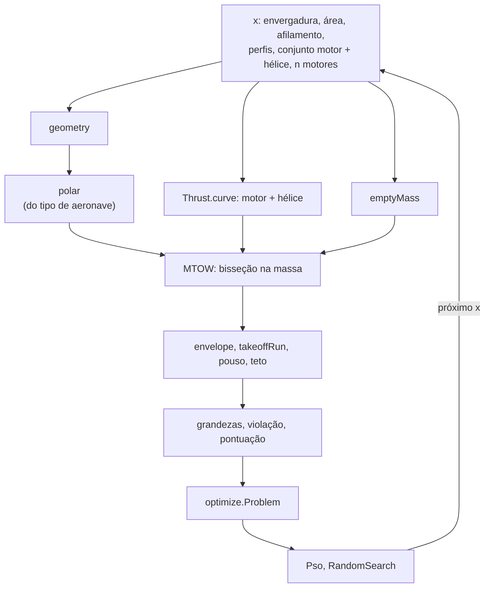
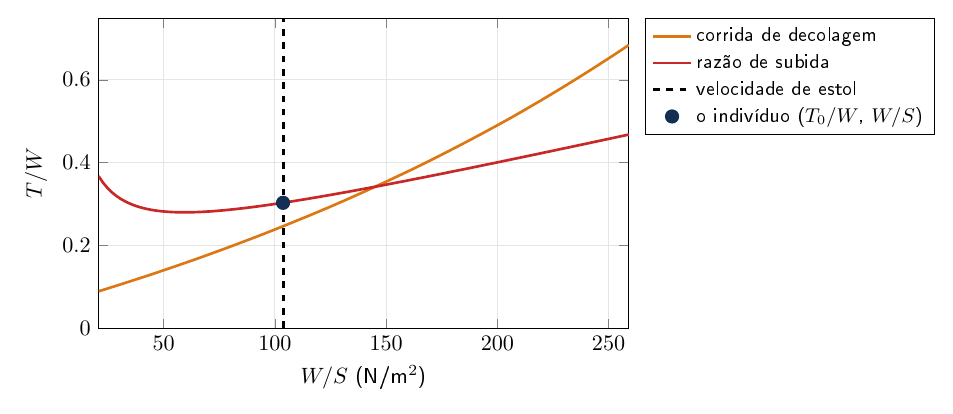

# core/src/sizing — dimensionamento inicial (mini-MDO)

Esta parte do núcleo procura um avião bom antes de existir um avião. Dados os requisitos (pista, massa, velocidades)
e as faixas de cada variável de projeto (envergadura, área, afilamento, perfis, motor), ela avalia cada combinação com
contas rápidas e devolve o avião resultante: área, velocidade de estol, corrida, MTOW e carga paga. Um otimizador
percorre as combinações em busca do maior MTOW ou da melhor eficiência estrutural, e como cada avaliação é curta, ele
volta em tempo real na GUI. É a conta do mini-MDO da sprint e a base do aeroopt; as contas das etapas da sprint também
moram aqui: a linha sustentadora da etapa Projetar (`wing_line`), a empenagem por volume de cauda com a estática, a
faixa de CG, a rotação e a rolagem (`tail`), e a corrida rápida e a tração motor + hélice da etapa Motores (`ground`,
`motorprop`).

O cálculo de um avião é uma cadeia de estágios, cada um uma função pura que parte do anterior, gerada em comptime
para o tipo de aeronave (convencional com N asas, asa voadora, tailsitter, VTOL) e para o provedor de tração. O MTOW
sai por bisseção na massa: a maior massa que ainda decola na pista e cumpre as restrições.



Deixando a envergadura e a área livres, com o motor e a hélice do avião dos testes, uma pista de 50 m e dez iterações
do enxame:

```zig
const std = @import("std");
const core = @import("aerosim");
const sizing = core.sizing.types;

var params: core.types.Params = .{};
var evaluated_buffer: [2048]sizing.Individual = undefined;

pub fn main() !void {
    core.test_aircraft(&params); // o motor e a hélice do avião dos testes viram o conjunto de tração
    var cfg: sizing.SizingCfg = .{};
    cfg.vars[sizing.variable(.span)] = .{ .lo = 1.5, .hi = 2.5 }; // o otimizador escolhe envergadura e área
    cfg.vars[sizing.variable(.area)] = .{ .lo = 0.6, .hi = 1.4 };
    cfg.vars[sizing.variable(.taper)] = .{ .lo = 0.7, .hi = 0.7 }; // o resto fica fixo (lo = hi)
    cfg.vars[sizing.variable(.motors)] = .{ .lo = 1, .hi = 1, .kind = .integer };
    cfg.sets[0] = .{ .unit = params.prop[0], .mass = 0.8, .P_max = 600 };
    cfg.n_cons = 1;
    cfg.cons[0] = .{ .q = .takeoff_run, .op = .at_most, .value = 50 }; // pista de 50 m

    const options: sizing.OptOpts = .{ .iterations = 10 };
    var evaluated: usize = 0;
    var best: sizing.SizingOut = .{};
    core.sizing.optimize(&cfg, &options, &params, &evaluated_buffer, &evaluated, &best, null, null);
    std.debug.print("{d} avaliações; viável: {}\n", .{ evaluated, best.feasible == 1 });
    std.debug.print("melhor: b = {d:.2} m  S = {d:.2} m²  MTOW = {d:.2} kg  corrida = {d:.1} m\n", .{
        best.x[sizing.variable(.span)],                best.x[sizing.variable(.area)],
        best.q[sizing.quantity(.mtow)], best.q[sizing.quantity(.takeoff_run)],
    });
}
```

```
240 avaliações; viável: true
melhor: b = 2.50 m  S = 1.40 m²  MTOW = 11.37 kg  corrida = 50.0 m
```

O enxame foi para a maior envergadura e a maior área permitidas, e o MTOW subiu até a corrida encostar na pista. O
exemplo está em `exemplo.zig` e roda com `cd core && python -m ziglang build exemplo -Dexemplo=sizing`. Um tipo
de aeronave novo é um struct posto em `kinds.all` (a interface é conferida em comptime), um otimizador novo é um
struct com `name` e `run` em `optimize.all`, e os testes rodam com `cd core && python -m ziglang build test
-Dgrupo=sizing`, com fuzzing das interfaces (`-Dfuzz=N -Dseed=S`).

O resultado é o ponto de partida do projeto: a asa que a sprint detalha e o que o aeroopt refina. O MTOW de cada
avaliação ao longo das iterações e o diagrama de restrições do melhor:



