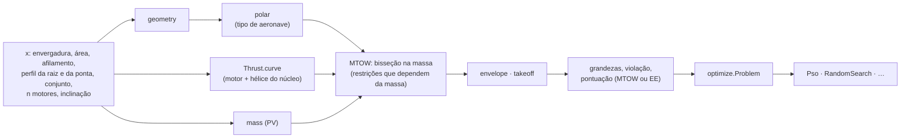

# core/src/sizing — dimensionamento inicial (mini-MDO)

Esta é a parte do núcleo que procura um avião bom antes de existir um avião. Dados os requisitos (pista, massa,
velocidades) e as faixas de cada variável de projeto (envergadura, área, afilamento, perfis, motor), ela avalia cada
combinação com contas rápidas e devolve as grandezas do avião resultante: área, velocidade de estol, corrida, peso
máximo de decolagem (MTOW), carga paga. Um otimizador percorre essas combinações em busca da melhor. O Python
(`aerosim/design/mdo.py`) só monta a configuração e desenha; como cada avaliação é curta, o otimizador volta em tempo
real na GUI.

O cálculo de um avião é uma cadeia de estágios, cada um uma função pura que parte do anterior: a geometria e o perfil
médio, a polar, o envelope de voo, a curva, o teto e o pouso, a decolagem e, por fim, a massa e o MTOW. O README
segue essa ordem e termina no otimizador, que trata a cadeia como uma caixa-preta.

| arquivo | o que tem |
|---|---|
| `types.zig` | `SizingCfg`, `OptOpts`, `SizingOut` e os índices das grandezas, variáveis e restrições |
| `stages.zig` | os estágios da cadeia, cada um uma função pura: geometria, polar, envelope, decolagem, pouso, teto, massa |
| `kinds.zig` | os tipos de aeronave (monoplano, biplano, asa voadora, tailsitter, VTOL), com a interface conferida em comptime |
| `chain.zig` | a cadeia de um tipo e de um provedor de tração, gerada em comptime; o MTOW por bisseção na massa |
| `optimize.zig` | os otimizadores atrás de uma interface só (PSO, busca aleatória) |
| `ground.zig` | a corrida de decolagem rápida da sprint (etapa Motores do aerosim), com a espera pela rotação do profundor e a bisseção do MTOW na pista |
| `motorprop.zig` | a tração em regime de um motor + hélice + bateria com acelerador cheio, a curva $`T(V)`$ da sprint |
| `sizing.zig` | a entrada: escolhe a cadeia pelo índice do tipo e o otimizador pelo índice do método |



## Geometria e perfil (`stages.geometry`, `stages.blendAirfoils`)

Com envergadura $`b`$ e área total $`S`$ (o biplano divide a área em duas asas de mesma envergadura), o alongamento do
monoplano equivalente e a corda média são:

```math
AR_{eq} = \frac{b^2}{S} \qquad \bar c = \frac{S}{b\,n_{asas}}
```

A asa trapezoidal tem um perfil na raiz e outro na ponta. Cada propriedade 2D ($`c_{l\alpha}`$, $`\alpha_0`$, $`c_{l,max}`$,
$`c_{d0}`$, $`c_m`$) varia linearmente ao longo da envergadura, e a média pesada pela corda, com o afilamento $`\lambda`$,
fica:

```math
\bar p = \frac{\int_0^1 p\,c\,d\eta}{\int_0^1 c\,d\eta} = p_r + (p_t - p_r)\,\frac{1 + 2\lambda}{3\,(1 + \lambda)}
```

## Polar (`stages.polar`)

Polar parabólica. O arrasto parasita soma o do perfil (com a fração da empenagem) e o da fuselagem, do trem e das
naceles por área de arrasto; o fator do induzido vem de Oswald, multiplicado pelo fator do tipo de aeronave:

```math
C_D = C_{D0} + K\,C_L^2
\qquad
C_{D0} = c_{d0}\,(1 + f_{emp}) + \frac{(C_DS)_{fus} + (C_DS)_{nac}}{S}
\qquad
K = \frac{k_{tipo}}{\pi\,AR_{eq}\,e}
```

$`C_{L,max}`$ é o $`c_{l,max}`$ do perfil vezes o fator do tipo (a asa voadora perde parte para se equilibrar sem EH).

**Biplano.** Com a mesma envergadura e a mesma área total, o arrasto induzido do biplano é o do monoplano vezes
$`(1 + \sigma)/2`$, com $`\sigma`$ o fator de interferência de Prandtl, ajustado pela razão vão/envergadura $`G/b`$ (forma
do ajuste a conferir no PDF):

```math
k_{tipo} = \frac{1 + \sigma}{2}
\qquad
\sigma \approx \frac{1 - 0{,}66\,G/b}{1{,}055 + 3{,}7\,G/b}
```

## Envelope (`stages.envelope`)

Com a tração disponível $`T(V)`$ (uma curva já calculada pelo provedor de tração) e o arrasto do voo nivelado:

```math
V_S = \sqrt{\frac{2W}{\rho S C_{L,max}}}
\qquad
C_L = \frac{W}{qS}
\qquad
D = qS\,(C_{D0} + K C_L^2)
```

Acima de $`V_S`$, a subida e o gradiente de subida vêm do excesso de tração, e $`V_{max}`$ é onde $`T = D`$ (interpolado
entre os pontos da grade):

```math
RC = \max_V \frac{(T - D)\,V}{W}
\qquad
\sin\gamma_{max} = \max_V \frac{T - D}{W}
```

A melhor razão sustentação/arrasto e a velocidade dela, pela polar parabólica (Anderson, *Aircraft Performance and
Design*, cap. 5, a conferir no PDF):

```math
\left(\frac{L}{D}\right)_{max} = \frac{1}{2\sqrt{K\,C_{D0}}}
\qquad
V_{L/D} = \sqrt{\frac{2W}{\rho S}\sqrt{\frac{K}{C_{D0}}}}
```

## Curva, teto e pouso

**Curva sustentada** (Gudmundsson, *General Aviation Aircraft Design*, cap. 3, a conferir no PDF): o fator de carga que
a tração mantém, limitado pelo estol:

```math
n = \min\left(\sqrt{\frac{q}{K\,W/S}\left(\frac{T}{W} - \frac{q\,C_{D0}}{W/S}\right)},\ \frac{q\,C_{L,max}}{W/S}\right)
```

**Teto.** A altitude-densidade em que a subida máxima cai ao valor pedido, com a tração proporcional a $`\rho`$, achada
por bisseção. A densidade é a ISA:

```math
\rho(h) = \rho_0\,(1 - 2{,}25577\times10^{-5}\,h)^{4{,}2559}
```

**Corrida de pouso.** Toque a $`1{,}15\,V_S`$ e frenagem com atrito $`\mu_f`$, sem arrasto nem sustentação (estimativa
conservadora, a mesma do limite de pouso do diagrama de restrições):

```math
s_{pouso} = \frac{(1{,}15)^2\,W/S}{\rho\,C_{L,max}\,g\,\mu_f}
```

## Decolagem (`stages.takeoffRun`)

A corrida é integrada no tempo até $`V_{LO} = 1{,}1\,V_S`$, com o $`C_L`$ de corrida no chão ($`C_{L,g}`$) e a tração
inclinada de $`\theta_T`$:

```math
m\,\frac{dV}{dt} = T\cos\theta_T - qS\,(C_{D0} + K C_{L,g}^2) - \mu\,\max(W - qS\,C_{L,g} - T\sin\theta_T,\ 0)
```

A posição avança com o passo exato para aceleração constante, e o último passo volta ao instante em que $`V = V_{LO}`$.
O tipo que paira (tailsitter, ou VTOL se a tração deixar) decola na vertical quando a tração estática vence o peso com
a margem pedida: $`T(0) \ge k\,m g`$.

## Corrida rápida da sprint (`ground.zig`)

Aqui se calcula a corrida do ponto de projeto acoplado do aerosim (`aerosim/design/power.py: performance`), que
antes rodava em Python e era o que mais pesava em cada ponto: a bisseção do MTOW na pista e a curva corrida × massa
refazem a corrida umas setenta vezes. A conta é a mesma da decolagem acima, com duas diferenças que vêm da sprint.
A tração é lida de uma curva $`T(V)`$ com a interpolação do `numpy.interp`, e o avião só sai do chão depois de
passar da velocidade em que o profundor todo cabrando consegue rodá-lo:

```math
V \ge V_{rot}(m) \quad\text{e}\quad \tfrac12\rho V^2 S\,C_{L,max} \ge 1{,}21\,(m g - T\sin\theta_T)
```

$`V_{rot}(m)`$ é a primeira velocidade da tabela em que o momento de cabrar (aerodinâmico com o profundor todo, mais
o da tração) vence o do peso em torno do trem principal. O passo é Euler explícito de 0,02 s, na mesma ordem das
contas do Python, então o resultado sai bit a bit igual ao de antes (`tests/design/test_ground_run.py`). A fonte do
modelo de corrida é a mesma da seção anterior (a conferir no PDF).

Com a atitude no chão da sprint (`power.ground_pitch`, a bequilha mais comprida), a asa já corre num ângulo e o avião
pode sair do chão sem rodar. É o caso da asa voadora, em que o elevon roda pouco. `lift_off = 1` liga essa saída: o
avião também sai quando $`\tfrac12\rho V^2 S\,C_{L,g} + T\sin\theta_T \ge m g`$, com o $`C_{L,g}`$ já nesse ângulo.
Desligado, a corrida é a de sempre.

## Tração motor + hélice da sprint (`motorprop.zig`)

Aqui se calcula a curva de tração com acelerador cheio que a sprint e o aeroopt usam em quase toda conta rápida
(`aerosim/design/power.py: thrust_of`): a corrida, a trimagem de decolagem, o desempenho. Antes ela era uma bisseção
em Python para cada velocidade, e era o que mais pesava no aeroopt; como segurava o GIL, rodar os candidatos em
linhas de execução não adiantava nada.

A rotação do conjunto é a do equilíbrio entre o torque que o motor entrega e o que a hélice pede. O motor de
corrente contínua sem escovas, com a bateria em série, é o modelo de primeira ordem (Drela, "First-Order DC Electric
Motor Model", MIT, 2007, a conferir no PDF), com $`k_v`$ em rad/(V·s), $`R_m`$ do motor e $`R_{int}`$ da bateria:

```math
I = \min\left(\frac{V_{oc} - \omega/k_v}{R_m + R_{int}},\; I_{max}\right) \qquad Q_m = \frac{I}{k_v} - \tau_c - B\,\omega
```

A hélice pede o torque da tabela de potência, com a razão de avanço $`J = V/(nD)`$ e $`n = \omega/2\pi`$:

```math
Q_p = \frac{C_P(J)}{2\pi}\,\rho\,n^2 D^5
```

Uma bisseção de 60 passos em $`\omega \in [1, V_{oc}k_v]`$ acha $`Q_m = Q_p`$, e a tração sai da tabela de empuxo, que
vale zero depois do último $`J`$ (a hélice já não empurra):

```math
T = \max\left(C_T(J)\,\rho\,n^2 D^4,\; 0\right)
```

As contas seguem a ordem das do Python de antes e a interpolação é a do `numpy.interp`; $`D^4`$ e $`D^5`$ vêm prontos do
Python, porque a potência das duas linguagens pode diferir no último bit. Assim a curva sai bit a bit igual à de
antes, com todos os motores, hélices e baterias do catálogo (`tests/design/test_motor_prop.py`). A tabela da hélice
vai até 256 pontos. A chamada é `aerosim_motor_prop_thrust`, e no Python `ISimBackend.motor_prop_thrust(spec, V, rho)`.

## Massa e MTOW (`stages.emptyMass`, `chain`)

A massa vazia (PV) soma asa e empenagem por densidade de área, os conjuntos motopropulsores, a fuselagem, os sistemas,
o trem e a massa própria do tipo:

```math
PV = \rho_{asa}\,S + \rho_{emp}\,f_{emp}\,S + n_m\,m_{conj} + m_{fus} + m_{sis} + m_{trem} + m_{tipo}
```

O MTOW é a maior massa em que as restrições que dependem da massa (corrida, $`V_S`$, subida, $`V_{max}`$, $`T/W`$...) ainda
cumprem, achada por bisseção (elas pioram com a massa). No MTOW:

```math
CP = MTOW - PV \qquad EE = \frac{CP}{PV}
```

## Otimizador (`optimize.zig`)

O problema chega como `Problem`: limites e tipo de cada variável (contínua, inteira, lista) e uma função que avalia um
vetor e devolve a aptidão (maior é melhor), já com a penalidade das restrições violadas. O otimizador não sabe nada de
avião: os testes usam funções analíticas.

**PSO** (enxame de partículas, melhor global; Kennedy e Eberhart, *Particle Swarm Optimization*, IEEE ICNN 1995, a
conferir no PDF). Cada partícula $`k`$ guarda a melhor posição que viu ($`p_k`$), e o enxame a melhor de todas ($`g`$). Com
$`r_1, r_2`$ sorteados em $`[0, 1]`$, inércia $`w`$ e pesos $`c_1, c_2`$:

```math
v_k \leftarrow w\,v_k + c_1 r_1\,(p_k - x_k) + c_2 r_2\,(g - x_k)
\qquad
x_k \leftarrow x_k + v_k
```

A velocidade é limitada a meia faixa da variável e a posição aos limites. A **busca aleatória** sorteia vetores na
faixa e serve de referência.

## Como chamar

```python
from aerosim.backend.zig import ZigBackend
from aerosim.design import mdo
from aerosim.design.project import DesignProject

proj = DesignProject()                       # requisitos e restrições padrão
proj.mdo.iterations = 5                      # poucas iterações, só para ver
rows, best, names = mdo.run(proj, backend=ZigBackend())
print(len(rows), best["score"], best["feasible"])   # cada avaliação e a melhor
```

Testes: `python -m ziglang build test -Dgrupo=sizing` (dentro de `core/`), com fuzzing das interfaces (`-Dfuzz=N -Dseed=S`).

## Como acrescentar

- **Tipo de aeronave:** um struct com `name`, `wings`, `tail`, `hover`, `inducedFactor`, `clmaxFactor`, `extraMass` e
  `surfaces`, posto em `kinds.all`; `kinds.check` confere a interface em comptime, e a ABI e o Python passam a aceitá-lo
  pelo índice.
- **Otimizador:** um struct com `name` e `run`, posto em `optimize.all` (o índice é `OptOpts.method`).
- **Tração:** qualquer tipo com `fn curve(self, set, n_motor) stages.Curve` (`chain.checkThrust`); os testes usam mocks
  como $`T = T_0\,(1 - V/V_z)`$.
