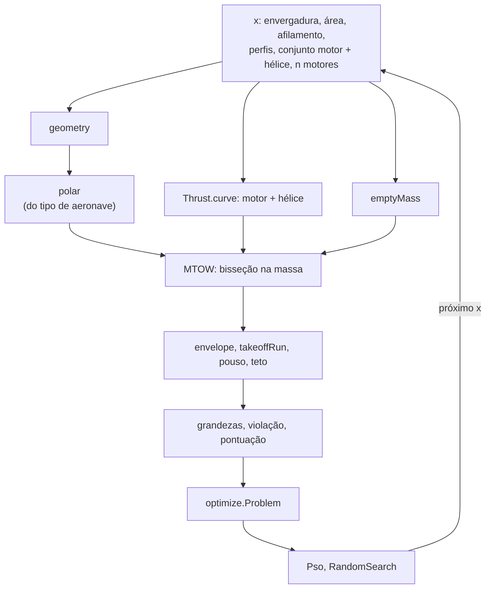
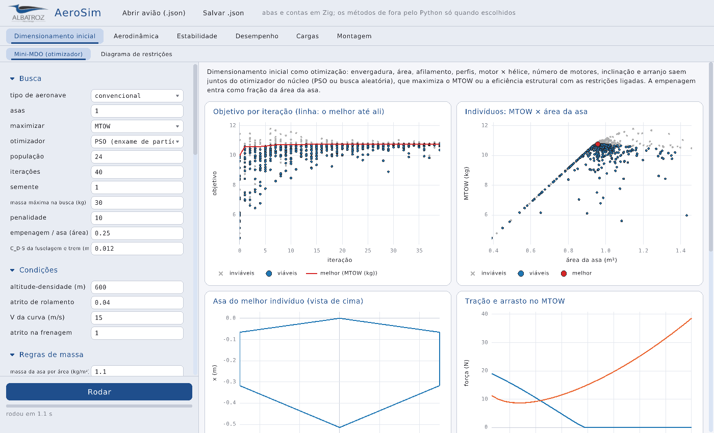
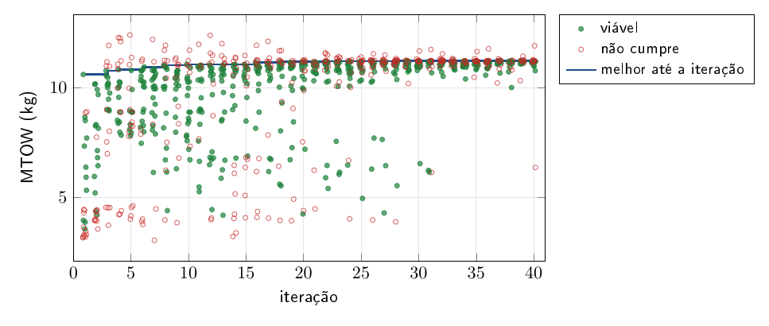

# core/src/sizing — dimensionamento inicial (mini-MDO)

Esta parte do núcleo procura um avião bom antes de existir um avião. Dados os requisitos (pista, massa, velocidades)
e as faixas de cada variável de projeto (envergadura, área, afilamento, perfis, motor), ela avalia cada combinação com
contas rápidas e devolve o avião resultante: área, velocidade de estol, corrida, MTOW e carga paga. Um otimizador
percorre as combinações em busca do maior MTOW ou da melhor eficiência estrutural, e como cada avaliação é curta, ele
volta em tempo real na GUI. É a conta do mini-MDO da sprint e a base do aeroopt; as contas das etapas da sprint também
moram aqui: a linha sustentadora da etapa Projetar (`wing_line`), a empenagem por volume de cauda com a estática, a
faixa de CG, a rotação e a rolagem (`tail`), e a corrida rápida e a tração motor + hélice da etapa Motores (`ground`,
`motorprop`).

O cálculo de um avião é uma cadeia de estágios, cada um uma função pura que parte do anterior, gerada em comptime
para o tipo de aeronave (convencional com N asas, asa voadora, tailsitter, VTOL) e para o provedor de tração. O MTOW
sai por bisseção na massa: a maior massa que ainda decola na pista e cumpre as restrições.



Deixando a envergadura e a área livres, com uma pista de 50 m, e dez iterações do enxame:

```python
from aerosim.backend.zig import ZigBackend
from aerosim.design import mdo
from aerosim.design.project import DesignProject

proj = DesignProject()
proj.requirements.takeoff_run = 50.0
for v in proj.variables:
    if v.key in ("wing.span", "wing.area"):
        v.mode = "variável"                      # o otimizador escolhe envergadura e área
proj.mdo.iterations = 10
rows, best, names = mdo.run(proj, backend=ZigBackend())
q = dict(zip(names["quantities"], best["q"]))
print(len(rows), "avaliações; viável:", bool(best["feasible"]))
print("melhor: b =", round(best["x"][0], 2), "m  S =", round(best["x"][1], 2), "m²  MTOW =", round(q["mtow"], 2),
      "kg  corrida =", round(q["s_to"], 1), "m")
```

```
240 avaliações; viável: True
melhor: b = 2.5 m  S = 1.22 m²  MTOW = 10.51 kg  corrida = 47.4 m
```

O enxame foi para a maior envergadura permitida e para a área que leva o MTOW até a corrida encostar na pista. Um tipo
de aeronave novo é um struct posto em `kinds.all` (a interface é conferida em comptime), um otimizador novo é um
struct com `name` e `run` em `optimize.all`, e os testes rodam com `cd core && python -m ziglang build test
-Dgrupo=sizing`, com fuzzing das interfaces (`-Dfuzz=N -Dseed=S`).

O resultado é o ponto de partida do projeto: a asa que a sprint detalha e o que o aeroopt refina. O MTOW de cada
avaliação ao longo das iterações e o diagrama de restrições do melhor:






