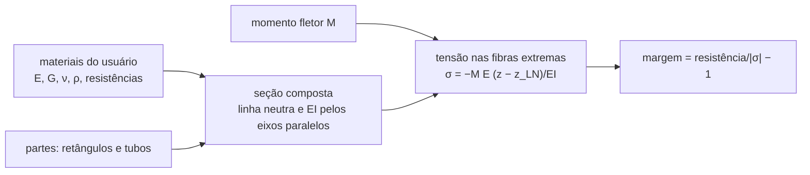
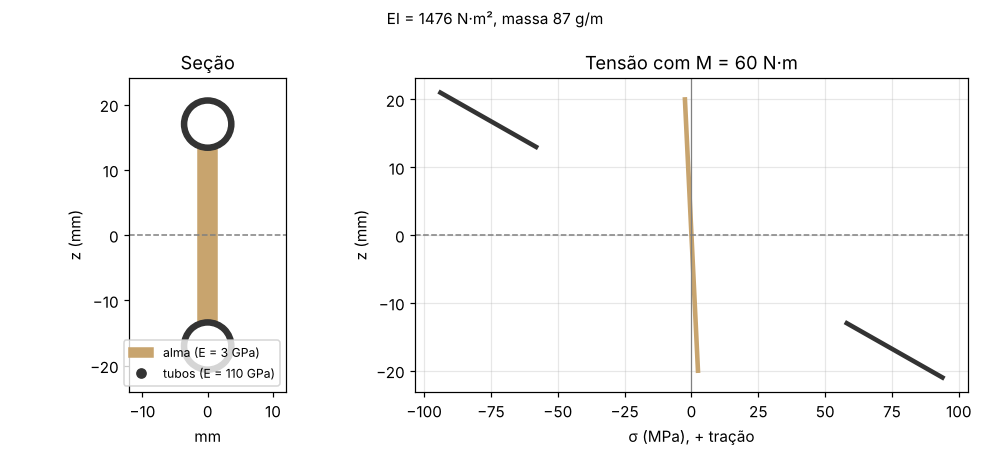

# core/src/structures — estruturas da aeronave

Esta parte do núcleo verifica se a estrutura aguenta as cargas que o resto do projeto calcula. Hoje ela tem a seção
composta de uma viga, como uma longarina com alma de balsa e tubos de carbono, ou um tubo de cauda. Cada parte da
seção tem o seu material. Daqui saem a linha neutra, a rigidez à flexão EI e a massa por metro. Sob um momento fletor
saem também a tensão nas fibras extremas de cada parte e a margem contra a resistência do material. O material é
sempre dado pelo usuário, e o núcleo não tem valor padrão. Os próximos passos são o diagrama V-n com a rajada,
o cortante e o fletor ao longo da envergadura, a flambagem, a torção com divergência e reversão, o flutter e o trem de
pouso.



A linha neutra pondera a área pelo módulo, e a rigidez soma o termo próprio de cada parte com o de eixos paralelos
(Megson, *Aircraft Structures for Engineering Students*, a conferir no PDF):

```math
z_{LN} = \frac{\sum E_k A_k z_k}{\sum E_k A_k},\qquad EI = \sum E_k\left(I_k + A_k (z_k - z_{LN})^2\right)
```

Uma longarina com alma de 3 × 40 mm e dois tubos de 8/6 mm, sob 60 N·m. Os materiais deste exemplo são só para mostrar
a conta:

```python
import ctypes, math
from aerosim.backend.zig.backend import ZigBackend

lib = ZigBackend()._lib
T = lib.schema.types
materiais = (T["Material"] * 2)()
materiais[0].modulus, materiais[0].density, materiais[0].tension, materiais[0].compression = 3e9, 160, 12e6, 10e6
materiais[1].modulus, materiais[1].density, materiais[1].tension, materiais[1].compression = 110e9, 1550, 1200e6, 1000e6

def tubo(material, D, d, z):
    return T["SectionPart"](material=material, area=math.pi / 4 * (D * D - d * d), z=z,
                            own_inertia=math.pi / 64 * (D**4 - d**4), half_depth=D / 2)

partes = (T["SectionPart"] * 3)(
    T["SectionPart"](material=0, area=0.003 * 0.04, z=0, own_inertia=0.003 * 0.04**3 / 12, half_depth=0.02),
    tubo(1, 0.008, 0.006, 0.017), tubo(1, 0.008, 0.006, -0.017))
secao, tensoes = T["SectionProperties"](), (T["PartStress"] * 3)()
lib.dll.aerosim_section_check(materiais, 2, partes, 3, ctypes.c_double(60.0), ctypes.byref(secao), tensoes)
print(f"EI = {secao.bending:.0f} N·m², {secao.mass_per_length * 1e3:.0f} g/m")
for nome, t in zip(("alma", "tubo de cima", "tubo de baixo"), tensoes):
    print(f"{nome}: {t.top / 1e6:.1f} / {t.bottom / 1e6:.1f} MPa, margem {t.margin:.2f}")
```

```
EI = 1476 N·m², 87 g/m
alma: -2.4 / 2.4 MPa, margem 3.10
tubo de cima: -93.9 / -58.1 MPa, margem 9.65
tubo de baixo: 58.1 / 93.9 MPa, margem 11.78
```

Os tubos, 37 vezes mais rígidos que a balsa, levam quase todo o momento, e a alma fica com pouca tensão. Os testes
rodam com `cd core && python -m ziglang build test -Dgrupo=structures`. O EI daqui vai para a flecha da asa, e as
margens vão para a verificação da longarina e do tubo de cauda, a partir das cargas de
[`loads`](../loads/README.md):


