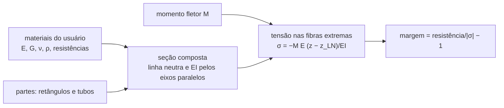

# core/src/structures — estruturas da aeronave

Esta parte do núcleo verifica se a estrutura aguenta as cargas que o resto do projeto calcula. Hoje ela tem a seção
composta de uma viga, como uma longarina com alma de balsa e tubos de carbono, ou um tubo de cauda. Cada parte da
seção tem o seu material. Daqui saem a linha neutra, a rigidez à flexão EI e a massa por metro. Sob um momento fletor
saem também a tensão nas fibras extremas de cada parte e a margem contra a resistência do material. O material é
sempre dado pelo usuário, e o núcleo não tem valor padrão. A pasta também tem a rigidez à torção (caixa D por
Bredt–Batho, paredes abertas e tubos), a flambagem do chapeado plano e curvo e da alma, com as nervuras que cada vão
precisa, e o trem de pouso (pórtico 3D de tubos com margens e o impacto do pouso). O que é carga fica em
[`loads`](../loads/README.md): o V-n com a rajada, os esforços ao longo da envergadura, a divergência, a reversão e o
flutter.



A linha neutra pondera a área pelo módulo, e a rigidez soma o termo próprio de cada parte com o de eixos paralelos
(Megson, *Aircraft Structures for Engineering Students*, a conferir no PDF):

```math
z_{LN} = \frac{\sum E_k A_k z_k}{\sum E_k A_k},\qquad EI = \sum E_k\left(I_k + A_k (z_k - z_{LN})^2\right)
```

Uma longarina com alma de 3 × 40 mm e dois tubos de 8/6 mm, sob 60 N·m. Os materiais deste exemplo são só para mostrar
a conta:

```zig
const std = @import("std");
const section = @import("aerosim").structures.section;

pub fn main() !void {
    const materials = [_]section.Material{
        .{ .modulus = 3e9, .density = 160, .tension = 12e6, .compression = 10e6 }, // 0: alma (balsa)
        .{ .modulus = 110e9, .density = 1550, .tension = 1200e6, .compression = 1000e6 }, // 1: tubos (carbono)
    };
    const parts = [_]section.SectionPart{
        section.SectionPart.rectangle(0, 0.003, 0.04, 0), // alma de 3 × 40 mm
        section.SectionPart.tube(1, 0.008, 0.006, 0.017), // tubo de 8/6 mm em cima
        section.SectionPart.tube(1, 0.008, 0.006, -0.017), // e embaixo
    };
    const properties = try section.properties(&materials, &parts);
    var stresses: [parts.len]section.PartStress = undefined;
    try section.stresses(&materials, &parts, properties, 60.0, &stresses);
    std.debug.print("EI = {d:.0} N·m², {d:.0} g/m\n", .{ properties.bending, properties.mass_per_length * 1e3 });
    for ([_][]const u8{ "alma", "tubo de cima", "tubo de baixo" }, stresses) |name, stress| {
        std.debug.print("{s}: {d:.1} / {d:.1} MPa, margem {d:.2}\n", .{ name, stress.top / 1e6, stress.bottom / 1e6, stress.margin });
    }
}
```

```
EI = 1476 N·m², 87 g/m
alma: -2.4 / 2.4 MPa, margem 3.10
tubo de cima: -93.9 / -58.1 MPa, margem 9.65
tubo de baixo: 58.1 / 93.9 MPa, margem 11.78
```

Os tubos, 37 vezes mais rígidos que a balsa, levam quase todo o momento, e a alma fica com pouca tensão. O exemplo
está em `exemplo.zig` (`python -m ziglang build exemplo -Dexemplo=structures`), e os testes rodam com `cd core &&
python -m ziglang build test -Dgrupo=structures`. O EI daqui vai para a flecha da asa, e as
margens vão para a verificação da longarina e do tubo de cauda, a partir das cargas de
[`loads`](../loads/README.md).
