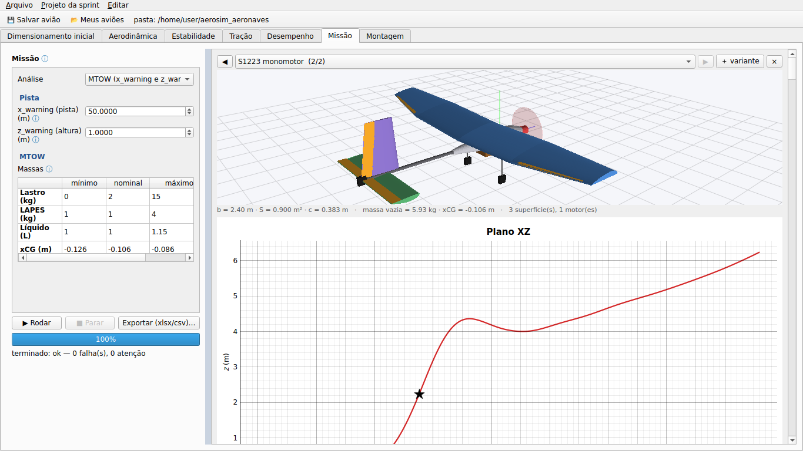

# Estudo S1223 — MTOW por empenagem, motorização e altitude-densidade

Gerado por `python tools/estudo_s1223.py`. Os projetos abrem em **Projeto da sprint → Abrir projeto…**, os aviões (`avioes/`) em **Arquivo → Abrir arquivo…** ou no AeroDrive.

## Hipóteses

- Asa S1223: envergadura 2,4 m, área 0,9 m², 50 % retangular, afilamento 0,6, washout 1,5°, diedro 2°; ângulo de cruzeiro da fuselagem 3° (com 0° a asa fica calada a ~5,6° e estola na rotação na simulação 6GDL).
- Polares 2D pelo NeuralFoil no Re de cada superfície; empenagem por volume (V_H 0,45, V_V 0,04, braço 0,95 m), margem estática 12 %.
- Carga paga nominal: lastro 2 kg + líquido 1 L + LAPES 1 kg, no CG. Pista 50 m, z_warning 1 m, μ 0,04.
- MTOW rápido: corrida até 1,1 V_S (motor inclinado: a parte vertical da tração alivia o peso). MTOW 6GDL: aba Missão, bisseção no lastro (0 a 15 kg), acionamento do profundor otimizado em cada massa (e, se o avião sai do chão cedo demais, o profundor segurado picando na corrida).
- Rotação: velocidade a partir da qual o profundor todo (20°) levanta o nariz em torno do trem principal, com o C_L da EH limitado pela polar do perfil nos dois lados — a EH invertida tem c_l negativo maior e roda antes.
- CP possível = MTOW − PV.

| lugar | elevação | QNH | temperatura | umidade | ρ (kg/m³) | AD (m) |
|---|---|---|---|---|---|---|
| Joinville | 4 m | 1013 hPa | 30 °C | 75 % | 1.150 | 655 |
| São José dos Campos | 646 m | 1015 hPa | 28 °C | 60 % | 1.077 | 1320 |

## Resultados

### Joinville (AD 655 m)

| avião | PV (kg) | i_h (°) | roda a partir de (m/s, sem tração) | sai do chão (m/s) | corrida com CP nominal (m) | MTOW rápido (kg) | CP possível rápido | MTOW 6GDL (kg) | CP possível 6GDL |
|---|---|---|---|---|---|---|---|---|---|
| monomotor · EH MH 113 inv · EV HT 14 | 3.93 | +0.6 | 8.52 | 11.6 | 23 | 11.64 | 7.71 | 11.99 | 8.06 |
| bimotor · EH MH 113 inv · EV HT 14 | 4.02 | +0.6 | 8.52 | 11.6 | 21 | 10.84 | 6.82 | 10.68 | 6.66 |
| monomotor inclinado 6° · EH MH 113 inv · EV HT 14 | 3.93 | +0.6 | 8.52 | 11.6 | 21 | 11.73 | 7.81 | 11.14 | 7.21 |
| monomotor · EH MH 113 inv · EV SD8020 | 3.93 | +0.6 | 8.52 | 11.6 | 23 | 11.64 | 7.71 | 11.99 | 8.06 |
| bimotor · EH MH 113 inv · EV SD8020 | 4.02 | +0.6 | 8.52 | 11.6 | 21 | 10.84 | 6.82 | 10.68 | 6.66 |
| monomotor inclinado 6° · EH MH 113 inv · EV SD8020 | 3.93 | +0.6 | 8.52 | 11.6 | 21 | 11.73 | 7.81 | 11.11 | 7.19 |
| monomotor · EH MH 113 · EV NACA 0012 | 3.93 | -14.1 | 53.07 | 11.6 | inf | — | — | 9.21 | 5.28 |
| bimotor · EH MH 113 · EV NACA 0012 | 4.02 | -14.1 | 53.07 | 11.6 | inf | — | — | 6.40 | 2.38 |
| monomotor inclinado 6° · EH MH 113 · EV NACA 0012 | 3.93 | -14.1 | 53.07 | 11.6 | inf | — | — | 10.44 | 6.51 |
| monomotor · EH NACA 0012 · EV NACA 0012 | 3.93 | -8.3 | 11.52 | 11.6 | 46 | 8.08 | 4.15 | 11.49 | 7.57 |
| bimotor · EH NACA 0012 · EV NACA 0012 | 4.02 | -8.3 | 11.52 | 11.6 | 47 | 8.24 | 4.22 | 9.97 | 5.96 |
| monomotor inclinado 6° · EH NACA 0012 · EV NACA 0012 | 3.93 | -8.3 | 11.52 | 11.6 | 41 | 8.87 | 4.94 | 12.08 | 8.15 |
| monomotor · cauda em V MH 113 inv | 3.93 | +2.8 | 7.99 | 11.6 | 20 | 11.64 | 7.71 | 9.94 | 6.01 |
| bimotor · cauda em V MH 113 inv | 4.02 | +2.8 | 7.99 | 11.6 | 21 | 10.83 | 6.81 | 9.95 | 5.93 |
| monomotor inclinado 6° · cauda em V MH 113 inv | 3.93 | +2.8 | 7.99 | 11.6 | 19 | 11.73 | 7.80 | 10.53 | 6.60 |

### São José dos Campos (AD 1320 m)

| avião | PV (kg) | i_h (°) | roda a partir de (m/s, sem tração) | sai do chão (m/s) | corrida com CP nominal (m) | MTOW rápido (kg) | CP possível rápido | MTOW 6GDL (kg) | CP possível 6GDL |
|---|---|---|---|---|---|---|---|---|---|
| monomotor · EH MH 113 inv · EV HT 14 | 3.93 | +0.0 | 8.63 | 12.0 | 25 | 10.86 | 6.94 | 9.21 | 5.28 |
| bimotor · EH MH 113 inv · EV HT 14 | 4.02 | +0.0 | 8.63 | 12.0 | 25 | 10.12 | 6.10 | 10.18 | 6.16 |
| monomotor inclinado 6° · EH MH 113 inv · EV HT 14 | 3.93 | +0.0 | 8.63 | 12.0 | 23 | 10.95 | 7.02 | 9.74 | 5.81 |
| monomotor · EH MH 113 inv · EV SD8020 | 3.93 | +0.0 | 8.63 | 12.0 | 25 | 10.86 | 6.93 | 9.21 | 5.28 |
| bimotor · EH MH 113 inv · EV SD8020 | 4.02 | +0.0 | 8.63 | 12.0 | 25 | 10.12 | 6.10 | 10.18 | 6.16 |
| monomotor inclinado 6° · EH MH 113 inv · EV SD8020 | 3.93 | +0.0 | 8.63 | 12.0 | 23 | 10.95 | 7.02 | 9.74 | 5.81 |
| monomotor · EH MH 113 · EV NACA 0012 | 3.93 | -14.0 | 37.62 | 12.0 | inf | — | — | 8.53 | 4.61 |
| bimotor · EH MH 113 · EV NACA 0012 | 4.02 | -14.0 | 37.62 | 12.0 | inf | — | — | — | — |
| monomotor inclinado 6° · EH MH 113 · EV NACA 0012 | 3.93 | -14.0 | 37.62 | 12.0 | inf | — | — | 9.03 | 5.11 |
| monomotor · EH NACA 0012 · EV NACA 0012 | 3.93 | -9.4 | 11.80 | 12.0 | 54 | 7.73 | 3.80 | 10.06 | 6.13 |
| bimotor · EH NACA 0012 · EV NACA 0012 | 4.02 | -9.4 | 11.80 | 12.0 | 58 | 7.76 | 3.74 | 7.60 | 3.58 |
| monomotor inclinado 6° · EH NACA 0012 · EV NACA 0012 | 3.93 | -9.4 | 11.80 | 12.0 | 48 | 8.17 | 4.24 | 9.38 | 5.46 |
| monomotor · cauda em V MH 113 inv | 3.93 | +2.2 | 8.13 | 12.0 | 23 | 10.86 | 6.93 | 9.27 | 5.34 |
| bimotor · cauda em V MH 113 inv | 4.02 | +2.2 | 8.13 | 12.0 | 25 | 10.12 | 6.10 | 8.72 | 4.70 |
| monomotor inclinado 6° · cauda em V MH 113 inv | 3.93 | +2.2 | 8.13 | 12.0 | 22 | 10.95 | 7.02 | 8.60 | 4.67 |

Tempo total: 2186 s.
