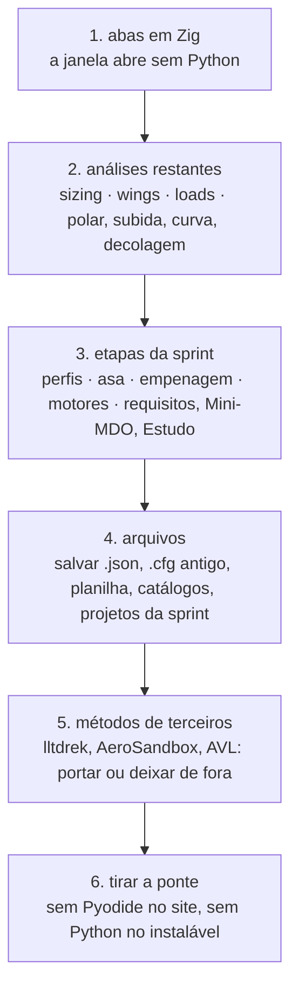

# Plano: o aerosim sem Python

Hoje a tela em Zig ainda precisa do Python para três coisas. Primeiro, a lista de abas: sem o Python a janela abre
vazia. Segundo, as quatro etapas da sprint: Perfis, Projetar, Empenagem e comandos, Motores e montagem. Terceiro, três
análises: Diagrama de restrições, Analisar e Cargas.

Já rodam só em Zig a Montagem e cinco análises: Estabilidade (avião montado e dinâmica), Desempenho, Voo nivelado e
envelopes, Tração e Missão.

A meta é a do dono: uma base só, raylib → interface em Zig → núcleo em Zig, que roda instalada e no navegador sem baixar
o Pyodide. Cada passo segue a regra que já vale para a G23:
- o `.zig` nasce ao lado do `.py`, com o teste nos números do Python;
- a tela troca para o `.zig` na mesma subaba;
- o `.py` só sai no fim, quando nada mais o chama.

| passo | o que entra em Zig | onde está hoje em Python | o que já existe no núcleo ou na tela | tamanho |
|---|---|---|---|---|
| 1 | a lista de áreas e subabas (o pedido `layout`) | a ponte e `interfaces.simulation.AREAS` | o registro `manager.analyses`, que já acrescenta as abas em Zig | pequeno |
| 2 | Diagrama de restrições, Analisar, Cargas e as análises sem aba (polar, subida, curva, decolagem, aerodinâmica) | `manager/simulations/{sizing,wings,loads,polar,climb,turn,takeoff,aerodynamics}.py` | o dimensionamento (`sizing`), a varredura das asas e a linha sustentadora (`loads`), a trimagem e o desempenho | médio |
| 3 | as etapas da sprint e o projeto | `manager/stages.py` (984 linhas) e `aerosim/design` (cerca de 4 mil linhas: perfis, asa, empenagem, motores, Mini-MDO, Estudo, registro) | `design/dims.zig`, `design/balance.zig`, a polar 2D, a linha de Glauert, as peças de etapa da tela (`ui/stage.zig`, `ui/table.zig`, `ui/checks.zig`) | grande |
| 4 | gravar o avião, o `.cfg` antigo, a planilha por mapa de células, os catálogos e as pastas da sprint | `aerosim/data` e `design/store.py`, `design/project.py` | a leitura do `.json` (modelo do AeroDrive) e a Montagem, que já edita e grava a árvore do arquivo | médio |
| 5 | os métodos que vêm de fora | lltdrek, AeroSandbox (VLM, buildup, linha sustentadora) e AVL (Fortran, pelo `optvl`) | as faixas, a linha sustentadora de Phillips e Snyder e a de Goates e Hunsaker | decisão do dono |
| 6 | tirar a ponte, o Pyodide do site e o Python do instalável | `aerosim/bridge.py`, `gui/python_bridge.zig`, `gui/web/python.html`, a pasta `app/` da G22 | — | pequeno |

## O que o dono precisa decidir

No passo 5 há duas saídas, e a recomendada é a primeira.

1. **Recomendado: portar um VLM para o núcleo, como método novo e desligado por padrão (regra 5), e deixar de fora o
   lltdrek, o AeroSandbox e o AVL.** A comparação entre métodos continua, só que entre os do núcleo, com o AVL
   conferido uma vez e os números escritos nos testes.
2. **Manter os de fora como opcionais.** Nesse caso eles rodam só na instalação com Python, e o site nunca os tem.

## Como medir

O passo 1 já tira os 0,3 s de abertura do Python. Medido em 2026-11-06 nesta máquina, sem placa de vídeo, com a tela em
release:
- **Contas pelo Python:** de 0,05 s a 7,5 s, e a tela segue a 60 quadros por segundo enquanto elas rodam.
- **Quadro lento na chegada do resultado:** um só, de 70 a 520 ms.
- **No navegador:** a conta em Python para a página até acabar. É isso que o plano resolve de vez.

Cada passo termina com a mesma medida. Os testes de `tests/` que fixam números do Python viram testes em Zig com os
mesmos números esperados.

## Fora do plano

- O aeroopt fica como está, por pedido do dono.
- As ferramentas de `tools/` são scripts de quem desenvolve e continuam em Python.
