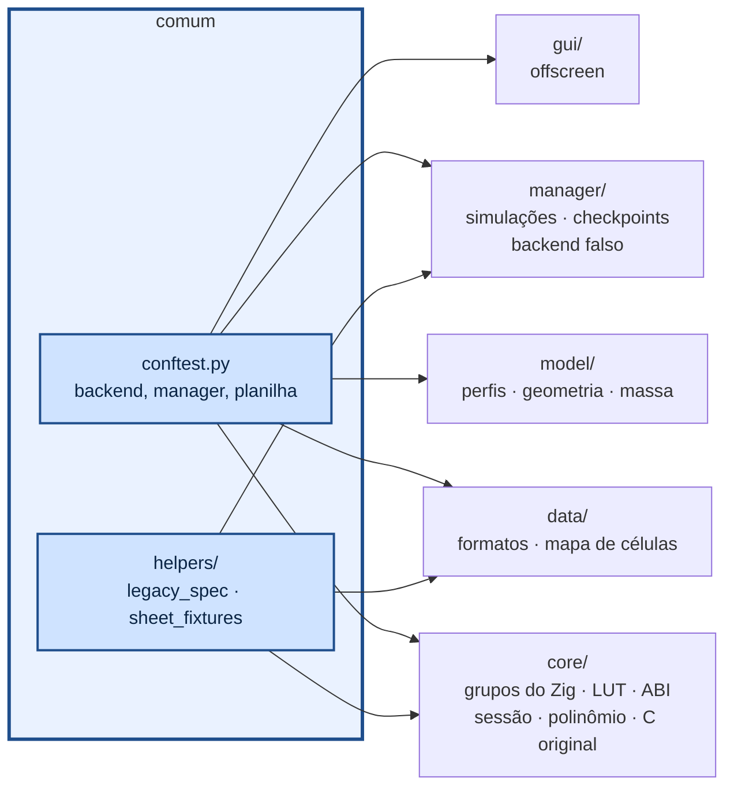

# tests — uma pasta por camada



```sh
python -m pytest                       # tudo menos medições de tempo
python -m pytest tests/core            # uma camada
python -m pytest -m lut                # só LUTs e aproximações
python -m pytest -m bench -s           # medições (LUT x std, custo de f(t,x)); imprime os tempos
python -m pytest -m legacy             # comparação com o simulador C original (gcc + make)
```

| arquivo | o que testa |
|---|---|
| `core/test_zig_groups.py` | `zig build test-math`, `test-physics`, `test-control`, `test-sim` |
| `core/test_lut.py` | LUTs isoladas: mesmo resultado que a std (sequencial e aleatório), tempos (`bench`) |
| `core/test_abi.py` | esquema, ordem dos termos do polinômio, erros de configuração, slots |
| `core/test_session.py` | checkpoint exato, fatias = corrida inteira, trimagem, começo em voo |
| `core/test_poly_thrust.py` | tração polinomial no núcleo = conta do Python; densidade; decola |
| `core/test_legacy.py` | decolagem igual à do simulador C original |
| `model/*` | perfil fino, `.dat`, painéis, sinais dos comandos, malhas, massa, tanque quadrado |
| `data/*` | ida e volta `.json/.cfg/.xlsx`, catálogo, planilha Dados_Desempenho (campos e aba Tracao) |
| `manager/*` | todas as simulações, missão das três aeronaves, retomar de checkpoint, cancelar, backend falso |
| `gui/*` | janela, edição, aba de simulação, editor de tração polinomial |
