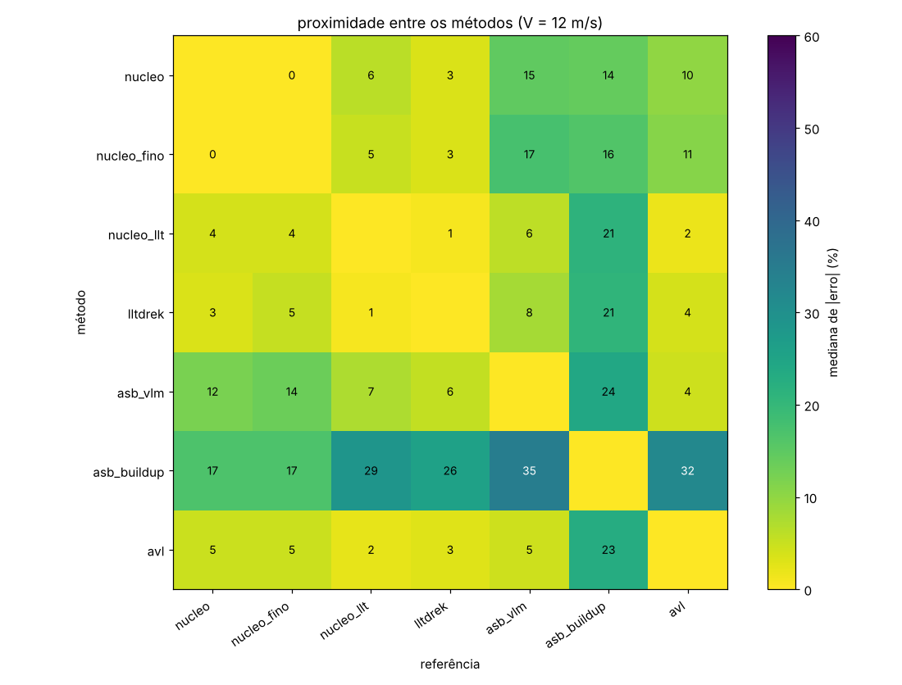
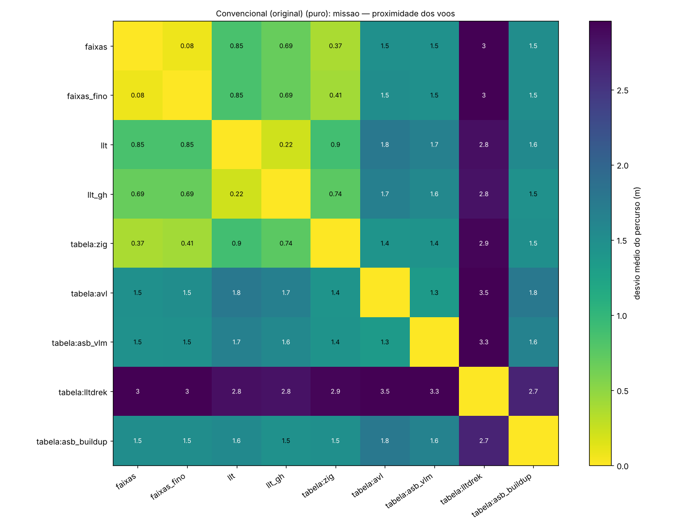
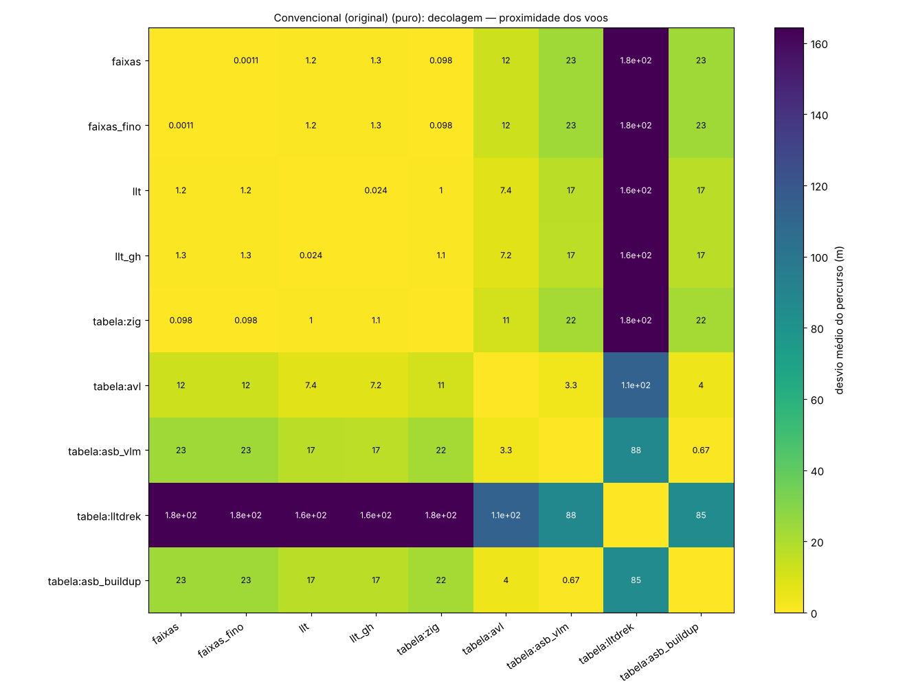
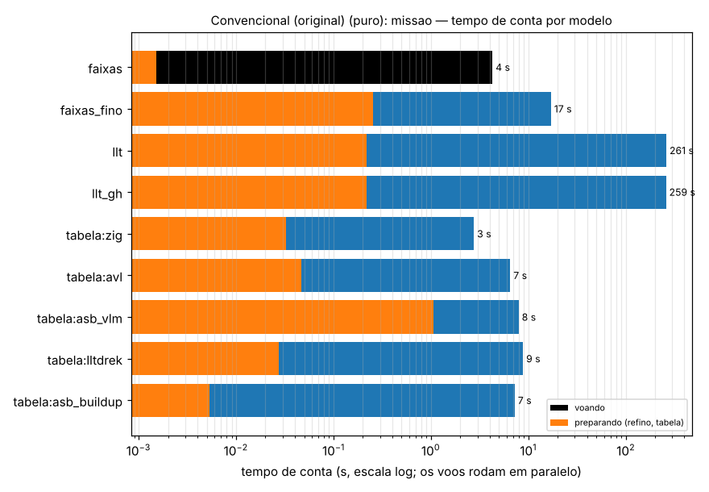

# tools — ferramentas de linha de comando

Scripts que usam o programa (manager → núcleo) sem a GUI: imprimem, gravam tabelas e gráficos e servem de teste
rápido. Nenhum faz conta própria. O cálculo é do núcleo (`core/`) ou dos métodos de `aerosim/aero`; a ferramenta
orquestra e desenha. O que elas gravam (gráficos, tabelas, voos) fica fora do git, em `perfis/` ou na pasta que você
passar, e só as figuras escolhidas vão para `docs/img`.

## Aerodinâmica e voo com cada modelo (`tools/aero/`)

Detalhes, comandos e resultados no [README da pasta](aero/README.md).

| ferramenta | o que faz |
|---|---|
| `aero/coeficientes.py` | os coeficientes de aviões simples, só superfícies, a 12 m/s, por todos os métodos: faixas, linha sustentadora (Phillips e Snyder; Goates e Hunsaker), lltdrek, ASB, AVL. Distância até qualquer referência, matriz entre os métodos, varredura de malha e de V, perfil por `.dat` |
| `aero/decolagem.py` | a decolagem da GUI reavaliada em cada instante com cada método, no mesmo estado: o erro de cada coeficiente no tempo |
| `aero/missao.py` | a decolagem ou a missão inteira **voada** com cada modelo (`ac.sim.aero_model`). Erro ao longo do percurso contra qualquer referência, mapa de proximidade dos voos, tempo de conta, voos em paralelo, `--carregar` sem voar de novo |
| `aero/casos.py` | os aviões de teste (retangulares, trapezoidal, enflechada, diedro, torcida, asa + EH, convencional) |

```sh
python tools/aero/coeficientes.py --matriz --pasta perfis/aero                       # coeficientes de todos os métodos
python tools/aero/decolagem.py --puro --metodos nucleo_gh,lltdrek,asb_vlm,avl --pasta perfis/decolagem
python tools/aero/missao.py --puro --ref faixas --ref llt_gh --pasta perfis/missao    # missão com cada modelo
python tools/aero/missao.py --carregar perfis/missao --ref tabela:avl                 # outra referência, sem voar
```

### Mapas de proximidade

Os três mapas medem o quanto cada método fica perto de cada outro, em três níveis.

**Coeficientes** (`coeficientes.py --matriz`): a mediana de |erro| (%) da linha tomando a coluna como referência, em
todos os casos e coeficientes. Não é simétrica, porque o erro relativo divide pelo valor da referência.



**Missão voada** (`missao.py`): o desvio médio do percurso (m) entre cada par de voos. É simétrico e independe do
tempo.



**Decolagem voada** (`missao.py --analise decolagem`):



**Leitura:**
- **Na missão, três grupos:**
  1. o núcleo (faixas, a tabela das faixas e as duas linhas sustentadoras), a menos de 1 m entre si;
  2. AVL, VLM e buildup do ASB, a ~1,5 m do núcleo;
  3. o lltdrek, sozinho, a ~3 m.
- **O lltdrek muda de lugar conforme o nível:** nos coeficientes da asa sozinha, ele fica a ~1 % da nossa linha
  sustentadora; no avião inteiro em voo, se afasta, porque o C_m dele com a cauda é outro e ele não trata β.

### Tempo de conta



Medido em sequência, na missão de 165 s do `conventional`:
- faixas: 4 s;
- faixas refinadas: 17 s;
- linha sustentadora: ~260 s;
- tabelas dos métodos de fora: 3–9 s (com o cache em disco).

O que deixou a linha sustentadora rápida está em `core/OTIMIZACOES.md`.

## Validação

| ferramenta | o que faz |
|---|---|
| `validacao/navion.py` | o Ryan Navion montado com os números da NASA TN D-6643 e as derivadas de cada método contra as tiradas do voo |

## Cargas e modificadores

| ferramenta | o que faz |
|---|---|
| `span_load.py` | a carga ao longo das superfícies num ponto de operação, com e sem um modificador (ex.: a esteira) |
| `load_view.py` | a vista 3D da carga (superfícies pintadas, setas de força e de induzida, esteira); janela ou PNG (`xvfb-run`) |
| `modcheck.py` | a decolagem com os modificadores do avião e sem cada um, um de cada vez |
| `probe.py` | o módulo de modificadores do núcleo chamado direto, sem simulação: CSV e gráfico |

## Desempenho do programa

| ferramenta | o que faz |
|---|---|
| `time_profile.py` | onde uma análise gasta o tempo, no Python e no núcleo ao mesmo tempo (py-spy; `--exato` com o Callgrind): tabela por função e por módulo, flame graph |
| `opt_matrix.py` | as variantes do núcleo em avaliação (`-Dopt`), medidas por tempo ou por instruções e comparadas com o núcleo de sempre |

## Regressão, mapa do código e figuras

| ferramenta | o que faz |
|---|---|
| `checks/run.py` | os checks: núcleo, AeroDrive, mapa do código, regressão bit a bit dos exemplos contra a `main`, testes por área (`--tudo` inclui os lentos). Ver `checks/README.md` |
| `codemap.py` | refaz `docs/MAP.md` a partir do código (`--check` só confere) |
| `capturas.py` | fotos de todas as abas (roda cada simulação com os padrões) |
| `plot_comparativo.py` | as figuras das abas Aerodinâmica e Estabilidade, iguais às da GUI |

## Exemplos de projeto da sprint

| ferramenta | o que faz |
|---|---|
| `sprint_pasta.py` | converte um projeto antigo (um `.json` só) para a pasta nova, um arquivo por asa |
| `sprint_tres_caudas.py` | uma asa com três opções de superfícies, no formato de pasta |
