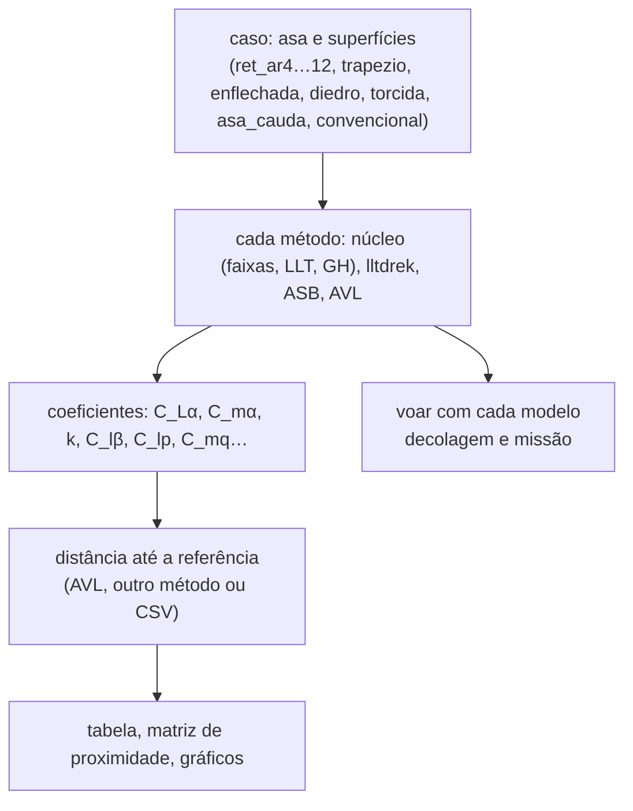
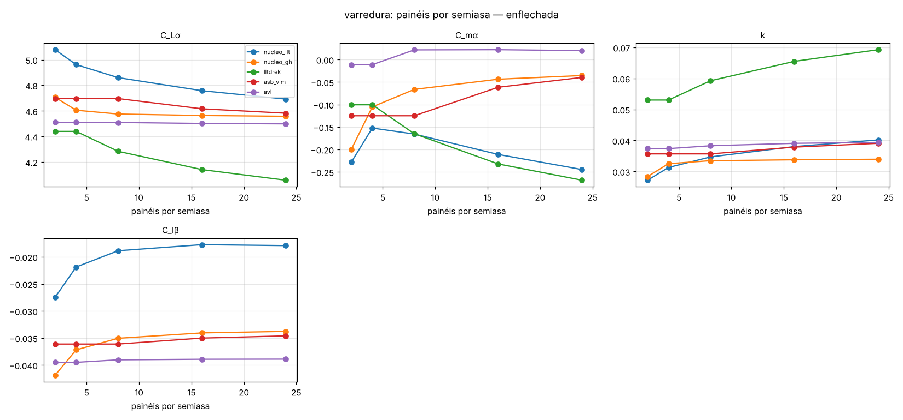
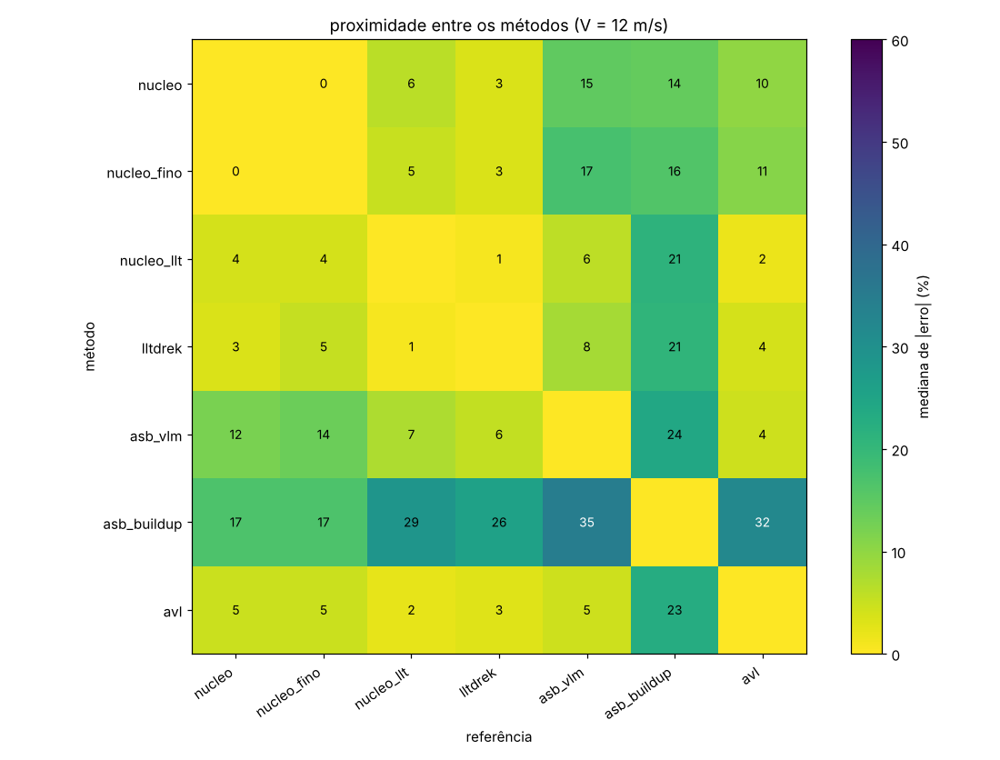

# tools/aero — perfis de teste dos coeficientes

Esta pasta confere os métodos aerodinâmicos uns contra os outros. Ela monta aviões simples, só com superfícies (asa
retangular, enflechada, com diedro, torcida, asa com cauda), calcula os coeficientes por todos os métodos do projeto
e mostra onde eles concordam e onde divergem. Tudo o que sai (tabelas, gráficos, `valores.csv`) fica fora do git.

## Para que serve

- **Escolher um método com confiança** antes de voar com ele: a distância de cada um até o AVL, ou até um CSV de túnel.
- **Achar erro de método.** Foi aqui que apareceu a divergência da linha sustentadora em derrapagem e na asa
  enflechada, corrigida pelo método de Goates e Hunsaker.
- **Ver a malha.** Quantos painéis cada método precisa para parar de mudar.
- **Ver o efeito no voo.** A mesma decolagem e a mesma missão voadas com cada modelo (`decolagem.py`, `missao.py`).

## Como funciona



O $`C_{m\alpha}`$ é comparado como deslocamento do ponto neutro em % da CMA, porque no 1/4 da CMA ele é quase zero e o
erro relativo não diria nada. A referência não é a verdade: o AVL também erra, e contra o real só com dado de túnel.

## Exemplo

```sh
python tools/aero/coeficientes.py --lista                                     # casos, métodos e coeficientes
python tools/aero/coeficientes.py --caso ret_ar8,enflechada --pasta perfis/aero
python tools/aero/coeficientes.py --matriz --pasta perfis/aero                 # cada método contra cada outro
python tools/aero/coeficientes.py --caso ret_ar8 --referencia tunel.csv --ref csv --pasta perfis/aero
python tools/aero/coeficientes.py --caso enflechada --metodos nucleo_llt,nucleo_gh --varrer paineis=1,2,4,8,16,24
python tools/aero/missao.py                                                    # a missão voada com cada modelo
```

O CSV de fora tem as colunas `alpha` (graus), `CL`, `CD` e `Cm`, e entra nos gráficos como curva preta tracejada.

## O que isso influencia

Daqui sai qual método o projeto usa por padrão para cada coisa. A malha da asa enflechada mostra o caso que levou ao
método de Goates e Hunsaker: a linha sustentadora de Phillips e Snyder (azul) não para de mudar com a malha, e a
corrigida (laranja) converge perto do AVL.



E a proximidade entre os métodos, cada um tomado como referência dos outros:


