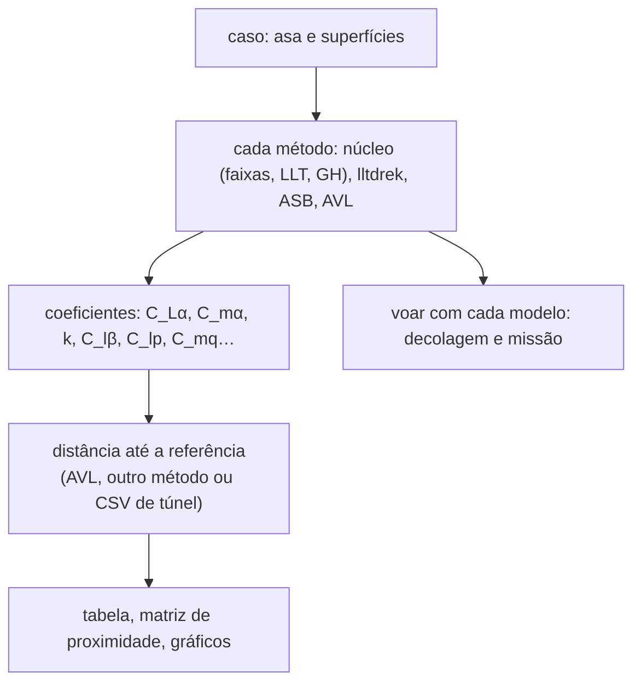

# tools/aero — perfis de teste dos coeficientes

Esta pasta confere os métodos aerodinâmicos uns contra os outros. Ela monta aviões simples, só com superfícies (asa
retangular de alongamento 4 a 12, trapezoidal, enflechada, com diedro, torcida, asa com cauda), calcula os
coeficientes por todos os métodos do projeto e mostra onde eles concordam e onde divergem. Serve para escolher um
método com confiança antes de voar com ele, para achar erro de método (foi aqui que apareceu a divergência da linha
sustentadora em derrapagem e na asa enflechada, corrigida pelo método de Goates e Hunsaker), para ver quantos painéis
cada método precisa e para voar a mesma decolagem e a mesma missão com cada modelo (`decolagem.py`, `missao.py`).
Tudo o que sai (tabelas, gráficos, `valores.csv`) fica fora do git.



O $`C_{m\alpha}`$ é comparado como deslocamento do ponto neutro em % da CMA, porque no 1/4 da CMA ele é quase zero e o
erro relativo não diria nada. A referência não é a verdade: o AVL também erra, e contra o real só com dado de túnel
(`--referencia tunel.csv --ref csv`, colunas `alpha`, `CL`, `CD`, `Cm`). A asa retangular de alongamento 8, pelo
núcleo, pelo núcleo com Goates e Hunsaker e pelo AVL:

```sh
python tools/aero/coeficientes.py --caso ret_ar8 --metodos nucleo,nucleo_gh,avl --coef CLa,k,Clp
```

```
== ret_ar8: retangular AR 8  (V = 12 m/s; derivadas por rad, momentos no 1/4 da CMA)
método              CLa        k      Clp
nucleo           4.6753   0.0468  -0.5880
nucleo_gh        4.6299   0.0419  -0.5790
avl              4.5682   0.0411  -0.5142

== distância até avl: mediana de |erro| nos casos (%; ponto neutro em % da CMA)
método              C_Lα         k      C_lp   geral
nucleo               2.3      13.8      14.3    13.8
nucleo_gh            1.4       1.8      12.6     1.8
```

O $`C_{L\alpha}`$ das faixas já fica a 2 % do AVL, mas o k (o arrasto induzido) sai 14 % acima, porque as faixas usam
a elipse com o Oswald fixo. A linha sustentadora acerta o k a 2 %. O $`C_{lp}`$ das duas fica uns 12 % acima, que é o
limite de usar a inclinação 3D na carga antissimétrica da rolagem. `--lista` mostra os casos e os métodos, `--matriz`
compara cada método com cada outro, `--varrer paineis=1,2,4,8,16` varia a malha e `--pasta perfis/aero` grava os
gráficos.

Daqui sai qual método o projeto usa por padrão para cada coisa. A malha da asa enflechada mostra o caso que levou ao
método de Goates e Hunsaker: a linha sustentadora de Phillips e Snyder (azul) não para de mudar com a malha, e a
corrigida (laranja) converge perto do AVL.


