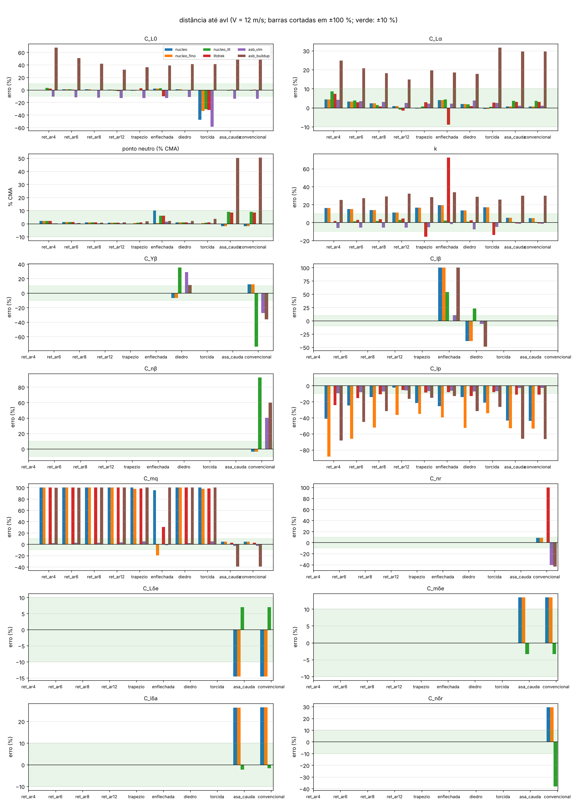
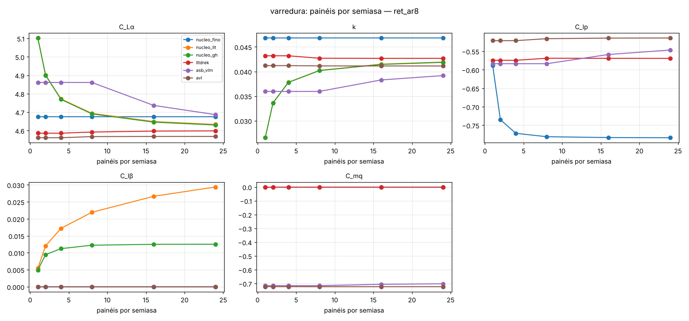
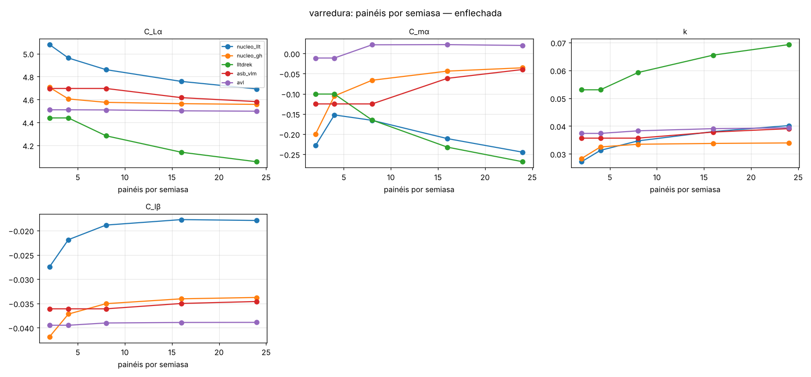
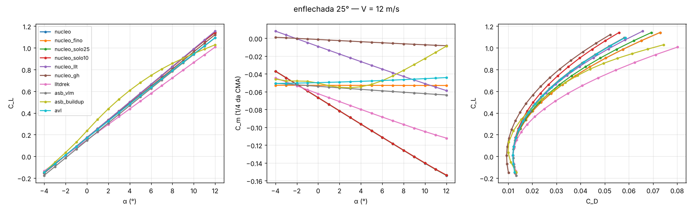
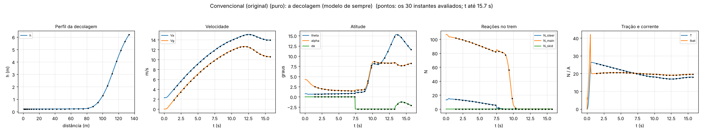
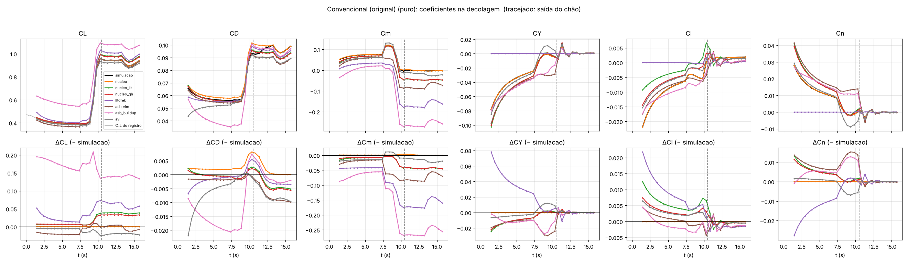
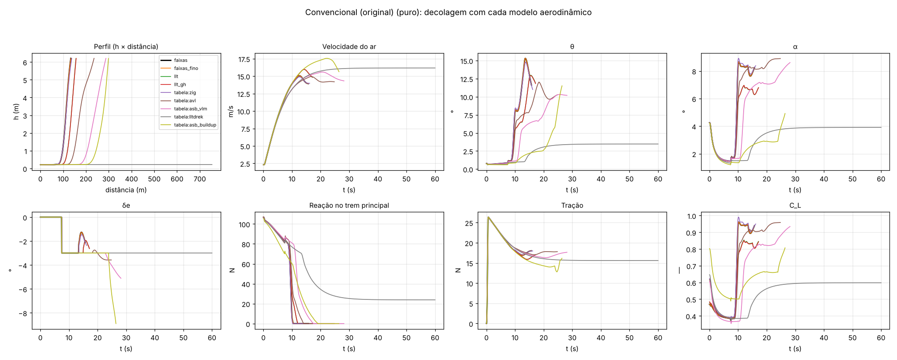
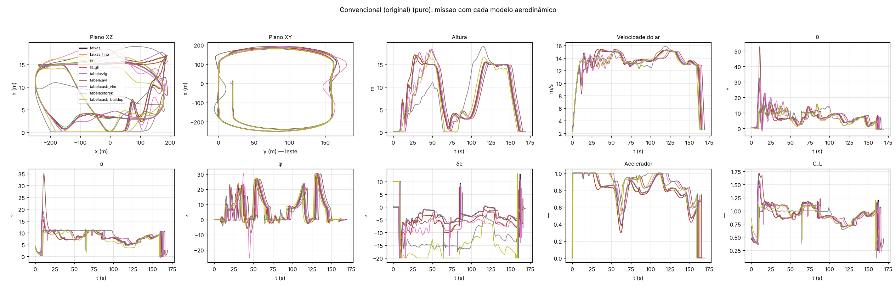
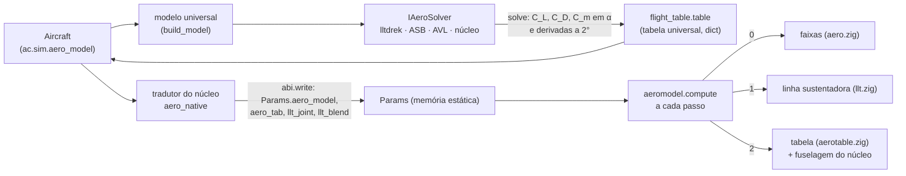

# tools/aero — perfis de teste dos coeficientes

Aviões simples, **só superfícies** (sem fuselagem e sem motor), para comparar os coeficientes de cada método numa
velocidade típica (padrão 12 m/s). Os momentos são tomados no 1/4 da CMA da asa (a origem de cada caso). Tudo o que
sai (tabelas no terminal, gráficos e `valores.csv` com `--pasta`) fica fora do git.

| arquivo | o que tem |
|---|---|
| `casos.py` | `CASOS` (abaixo); `so(ac, partes)` deixa só asa, EH ou EV; `com_perfil(ac, arquivo.dat)` troca o perfil |
| `decolagem.py` | o erro de cada método ao longo de uma decolagem (fase A: o mesmo voo reavaliado) |
| `missao.py` | a decolagem ou a missão voada com cada modelo (fase B) |
| `coeficientes.py` | as variantes do núcleo, o resumo (C_L0, C_Lα, C_m0, C_mα, C_D0, k), a distância até uma referência, a matriz entre os métodos, a varredura, os gráficos e a linha de comando |

## Comandos

```sh
python tools/aero/coeficientes.py --lista                       # casos, métodos e coeficientes
python tools/aero/coeficientes.py                               # tudo: todos os casos e métodos (~2 min)
python tools/aero/coeficientes.py --caso ret_ar8,enflechada --pasta perfis/aero   # gráficos e valores.csv
```

**Escolher o que roda:**

```sh
python tools/aero/coeficientes.py --metodos nucleo,nucleo_gh,avl            # só alguns métodos
python tools/aero/coeficientes.py --coef CLa,Cma,Clp,Cmq                     # só alguns coeficientes
python tools/aero/coeficientes.py --caso convencional --so ev --coef CYb,Cnb,Cnr,CYdr,Cndr   # só a EV
python tools/aero/coeficientes.py --caso convencional --so asa,eh            # asa + EH, sem a EV
python tools/aero/coeficientes.py --V 20                                     # outra velocidade
python tools/aero/coeficientes.py --perfil meu_perfil.dat                    # perfil .dat (Selig/Lednicer) na asa
python tools/aero/coeficientes.py --perfil eh.dat --perfil-em eh             # ... ou na EH
```

Com `--so`, a referência (S, c, b e a origem) continua a do avião inteiro, para que os números de cada parte se
somem. Sem a asa, a EH deixa de ver o downwash.

**Referência e proximidade:**

```sh
python tools/aero/coeficientes.py --ref avl --pasta perfis/aero              # distância até o AVL (padrão)
python tools/aero/coeficientes.py --ref lltdrek --pasta perfis/aero          # qualquer método vira a referência
python tools/aero/coeficientes.py --caso ret_ar8 --referencia asa.csv --ref csv --pasta perfis/aero   # um CSV de fora
python tools/aero/coeficientes.py --matriz --pasta perfis/aero               # cada método contra cada outro
```

O CSV de fora tem cabeçalho e colunas `alpha` (graus), `CL`, `CD`, `Cm` (as que houver; vírgula ou ponto e vírgula).
Ele entra nos gráficos da polar como curva preta tracejada.

**Malha e varredura:**

```sh
python tools/aero/coeficientes.py --paineis 8                                # malha fixa: 8 painéis por semiasa
python tools/aero/coeficientes.py --caso ret_ar8 --metodos nucleo_llt,nucleo_gh --varrer paineis=1,2,4,8,16,24 --pasta perfis/aero
python tools/aero/coeficientes.py --caso ret_ar8 --metodos avl,lltdrek --varrer V=8,12,16,20 --coef CLa,k
python tools/aero/coeficientes.py --perfil meu_perfil.dat --metodos lltdrek --varrer paineis=4,8,16 --pasta perfis/aero
```

`--paineis` divide cada superfície do `nucleo_fino`, do `nucleo_llt` e do `nucleo_gh` (o mesmo número por lado em todas; até o limite de 48 painéis do núcleo; acima, fica no
limite) e vai como `n_span` para os outros. Cada método tem o seu mínimo:
- o AVL e o lltdrek usam pelo menos 4;
- o VLM do ASB usa metade, com mínimo de 4 (a malha só muda acima de 8).

O `nucleo` fica sempre com a malha da simulação.

## Casos

| nome | o quê |
|---|---|
| `ret_ar4`, `ret_ar6`, `ret_ar8`, `ret_ar12` | asa retangular, corda 0,25 m |
| `trapezio` | AR 8, afilamento 0,5 |
| `enflechada` | `trapezio` com 25° no bordo de ataque |
| `diedro` | retangular AR 8 com 6° |
| `torcida` | `trapezio` com −3° na ponta |
| `asa_cauda` | retangular AR 8 com aileron + EH (AR 4) com profundor |
| `convencional` | `asa_cauda` + EV com leme |

Todas as asas usam NACA 2412, e as caudas NACA 0012. A geometria é de livro, sem fonte: o que se compara são os
métodos entre si e contra as referências de fora.

## Métodos

| nome | o quê |
|---|---|
| `nucleo` | núcleo, faixas da simulação (`core/src/physics/aero.zig`), com a malha da simulação: uma faixa por trecho entre seções (a asa trapezoidal é **um** painel por lado) |
| `nucleo_fino` | o mesmo, com todas as superfícies refinadas (`--paineis`, ou o máximo que cabe) |
| `nucleo_solo25`, `nucleo_solo10` | o `nucleo` com o efeito solo (modifier padrão, McCormick) a h/b = 0,25 e 0,10 (`aerosim_aero_coeffs_at`) |
| `nucleo_llt` | núcleo, linha sustentadora de Phillips e Snyder (`core/src/loads/llt.zig`), superfícies refinadas: a conta da simulação com as forças dos painéis trocadas pelas da linha sustentadora (`aerosim_aero_coeffs_llt`: taxas, c_m das seções e fuselagem como na simulação). Não converge com a malha em derrapagem nem com enflechamento |
| `nucleo_gh` | o mesmo com as correções de Goates e Hunsaker 2021 (junta, linha efetiva e seção normal à linha; `core/src/loads/README.md`): converge e bate com o MachUpX a 1,5 % no C_Lα e 3 % no C_lβ (teste em `tests/tools`) |
| `lltdrek`, `asb_vlm`, `asb_buildup`, `avl` | os outros métodos de `aerosim.aero.all_solvers` (o AVL roda pelo OptVL) |

O único modifier que vale sem motor é o efeito solo. O de McCormick só mexe no arrasto induzido: o C_L e o C_m ficam
iguais, e o k cai pelo fator φ = (16 h/b)² / (1 + (16 h/b)²), que dá 16/17 a h/b = 0,25 e 2,56/3,56 a 0,10. O teste
confere esses valores. Os métodos com efeito solo ficam fora da distância e da matriz, porque são outro escoamento.

## Como se mede a distância

- **Erro relativo:** cada caso, método e coeficiente dá o erro em % contra a referência.
- **C_mα:** vira o **deslocamento do ponto neutro** em % da CMA, −ΔC_mα / C_Lα da referência (positivo: mais para
  trás). No 1/4 da CMA o C_mα é quase zero, e o erro relativo não diria nada.
- **Fica de fora** o coeficiente cuja |referência| é menor que 0,02 (ajustável com `--min-ref`; ex.: C_Yβ e C_nr da asa plana, quase zero).
- **Tabela:** a mediana de |erro| nos casos.
- **Matriz:** M[i, j] é a mediana de |erro| do método i tomando o j como referência, em todos os casos e
  coeficientes. Não é simétrica, porque o erro relativo divide pelo valor da referência.

**A referência não é a verdade.** O AVL é o padrão por ser o VLM mais validado que roda aqui, mas também erra: na asa
torcida ele dá C_L0 = 0,096, contra 0,040 a 0,066 de todos os outros. Contra experimento, só com dado de túnel ou de
voo (o Navion, em `tools/validacao`) ou com a asa do lltdrek que o dono vai mandar.

## Resultados (12 m/s; 17/10/2026, com o `nucleo_gh`)

### Distância até o AVL



### Proximidade entre os métodos


Na mediana de todos os coeficientes, o `nucleo_gh` fica a 1,2 % do AVL, o mais perto de todos (o `nucleo_llt`, a
1,6 %; o lltdrek, a 3,8 %). No C_lβ, o `nucleo_gh` cai para 8,7 %, contra 38 % do `nucleo_llt`. As faixas do núcleo
ficam a uns 10 % do AVL, puxadas pelo k e pelas derivadas de taxa. O `asb_buildup` (uma soma de correlações) fica longe
de todos.

### Malha (asa retangular AR 8)



### Malha (asa enflechada 25°)



O `nucleo_llt` (Phillips e Snyder) e o lltdrek se afastam a cada refino no C_Lα e no C_mα: é a singularidade da quina
da raiz. O `nucleo_gh` converge, e o C_mα dele vai para o do VLM do ASB e o do AVL.

### Polar da asa enflechada



## Decolagem: o erro de cada modelo no tempo (`decolagem.py`, fase A)

Roda a decolagem da GUI (a análise "takeoff" do manager, com os parâmetros padrão dela) com o modelo de sempre. O
resumo dela sai no terminal como na GUI, com as unidades: n_rot, n_LO, t_LO, V_LO, n_ht, V_ht, γ_ht, folga da cauda,
C_L/C_Lmáx, q de pico, corrente de pico, restrições e V_s. Depois reavalia pontos do registro com cada método, no mesmo
estado (V, α, β, p, q, r, comandos, altura, tração, CG). A simulação e o AeroDrive não mudam.

```sh
python tools/aero/decolagem.py                                              # conventional, métodos do núcleo
python tools/aero/decolagem.py --puro --metodos nucleo_gh,lltdrek,asb_vlm,avl --pasta perfis/decolagem
python tools/aero/decolagem.py --aviao data/aircraft/Convencional_original.json --pontos 40
```

- **Referência:** `simulacao`, o núcleo com as contas da corrida. A ferramenta confere que ele bate com o C_L do
  registro; deu 1e-8.
- **Núcleo:** os métodos do núcleo veem a altura (efeito solo do modifier) e a tração. A linha sustentadora entra por
  `aerosim_aero_coeffs_llt`, que dá os coeficientes do avião inteiro com as forças dos painéis trocadas pelas dela.
- **lltdrek, ASB e AVL:** não veem o chão nem a hélice.
- **`--puro`:** tira as sobrescritas das superfícies e os coeficientes da fuselagem, para que todos os métodos vejam o
  mesmo avião. Sem isso, o C_L0 = 0,3 que o `conventional` impõe na asa (o NACA 2412 daria ~0,17) só entra no núcleo,
  e os de fora ficam 0,12–0,15 abaixo o tempo todo.
- **Saída:** tabela com RMS e máximo de cada Δ coeficiente, o máximo de ΔL em % do peso e o de ΔM de arfagem em N·m.
  Com `--pasta`:
  - `decolagem_voo.png`: os gráficos da GUI (perfil h × distância, velocidade, atitude, reações no trem, tração e
    corrente), com os instantes avaliados marcados;
  - `decolagem.png`: os seis coeficientes e os Δ no tempo, com a saída do chão marcada;
  - `erros.csv`: um valor por instante, método e coeficiente.

**Resultado (`conventional --puro`, 30 pontos):** a decolagem da GUI dá n_rot = 49,0 m, n_LO = 71,7 m em t_LO =
10,5 s, V_LO = 14,2 m/s e γ = 8,9° em h_end, sem restrição violada.

| método | ΔC_L rms | ΔC_m rms | ΔL/W máx | ΔM máx (N·m) |
|---|---|---|---|---|
| `nucleo_gh` | 0,022 | 0,029 | 5,6 % | 2,5 |
| `nucleo_llt` | 0,025 | 0,029 | 6,6 % | 2,5 |
| lltdrek | 0,046 | 0,118 | 11 % | 9,8 |
| `asb_vlm` | 0,014 | 0,057 | 2,2 % | 4,8 |
| `asb_buildup` | 0,163 | 0,183 | 28 % | 15 |
| avl | 0,015 | 0,015 | 3,7 % | 1,2 |





- **C_L:** o das faixas da simulação fica perto do AVL e do VLM (2,5–4 % do peso). As linhas sustentadoras dão mais
  C_L depois da rotação.
- **C_m:** a maior diferença é no C_m depois da saída do chão. Isso muda o profundor de trimagem, e só a fase B (voar
  com o outro modelo) diz quanto muda a decolagem.
- **Lateral:** na corrida, o β é grande (vento lateral com V baixa), e o C_Y e o C_n separam os métodos. O C_Y do
  lltdrek é 0 porque ele não trata β.

**Próxima fase (T65 C):** efeito solo por imagens na linha sustentadora e nas tabelas.

## Voar com cada modelo: a decolagem e a missão inteira (`missao.py`, fase B)

A mesma análise da GUI (`manager.run("mission")`, ou `"takeoff"` com `--analise decolagem`) roda uma vez por modelo;
só muda `ac.sim.aero_model` (`core/src/physics/aeromodel.zig`). O padrão do programa e do AeroDrive continua "faixas",
bit a bit igual (a regressão dos exemplos confere).

| modelo | o quê |
|---|---|
| `faixas` | o de sempre |
| `faixas_fino` | as faixas com as superfícies refinadas (separa o efeito da malha) |
| `llt`, `llt_gh` | linha sustentadora do núcleo (Phillips e Snyder; Goates e Hunsaker), superfícies refinadas |
| `tabela:<método>` | tabela de voo de qualquer método (`aerosim/aero/flight_table.py`): `zig`, `lltdrek`, `asb_vlm`, `asb_buildup`, `avl`. Tem C_L, C_D e C_m em α de −10° a 20° e as derivadas tomadas a 2°. O que o método não dá vem do núcleo, e a ferramenta diz quais derivadas foram completadas. Não tem efeito solo nem esteira; a fuselagem entra pelo núcleo |

```sh
python tools/aero/missao.py --puro --pasta perfis/missao                             # missão, modelos padrão
python tools/aero/missao.py --puro --analise decolagem --modelos faixas,llt_gh,tabela:avl --pasta perfis/decolagem
python tools/aero/missao.py --aviao data/aircraft/Convencional_original.json --modelos faixas,tabela:asb_vlm
```

**Saída:**
- o resumo da GUI de cada voo lado a lado, com a diferença às faixas entre parênteses;
- `voos.png`, com as curvas sobrepostas:
  - missão: planos XZ e XY, altura, V, θ, α, φ, δe, acelerador e C_L;
  - decolagem: perfil, V, θ, α, δe, trem, tração e C_L;
- `resumo.csv`.

**Tempo de conta** (`tempo.png` com `--pasta`, separado em preparar e voar). Os voos rodam em paralelo: preparar
(refino, tabelas) é sequencial, porque os métodos em Python seguram o GIL, e depois os voos vão em `--jobs` threads (o
padrão é o número de núcleos), cada um com a sua sessão no núcleo; o ctypes solta o GIL enquanto o núcleo integra. As
tabelas passam pelo cache de polares (`aerosim/aero/service.py`, em disco para os métodos caros), então da segunda
vez não são montadas de novo. A decolagem com os 9 modelos leva ~2 min da primeira vez (quase tudo a tabela do
lltdrek) e 12,7 s da segunda. A missão inteira com os 9 modelos leva 5 min 15 s no total, com os voos idênticos aos de
antes do cache e do paralelo (desvio do percurso 0,0 m em todos). Em paralelo, o tempo de cada voo no relógio cresce: os 4 núcleos
são divididos e a parte em Python de cada análise (manager, calibrações, séries dos gráficos) roda um voo por vez, por
causa do GIL. Por isso a figura é a medida em sequência.


Medido em sequência (`--jobs 1`, cada barra é o modelo sozinho), na missão de 165 s do `conventional` e com o cache
das tabelas: faixas 4 s, faixas refinadas 17 s, `llt` 261 s, `llt_gh` 258 s, tabelas 3–9 s (9 min 37 s no total; em
paralelo, 5 min 15 s). A decolagem com os 9 modelos leva 24 s em sequência. Antes do cache da geometria, o `llt_gh`
levava 52 min na missão e o `llt`, 10 min (medidos numa máquina anterior; na mesma máquina, a decolagem caiu de 107 s
para 10 s com o `llt_gh` e de 21 s para 12 s com o `llt`).

### Decolagem (`conventional --puro`; profundor e ponto de rotação da GUI, fixos)



| | faixas | `llt_gh` | `tabela:zig` | `tabela:avl` | `tabela:asb_vlm` | `tabela:lltdrek` |
|---|---|---|---|---|---|---|
| n_LO (m) | 71,7 | 91,1 (+19,5) | 68,2 (−3,5) | 111,1 (+39,5) | 156,2 (+84,5) | não sai do chão em 60 s |
| V_LO (m/s) | 14,2 | 15,1 | 13,9 | 14,5 | 15,3 | — |
| γ em h_end (°) | 8,9 | 7,7 | 8,3 | 5,5 | 3,9 | — |
| q de pico (°/s) | 8,2 | 4,8 | 8,5 | 5,4 | 3,7 | 2,2 |

- **`tabela:zig` contra `faixas`:** dá o custo da tabela (derivadas lineares, sem efeito solo): 3,5 m em 72 m.
- **Malha:** `faixas_fino` dá o mesmo que `faixas` (a asa é retangular).
- **O que separa os modelos é o C_m.** Com o mesmo δe, a linha sustentadora, o AVL e o VLM giram o avião mais
  devagar (q de pico menor) e saem do chão mais longe. Com o C_m do lltdrek, o profundor fixo não tira o avião do chão.

### Missão inteira (`conventional --puro`)



| | faixas | `llt_gh` | `tabela:zig` | `tabela:avl` | `tabela:asb_vlm` | `tabela:lltdrek` |
|---|---|---|---|---|---|---|
| energia (Wh) | 11,34 | 10,27 (−9 %) | 11,41 | 14,59 (+29 %) | 14,25 (+26 %) | 15,02 (+32 %) |
| saiu do chão em (m) | 46,7 | 44,9 | 46,8 | 54,7 | 53,4 | 64,5 |
| parada depois do pouso (m) | 9,4 | 11,3 | 9,3 | 5,5 | 5,7 | 3,2 |
| C_L/C_Lmáx máx | 0,96 | 0,99 | 0,94 | 0,94 | 0,82 | 0,80 |

- **Todos completam o circuito.** O piloto automático e o ponto de acionamento otimizado da missão compensam o C_m de
  cada modelo; a diferença fica no profundor de trimagem (gráfico δe), na energia e nas distâncias.
- **Energia:** a linha sustentadora dá menos arrasto induzido que as faixas, que usam o Oswald fixo de 0,85 (−9 %).
  As tabelas de fora dão mais (+26 a +32 %), e parte disso é não terem efeito solo e terem o arrasto de perfil de cada
  método.
- **O que falta para valer como "erro contra o real":** um voo medido. Hoje dá para dizer quanto cada modelo muda o voo,
  não qual está certo.

### Tabela de erros ao longo do percurso

```sh
python tools/aero/missao.py --puro --ref faixas --ref llt_gh --pasta perfis/missao     # voa, grava os voos e as tabelas
python tools/aero/missao.py --carregar perfis/missao --ref tabela:avl                  # outra referência, sem voar
```

Para cada voo, contra a referência:
- **desvio do percurso:** para cada ponto da trajetória (x, y, h), a distância até o ponto mais próximo da outra, nos
  dois sentidos. Sai a média, o RMS e o máximo, em metros. Independe do tempo: um voo que só atrasa não desvia do
  caminho; um que deixa um trecho por fazer, sim;
- **RMS no tempo** de h, V, θ, α, δe e acelerador, numa grade de 0,1 s até o fim do voo mais curto dos dois;
- **diferenças do resumo:** energia, t_fim, distâncias.

`erros_<ref>.md` vai para a pasta, e os voos ficam em `voos.npz` e `voos.json` (fora do git), para trocar a
referência depois.

**Que referência adotar:** nenhum modelo é a verdade sem um voo medido. As duas que fazem sentido aqui:
- `faixas`: o que o programa e o AeroDrive usam. A tabela responde "quanto o voo muda se eu trocar o modelo";
- `llt_gh`: o modelo mais validado (C_Lα a 1,5 % e C_lβ a 3 % do MachUpX nas asas de teste).

**Missão inteira (`conventional --puro`), contra `faixas`:**

| modelo | percurso médio (m) | RMS (m) | máx. (m) | h (m) | V (m/s) | θ (°) | δe (°) | Δ energia (Wh) |
|---|---|---|---|---|---|---|---|---|
| faixas_fino | 0.08 | 0.10 | 0.32 | 0.02 | 0.02 | 0.08 | 0.22 | -0.00 |
| llt | 0.85 | 1.72 | 8.39 | 0.84 | 0.41 | 1.59 | 2.49 | -1.07 |
| llt_gh | 0.69 | 1.61 | 8.49 | 0.85 | 0.49 | 1.56 | 2.57 | -1.07 |
| tabela:zig | 0.37 | 0.69 | 3.23 | 0.36 | 0.19 | 0.90 | 0.93 | 0.07 |
| tabela:avl | 1.47 | 2.87 | 14.32 | 2.72 | 1.25 | 4.57 | 3.45 | 3.26 |
| tabela:asb_vlm | 1.46 | 2.82 | 14.98 | 2.04 | 0.86 | 3.02 | 4.56 | 2.91 |
| tabela:lltdrek | 2.96 | 4.08 | 12.12 | 5.10 | 1.08 | 4.59 | 10.15 | 3.68 |
| tabela:asb_buildup | 1.51 | 2.73 | 14.92 | 2.68 | 1.19 | 4.06 | 12.72 | 1.99 |

**Missão inteira, contra `llt_gh`:**

| modelo | percurso médio (m) | RMS (m) | máx. (m) | h (m) | V (m/s) | θ (°) | δe (°) | Δ energia (Wh) |
|---|---|---|---|---|---|---|---|---|
| faixas | 0.69 | 1.61 | 8.49 | 0.85 | 0.49 | 1.56 | 2.57 | 1.07 |
| faixas_fino | 0.69 | 1.61 | 8.42 | 0.84 | 0.48 | 1.55 | 2.58 | 1.07 |
| llt | 0.22 | 0.35 | 2.00 | 0.11 | 0.13 | 0.44 | 0.58 | 0.00 |
| tabela:zig | 0.74 | 1.49 | 6.20 | 1.13 | 0.61 | 1.84 | 2.53 | 1.14 |
| tabela:avl | 1.68 | 3.26 | 14.40 | 3.29 | 1.30 | 4.84 | 3.90 | 4.32 |
| tabela:asb_vlm | 1.58 | 3.16 | 17.95 | 2.60 | 1.11 | 3.66 | 3.92 | 3.98 |
| tabela:lltdrek | 2.81 | 3.81 | 11.06 | 5.04 | 0.88 | 4.62 | 8.58 | 4.75 |
| tabela:asb_buildup | 1.46 | 2.49 | 11.61 | 2.69 | 1.07 | 3.99 | 10.88 | 3.06 |

**Decolagem (profundor fixo da GUI), contra `faixas`:**

| modelo | percurso médio (m) | RMS (m) | máx. (m) | h (m) | V (m/s) | θ (°) | δe (°) | Δ n_LO (m) |
|---|---|---|---|---|---|---|---|---|
| faixas_fino | 0.00 | 0.00 | 0.05 | 0.00 | 0.00 | 0.00 | 0.00 | 0.02 |
| llt | 1.24 | 3.51 | 23.00 | 1.10 | 0.63 | 2.49 | 0.49 | 18.64 |
| llt_gh | 1.28 | 3.64 | 23.68 | 1.11 | 0.63 | 2.50 | 0.49 | 19.45 |
| tabela:zig | 0.10 | 0.31 | 4.28 | 0.13 | 0.07 | 0.25 | 0.09 | -3.50 |
| tabela:avl | 12.32 | 28.39 | 102 | 1.74 | 0.54 | 2.93 | 0.59 | 39.46 |
| tabela:asb_vlm | 23.31 | 48.90 | 154 | 1.75 | 0.54 | 4.44 | 0.58 | 84.51 |
| tabela:lltdrek | 181 | 273 | 620 | 1.75 | 0.55 | 6.52 | 0.59 | -71.65 |
| tabela:asb_buildup | 23.30 | 50.54 | 165 | 1.75 | 0.78 | 6.27 | 0.55 | 121 |

**Decolagem, contra `llt_gh`:**

| modelo | percurso médio (m) | RMS (m) | máx. (m) | h (m) | V (m/s) | θ (°) | δe (°) | Δ n_LO (m) |
|---|---|---|---|---|---|---|---|---|
| faixas | 1.28 | 3.64 | 23.68 | 1.11 | 0.63 | 2.50 | 0.49 | -19.45 |
| faixas_fino | 1.28 | 3.65 | 23.73 | 1.11 | 0.63 | 2.50 | 0.49 | -19.43 |
| llt | 0.02 | 0.04 | 0.68 | 0.02 | 0.01 | 0.03 | 0.01 | -0.81 |
| tabela:zig | 1.06 | 2.80 | 19.40 | 1.02 | 0.67 | 2.38 | 0.42 | -22.95 |
| tabela:avl | 7.25 | 18.85 | 78.57 | 1.42 | 0.74 | 1.56 | 0.37 | 20.01 |
| tabela:asb_vlm | 16.53 | 37.71 | 131 | 1.54 | 0.68 | 2.94 | 0.36 | 65.06 |
| tabela:lltdrek | 164 | 255 | 597 | 1.54 | 0.67 | 5.13 | 0.38 | -91.10 |
| tabela:asb_buildup | 16.80 | 39.61 | 142 | 1.54 | 0.49 | 5.00 | 0.30 | 101 |

- **Malha:** `faixas_fino` voa igual a `faixas`.
- **As duas linhas sustentadoras** (`llt` e `llt_gh`) voam quase igual entre si: 0,2 m de desvio médio na missão. Nesta
  asa reta, a correção de Goates e Hunsaker quase não muda o voo; ela pesa em asa enflechada e em derrapagem.
- **Contra as faixas,** a linha sustentadora fica a 0,7 m de desvio médio na missão, mas a 19 m na saída do chão da
  decolagem com o profundor fixo: o C_m dela gira o avião mais devagar.
- **O lltdrek é o mais longe de todos no voo:** 2,8–3 m de desvio médio, h RMS de 5 m e δe RMS de 9–10° na missão; na
  decolagem com o profundor fixo, não sai do chão. Nos coeficientes da asa sozinha ele fica a ~1 % da nossa linha
  sustentadora (a matriz acima); no avião inteiro, o C_m dele com a cauda é outro, e ele não trata β (a tabela usa as
  derivadas laterais do núcleo).
- **AVL e VLM do ASB** ficam entre os dois grupos: 1,5 m de desvio médio na missão, com +3 a +4 Wh de energia (sem
  efeito solo na tabela, e o arrasto de perfil de cada método).

### Mapa de proximidade dos voos

O desvio médio do percurso entre cada par de voos (simétrico; `matriz.png` com `--pasta`, também com `--carregar`).


Na missão saem três grupos:
1. **O núcleo:** faixas, a tabela das faixas e as duas linhas sustentadoras, a menos de 1 m entre si.
2. **Os métodos de painel e o buildup:** AVL, VLM e buildup do ASB, a ~1,5 m do núcleo e entre si.
3. **O lltdrek,** sozinho, a 2,7–3,5 m de todos.

### Como os dados de cada método entram no voo

Ninguém em Python roda durante o voo: o núcleo integra sozinho, a cada passo de 1 ms, como sempre. O que muda é o que
vai para os `Params` antes do voo.



- **Faixas e linha sustentadora (modelos 0 e 1):** a geometria vem do tradutor, como sempre (os painéis de
  `surface_panels`, com os nós no 1/4 de corda). Para a linha sustentadora, a ferramenta refina as superfícies antes
  (`refinar`), porque ela só converge com muitas faixas.
- **Métodos em Python (lltdrek, ASB, AVL; modelo 2):** rodam uma vez, antes do voo, sobre o modelo universal,
  em `flight_table.table`:
  - a polar em α de −10° a 20°, de grau em grau, a V0 da missão (15 m/s no `conventional`);
  - as derivadas de β, de taxas e de comandos, tomadas a 2°;
  - as derivadas que o método não dá ficam NaN e são completadas pelo núcleo; a tabela guarda quais.
- **Caminho da tabela:**
  1. Ela vai para `ac.sim.aero_table`. O `.json` do avião guarda a tabela, e o `.cfg` e a planilha não.
  2. O tradutor (`aero_native`) converte α para radianos e ordena.
  3. O `abi.write` copia para `Params.aero_tab`: até 64 pontos (`limits.max_tab`), sem alocação.
  4. No voo, o núcleo interpola C_L, C_D e C_m em α e soma as derivadas lineares.
- **Fuselagem:** os de fora não a têm (`includes_fuselage = False`), e o núcleo soma a dele por cima. A tabela do
  próprio núcleo (`tabela:zig`) já a tem.
- **O que a tabela não tem:**
  - efeito solo e esteira (ela é de voo livre);
  - variação com V e com Re (é feita numa V só);
  - estol, nos métodos lineares (o AVL e o VLM continuam a reta além do C_Lmáx);
  - derivadas que variem com α: são as de 2°.

## Por que os métodos diferem

| diferença | causa | como se vê |
|---|---|---|
| ponto neutro da enflechada 10 % da CMA atrás, no `nucleo` | **malha**: um painel por lado põe a força no meio da semienvergadura. Num trapézio esse ponto fica fora da CMA (y_CMA < b/4); na enflechada, bem atrás | `nucleo_fino`: 0,9 % |
| C_L0 da asa torcida (0,050 contra 0,064) | a mesma: um painel só pega a torção média | `nucleo_fino`: 0,064, igual ao lltdrek |
| C_Lα igual com e sem enflechamento | o C_Lα da superfície é o de Helmbold (`aerosim/model/universal.py`), que só vê o alongamento | o AVL cai 1,6 % com 25° |
| k uns 15 % acima do AVL | o induzido das faixas é o da elipse com o Oswald fixo da superfície (`LiftingSurface.oswald` = 0,85) | a LLT do núcleo dá o k do AVL (1 %) |
| **C_lp** das faixas 20–50 % acima | as faixas usam o C_Lα 3D de Helmbold, que vale para a carga simétrica (α igual em toda a asa). Na rolagem a carga é antissimétrica: o downwash induzido é outro e a inclinação efetiva é menor. Com o C_Lα uniforme, a teoria das faixas dá C_lp = −C_Lα/6 na asa retangular (−0,78). O −0,59 da malha grossa é coincidência: uma faixa só em y = b/4 dá −C_Lα/8 | as linhas sustentadoras resolvem a carga antissimétrica: lltdrek −0,57 e AVL −0,51 (≈ 10 %). Nas LLTs o C_lp vai bem |
| **C_mq** da asa sozinha = 0 nas linhas sustentadoras (núcleo e lltdrek) | **é do método**. A linha sustentadora tem um ponto de controle por faixa, sobre a linha de 1/4 da corda. Arfando em torno do 1/4 da CMA, a linha passa pelo eixo e o α ali não muda. A rotação faz a velocidade normal variar ao longo da corda, como uma curvatura a mais, e essa curvatura só aparece com pontos ao longo da corda (o teorema de Pistolesi põe o ponto de controle aos 3/4 da corda; fonte: Katz e Plotkin, *Low-Speed Aerodynamics*, capítulo a conferir no PDF) | o VLM do ASB (−0,70) e o AVL (−0,72) têm painéis na corda e concordam. No avião inteiro o C_mq vem quase todo da EH (braço lt), e aí todos ficam a 5 % (−18,5 a −19,9) |
| C_lβ do diedro 1,4× o do AVL | o mesmo das taxas: o diedro gira o α de cada faixa com o C_Lα simétrico | T62 do TRACKING |
| **C_lβ da asa plana pela LLT do núcleo cresce com a malha** (0,0055 → 0,029, como log da malha) | **singularidade do método de Phillips e Snyder** com a esteira alinhada ao vento: em derrapagem as pernas das ferraduras saem inclinadas no plano da asa, e a parte assimétrica da induzida soma ΔΓ/\|Δy\| sem trocar de sinal. "O método P-S não converge com a malha para asas enflechadas ou em derrapagem" (Goates e Hunsaker 2021, §II.A, p. 4) | **corrigido no `nucleo_gh`** (método novo, ligável; o `nucleo_llt` fica como era). Converge e bate com o MachUpX (a implementação dos autores) a α = 2°: asa plana +0,0125 contra +0,0125; diedro −0,085 contra −0,084 (AVL −0,089). O C_lβ positivo da asa plana é do modelo de esteira alinhada ao vento, não erro; o AVL e o VLM (esteira no eixo x) não o têm |
| **EV sozinha: C_Yβ da LLT do núcleo ≈ 2× o do AVL** (`--so ev`) | **malha do `tools/aero`**: só a asa era refinada, então a EV ficava com uma ferradura. A conta à mão com uma ferradura dá C_Lα ≈ 3,4 contra 1,78 do Helmbold (AR 1,25) | **corrigido**: todas as superfícies são refinadas. Converge devagar (−0,34 → −0,25 com 8 → −0,23 com 32); o que sobra (uns 25 % acima do AVL) é o limite da linha sustentadora em alongamento baixo |
| C_mα e C_Lα da enflechada pela linha sustentadora (núcleo de Phillips e Snyder e lltdrek) | a quina da raiz enflechada é singular (Goates e Hunsaker 2021, §II): o C_Lα do `nucleo_llt` vai de 4,96 a 4,69 entre 4 e 24 faixas sem convergir | **corrigido no `nucleo_gh`**: a linha efetiva tira a singularidade e a seção normal à linha dá o efeito do enflechamento: C_Lα 4,557 contra 4,539 do MachUpX e 4,50 do AVL (ver o gráfico da enflechada) |
| C_L0 do VLM do ASB 12 % abaixo de todos | a conferir: talvez o VLM do ASB use só a linha média plana | — |
